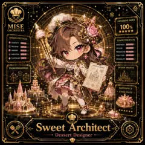

<!-- generated by tools/player-cards/scripts/build-character-pages.mjs from data/characters/sweet-architect.json; do not edit by hand -->
# Sweet Architect

**Card-defined chef (catalogue: visual reference only)** · Implementation: **Designed (not yet implemented in code)** · Detail record: [`data/characters/sweet-architect.json`](../../data/characters/sweet-architect.json)

Every field shows where its value comes from (`source:`). Repo-sourced values cite the repository or source-library file they were read from; values marked `authored: card design` were written for this card by [`enrich-characters.py`](../../tools/player-cards/scripts/enrich-characters.py), derived from the printed card text, role and kitchen theme, and are not claims about existing code.

## Identity

| Field | Value |
|---|---|
| Name | Sweet Architect source: `data/imports/photo-alignment.csv` |
| Aliases / printed variants | Yume (canon crosswalk, provisional) source: `docs/source-library/icloud/Catalogue/All images/Mise/MiseOS Bible/MiseOS-Canon-Bible-v1.0-package.zip/miseos_canon_bible_v1_0/registry/asset-registry.csv` |
| Role / title | Dessert Designer source: `data/player-cards-ocr.json (subtitle printed under the name)` |
| Kitchen / department | Pipeline Kitchen source: `docs/source-library/icloud/Catalogue/All images/Mise/MiseOS Bible/MiseOS-Canon-Bible-v1.0-package.zip/miseos_canon_bible_v1_0/registry/asset-registry.csv → data/characters/yume.json` |
| Department mission | Build. Test. Deploy. Repeat. source: `data/imports/miseos_character_master_inventory_001_300.csv (mission of Pipeline Kitchen)` |
| Registry rarity | Rare source: `docs/source-library/icloud/Catalogue/All images/Mise/MiseOS Bible/MiseOS-Canon-Bible-v1.0-package.zip/miseos_canon_bible_v1_0/registry/asset-registry.csv → data/characters/yume.json` |
| Collections | 1×1 Chefs source: `data/player-cards.json` |
| Cards linked | 1 source: `data/player-cards.json` |
| Catalogue status | visual_reference_only source: `data/imports/photo-alignment.csv` |

## Player cards

| Card | Collection | Printed title | Match method | Full size |
|---|---|---|---|---|
| `sweet-architect.webp` | 1×1 Chefs | Sweet Architect. | title | [open](../../assets/player-cards/1by1-chefs/sweet-architect.webp) |

## Card metadata (as printed)

| Field | Value |
|---|---|
| Printed rarity | Not printed on the card source: `data/player-cards-ocr.json (no rarity word in OCR)` |
| Printed stars | 5 source: `data/player-cards-ocr.json` |
| Printed meters | 100% source: `data/player-cards-ocr.json` |
| Roster stats | power 94 · precision 88 · speed 87 · resilience 91 · intelligence 83 · teamwork 89 source: `authored: card design (6-axis roster scale; baseline from stars + theme "plate")` |
| Abilities | Design Protocol, Creativity, Sweetness, Precision, Texture, Harmony source: `data/player-cards-ocr.json (printed card labels, glued OCR words segmented)` |
| Lore | Most of the brigade only notices Sweet Architect when something is missing, which is exactly the point. Sweet Architect finishes and presents the work: composition, garnish and a final visual check at the pass; the image the crew uses for it is the pass under warm lights, tweezers in hand. The card calls out Design Protocol, Creativity, Sweetness: the checks Sweet Architect runs before calling anything ready. In the canon crosswalk this card is a provisional match for Yume. source: `authored: card design (derived from printed card text/role)` |
| Signature phrase | Every send-back note when something is off accounted for. source: `authored: card design (derived from printed card text/role)` |

Full printed card text (OCR)

**`sweet-architect.webp`**: PATISSERIEINDEX · MISE · 100% · ORCHESTRA · ★★★★★ · DESIGN PROTOCOL · CONFECTIONSTATS · CREATIVITY · SWEETNESS · PRECISION · TEXTURE · HARMONY · PRESENTATION · INNOVATION · STRUCTURE · FLAVOR BALANCE · ORIGINALITY · DESSERT BLUEPRINT · SUGAR ENGINEERING · DESIGNARCHIVE · MASTERPIECE · ETOILEDOUCE · Sweet Architect · Dessert Designer

## Workflow

| Step | Value |
|---|---|
| Summary | Sweet Architect finishes and presents the work: composition, garnish and a final visual check at the pass. source: `authored: card design (theme "plate")` |
| Inputs | cooked components, plating spec / style guide, ticket source: `authored: card design (theme "plate")` |
| Outputs | plated dish, pass photo / visual check, send-back note when something is off source: `authored: card design (theme "plate")` |
| Proof gate | Pass inspection: each plate is compared to the spec image before it leaves; mismatches go back, never out. source: `authored: card design (theme "plate")` |

## Actions / commands

- command: `mise roster run sweet-architect --dept pipeline-kitchen --solo --emit report` · status: `proposed` source: `authored: follows data/imports/master-roster-cards.csv (mise roster run command convention)`
- command: `mise sweet-architect plate` · reads: `cooked components` · emits: `plated dish` · status: `proposed` source: `authored: card design (theme "plate")`
- command: `mise sweet-architect inspect` · reads: `plating spec / style guide` · emits: `pass photo / visual check` · status: `proposed` source: `authored: card design (theme "plate")`
- command: `mise sweet-architect send` · reads: `ticket` · emits: `send-back note when something is off` · status: `proposed` source: `authored: card design (theme "plate")`

## Implementation

**Status:** Designed (not yet implemented in code)

- Proposed handler: `sweetArchitect` (not written yet)
- Proposed command: `mise roster run sweet-architect --dept pipeline-kitchen --solo --emit report`
- Contract: inputs: cooked components, plating spec / style guide, ticket → outputs: plated dish, pass photo / visual check, send-back note when something is off; refuses to emit 'ready' unless the proof gate passes

source: `git ls-files grep + repo (no code found) + authored: proposed handler spec`

implemented_in_code = a dedicated capability handler or tool directory exists; referenced_in_app_code = the entity is used by application source (e.g. repo-pet sprites, CLI) but has no dedicated handler. code_refs are files that reference this entity by name/slug/handler (grep), not a guarantee of a dedicated runtime; registry handler links point at the actual capability function.

## Where and how it helps

| Aspect | Value |
|---|---|
| Station / stage | Dessert Designer source: `data/player-cards-ocr.json (subtitle printed under the name)` |
| Mission | Build. Test. Deploy. Repeat. source: `data/imports/miseos_character_master_inventory_001_300.csv (mission of Pipeline Kitchen)` |
| Problem it addresses | Good work loses its value when the last step (UI, docs, release notes) is sloppy. source: `authored: card design (theme "plate")` |
| Safety gate | Pass inspection: each plate is compared to the spec image before it leaves; mismatches go back, never out. source: `authored: card design (theme "plate")` |

## Agents and repo pets

Agents: [Yume](../agents/yume.md) source: `docs/source-library/icloud/Catalogue/All images/Mise/MiseOS Bible/MiseOS-Canon-Bible-v1.0-package.zip/miseos_canon_bible_v1_0/registry/asset-registry.csv → data/characters/yume.json`

Repo pets: [Yume](../repo-pets/yume.md) · [Mise Garde](../repo-pets/mise-garde.md) source: `authored: card design (closest repo pets for theme "plate")`

## Related characters

[Yume](./yume.md) · [Plating Poet](./plating-poet.md) · [Zen Plater](./zen-plater.md) · [Cacao Alchemist](./cacao-alchemist.md) · [Release Conductor](./release-conductor.md) · [Hugo Matrix](./hugo-matrix.md) source: `docs/source-library/icloud/Catalogue/All images/Mise/MiseOS Bible/MiseOS-Canon-Bible-v1.0-package.zip/miseos_canon_bible_v1_0/registry/asset-registry.csv (canon counterpart) + authored: card design (same theme "plate" / same department)`

## Sources

| Field | Source |
|---|---|
| name | `data/imports/photo-alignment.csv` |
| cards | `data/player-cards.json` |
| card_text | `data/player-cards-ocr.json (OCR of the card image)` |
| card_stars_printed | `data/player-cards-ocr.json` |
| card_meters_printed | `data/player-cards-ocr.json` |
| role | `data/player-cards-ocr.json (subtitle printed under the name)` |
| catalogue_status | `data/imports/photo-alignment.csv` |
| implementation | `git ls-files grep + repo (no code found) + authored: proposed handler spec` |
| helps.station | `data/player-cards-ocr.json (subtitle printed under the name)` |
| aliases | `docs/source-library/icloud/Catalogue/All images/Mise/MiseOS Bible/MiseOS-Canon-Bible-v1.0-package.zip/miseos_canon_bible_v1_0/registry/asset-registry.csv` |
| department | `docs/source-library/icloud/Catalogue/All images/Mise/MiseOS Bible/MiseOS-Canon-Bible-v1.0-package.zip/miseos_canon_bible_v1_0/registry/asset-registry.csv → data/characters/yume.json` |
| department_mission | `data/imports/miseos_character_master_inventory_001_300.csv (mission of Pipeline Kitchen)` |
| card_rarity_printed | `data/player-cards-ocr.json (no rarity word in OCR)` |
| rarity | `docs/source-library/icloud/Catalogue/All images/Mise/MiseOS Bible/MiseOS-Canon-Bible-v1.0-package.zip/miseos_canon_bible_v1_0/registry/asset-registry.csv → data/characters/yume.json` |
| stats | `authored: card design (6-axis roster scale; baseline from stars + theme "plate")` |
| abilities | `data/player-cards-ocr.json (printed card labels, glued OCR words segmented)` |
| lore | `authored: card design (derived from printed card text/role)` |
| signature_phrase | `authored: card design (derived from printed card text/role)` |
| workflow.summary | `authored: card design (theme "plate")` |
| workflow.inputs | `authored: card design (theme "plate")` |
| workflow.outputs | `authored: card design (theme "plate")` |
| workflow.proof_gate | `authored: card design (theme "plate")` |
| actions | `authored: follows data/imports/master-roster-cards.csv (mise roster run command convention)` |
| helps.mission | `data/imports/miseos_character_master_inventory_001_300.csv (mission of Pipeline Kitchen)` |
| helps.problem | `authored: card design (theme "plate")` |
| helps.proof_gate | `authored: card design (theme "plate")` |
| agents | `docs/source-library/icloud/Catalogue/All images/Mise/MiseOS Bible/MiseOS-Canon-Bible-v1.0-package.zip/miseos_canon_bible_v1_0/registry/asset-registry.csv → data/characters/yume.json` |
| repo_pets | `authored: card design (closest repo pets for theme "plate")` |
| related | `docs/source-library/icloud/Catalogue/All images/Mise/MiseOS Bible/MiseOS-Canon-Bible-v1.0-package.zip/miseos_canon_bible_v1_0/registry/asset-registry.csv (canon counterpart) + authored: card design (same theme "plate" / same department)` |
| theme | `authored: card design (keyword theme used for authored fields)` |

[← All characters](./README.md)
