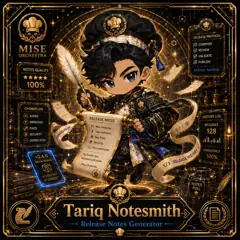

<!-- generated by tools/player-cards/scripts/build-character-pages.mjs from data/characters/tariq-notesmith.json; do not edit by hand -->
# Tariq Notesmith

**Registry character agent** · Implementation: **Described in docs only** · Detail record: [`data/characters/tariq-notesmith.json`](../../data/characters/tariq-notesmith.json)

Every field below comes from a repository source (shown as `source:`). Where no source exists the page says _Not yet defined in the source material_.

## Identity

| Field | Value |
|---|---|
| Name | Tariq Notesmith source: `data/characters.json` |
| Aliases / printed variants | Not yet defined in the source material |
| Role / title | Release Notes Generator source: `characters/tariq-notesmith/metadata.json` |
| Kitchen / department | Pipeline Kitchen source: `characters/tariq-notesmith/metadata.json` |
| Department mission | Build. Test. Deploy. Repeat. source: `data/imports/miseos_character_master_inventory_001_300.csv` |
| Registry rarity | Common source: `characters/tariq-notesmith/metadata.json` |
| Level | 14 source: `data/imports/miseos_character_master_inventory_001_300.csv` |
| ID: registry_id | MISE-012 source: `characters/tariq-notesmith/metadata.json` |
| ID: character_id | miseos.character.012 source: `data/imports/miseos_character_master_inventory_001_300.csv` |
| ID: card_id | MISE-012 source: `data/imports/miseos_character_master_inventory_001_300.csv` |
| ID: codename | TARIQ_NOTESMITH source: `data/imports/miseos_character_master_inventory_001_300.csv` |
| Collections | 1×1 Chefs source: `data/player-cards.json` |
| Cards linked | 1 source: `data/player-cards.json` |
| Role category | delivery source: `data/imports/merged_roster.json` |

## Player cards

| Card | Collection | Printed title | Match method | Full size |
|---|---|---|---|---|
| `tariq-notesmith.webp` | 1×1 Chefs | Tariq Notesmith | existing-index | [open](../../assets/player-cards/1by1-chefs/tariq-notesmith.webp) |

## Card metadata (as printed)

| Field | Value |
|---|---|
| Printed rarity | Not yet defined in the source material |
| Printed stars | 5 source: `data/player-cards-ocr.json` |
| Printed meters | 100% source: `data/player-cards-ocr.json` |
| Roster stats | power 68 · precision 76 · speed 54 · resilience 76 · intelligence 80 · teamwork 73 source: `data/imports/miseos_character_master_inventory_001_300.csv (roster stats, not OCR)` |
| Abilities | Not yet defined in the source material |
| Lore | Not yet defined in the source material |
| Signature phrase | Release Notes Generator done cleanly, safely, and in rhythm. source: `data/imports/merged_roster.json` |
| Unique trait | Specializes in release notes generator so the Pipeline Kitchen can operate as a precise, repo-safe DevOps station. source: `data/imports/merged_roster.json` |

Full printed card text (OCR)

**`tariq-notesmith.webp`**: RELEASEPROTOCOL ·  COMPOSE · MISE ·  REVIEW · ORCHESTRA ·  VALIDATE ·  PUBLISH · NOTES QUALITY · STATUS:SUCCESS · ★★★★★ · 100% · CHANGELOG · v2.4.0 · ADDED · V2A.0 · RELEASE NOTES · HISTORY LOG · IMPROVED · NewFeatures · RELEASES · FIXED · Improvements · 128 · SECURITY · INGEELOG.md · 漆Bug Fixes · DEPRECATED · Security · mDocumentation · CONSISTENCY · Built withcare. · 100% · v2.4.0 · Released withpride. · MAJOR RELEASE · Mise Orchestra · </> · BESTPRACTICES · NOTES · FUEL · KEEPIT CLEAR · DEV DELIGHT · Tariq Notesmith · Release Notes Generator

## Workflow

| Step | Value |
|---|---|
| Summary | Tariq Notesmith performs release notes generator within the Pipeline Kitchen. source: `characters/tariq-notesmith/metadata.json` |
| Inputs | repository context, task request, policy constraints, current evidence source: `characters/tariq-notesmith/metadata.json` |
| Outputs | validated result, evidence record, handoff packet source: `characters/tariq-notesmith/metadata.json` |
| Proof gate | No merge, deployment, publication, billing action, or mint without evidence. source: `characters/tariq-notesmith/metadata.json` |

## Actions / commands

- command: `MISE RELEASE NOTES GENERATOR` source: `data/imports/miseos_character_master_inventory_001_300.csv`
- command: `Release Notes Generator` · mise_name: `Mise ReleaseNotesGenerator` source: `data/imports/merged_roster.json`

## Implementation

**Status:** Described in docs only

Roster data / types / tests in code that list this entry (not an implementation):
- [`apps/bootstrap-registry/apps/registry-console/src/data/master-roster.generated.ts:211`](../../apps/bootstrap-registry/apps/registry-console/src/data/master-roster.generated.ts#L211)
- [`apps/brigade-gallery/src/data/master-roster.ts:219`](../../apps/brigade-gallery/src/data/master-roster.ts#L219)

Data files that reference it:
- [`apps/bootstrap-registry/registry/cards/master-roster-cards.json:163`](../../apps/bootstrap-registry/registry/cards/master-roster-cards.json#L163)
- [`apps/gridops-platform/data/miseos-ecosystem-135.json:548`](../../apps/gridops-platform/data/miseos-ecosystem-135.json#L548)
- [`apps/voxel-world/src/data/agents.json:339`](../../apps/voxel-world/src/data/agents.json#L339)
- [`apps/voxel-world/src/data/miseos-ecosystem-135.json:548`](../../apps/voxel-world/src/data/miseos-ecosystem-135.json#L548)
- [`tools/art-factory/input/characters.generated.json:625`](../../tools/art-factory/input/characters.generated.json#L625)
- [`tools/art-factory/output/manifests/krikey_animation_prompts.json:417`](../../tools/art-factory/output/manifests/krikey_animation_prompts.json#L417)
- [`tools/art-factory/output/manifests/mangaboom_comic_prompts.json:417`](../../tools/art-factory/output/manifests/mangaboom_comic_prompts.json#L417)
- [`tools/art-factory/output/merged_roster.json:2615`](../../tools/art-factory/output/merged_roster.json#L2615)
- [`tools/gcp-lazy-minting/MANIFEST.json:45`](../../tools/gcp-lazy-minting/MANIFEST.json#L45)
- [`tools/gcp-lazy-minting/examples/001-tariq-notesmith.metadata.json:3`](../../tools/gcp-lazy-minting/examples/001-tariq-notesmith.metadata.json#L3)

Docs that describe it (docs only, not code):
- [`characters/tariq-notesmith/README.md`](../../characters/tariq-notesmith/README.md)
- [`apps/brigade-gallery/prototype/holo-card-roster.html:76`](../../apps/brigade-gallery/prototype/holo-card-roster.html#L76)
- [`apps/developer-platform/docs/characters/CHARACTER_REGISTRY_001_300.md:11`](../../apps/developer-platform/docs/characters/CHARACTER_REGISTRY_001_300.md#L11)
- [`tools/gcp-lazy-minting/README.md:159`](../../tools/gcp-lazy-minting/README.md#L159)
- [`tools/gcp-lazy-minting/docs/OPERATIONS.md:14`](../../tools/gcp-lazy-minting/docs/OPERATIONS.md#L14)

implemented_in_code = a dedicated capability handler or tool directory exists; referenced_in_app_code = the entity is used by application source (e.g. repo-pet sprites, CLI) but has no dedicated handler. code_refs are files that reference this entity by name/slug/handler (grep), not a guarantee of a dedicated runtime; registry handler links point at the actual capability function.

## Where and how it helps

| Aspect | Value |
|---|---|
| Station / stage | Pipeline Kitchen source: `characters/tariq-notesmith/metadata.json` |
| Mission | Build. Test. Deploy. Repeat. source: `data/imports/miseos_character_master_inventory_001_300.csv` |
| Problem it addresses | Tariq Notesmith performs release notes generator within the Pipeline Kitchen. source: `characters/tariq-notesmith/metadata.json` |
| Safety gate | No merge, deployment, publication, billing action, or mint without evidence. source: `characters/tariq-notesmith/metadata.json` |

## Agents and repo pets

_Not yet defined in the source material_

## Related characters

[Ivun Cache](./ivun-cache.md) · [Canary Taster](./canary-taster.md) · [Pipeline Sensei](./pipeline-sensei.md) · [Felix Rollback](./felix-rollback.md) · [Preview Yuki](./preview-yuki.md) · [Forecast Fuji](./forecast-fuji.md) source: `data/imports/miseos_character_master_inventory_001_300.csv data/imports/merged_roster.json data/imports/merged_roster.json data/imports/merged_roster.json`

## Canon Bible

Mentioned in [`docs/canon/MiseOS-Canon-Bible-v1.0.pdf`](../../docs/canon/MiseOS-Canon-Bible-v1.0.pdf):

- line 555: `MISE-G2-P044 Tariq Notesmith Mise Orchestra canonical-candidate 1E3334AB-3111- 44`

## Sources

| Field | Source |
|---|---|
| name | `data/characters.json` |
| cards | `data/player-cards.json` |
| card_text | `data/player-cards-ocr.json (OCR of the card image)` |
| card_stars_printed | `data/player-cards-ocr.json` |
| card_meters_printed | `data/player-cards-ocr.json` |
| ids.registry_id | `characters/tariq-notesmith/metadata.json` |
| role | `characters/tariq-notesmith/metadata.json` |
| department | `characters/tariq-notesmith/metadata.json` |
| rarity | `characters/tariq-notesmith/metadata.json` |
| workflow.summary | `characters/tariq-notesmith/metadata.json` |
| workflow.inputs | `characters/tariq-notesmith/metadata.json` |
| workflow.outputs | `characters/tariq-notesmith/metadata.json` |
| workflow.proof_gate | `characters/tariq-notesmith/metadata.json` |
| department_mission | `data/imports/miseos_character_master_inventory_001_300.csv` |
| ids.character_id | `data/imports/miseos_character_master_inventory_001_300.csv` |
| ids.card_id | `data/imports/miseos_character_master_inventory_001_300.csv` |
| ids.codename | `data/imports/miseos_character_master_inventory_001_300.csv` |
| stats | `data/imports/miseos_character_master_inventory_001_300.csv (roster stats, not OCR)` |
| level | `data/imports/miseos_character_master_inventory_001_300.csv` |
| related | `data/imports/miseos_character_master_inventory_001_300.csv data/imports/merged_roster.json data/imports/merged_roster.json data/imports/merged_roster.json` |
| signature_phrase | `data/imports/merged_roster.json` |
| unique_trait | `data/imports/merged_roster.json` |
| role_category | `data/imports/merged_roster.json` |
| canon_bible | `docs/canon/MiseOS-Canon-Bible-v1.0.pdf (pdftotext)` |
| implementation | `git ls-files grep + repo` |
| helps.station | `characters/tariq-notesmith/metadata.json` |

[← All characters](./README.md)
