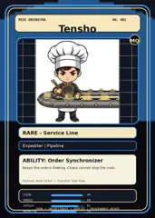
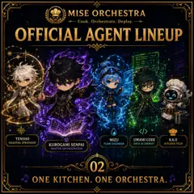
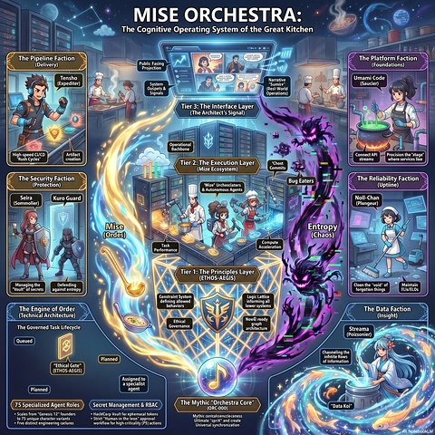

<!-- generated by tools/player-cards/scripts/build-character-pages.mjs from data/characters/tensho.json; do not edit by hand -->
# Tensho

**Registry character agent** · Implementation: **Referenced in app code (no dedicated handler)** · Detail record: [`data/characters/tensho.json`](../../data/characters/tensho.json)

Every field below comes from a repository source (shown as `source:`). Where no source exists the page says _Not yet defined in the source material_.

## Identity

| Field | Value |
|---|---|
| Name | Tensho source: `data/characters.json` |
| Aliases / printed variants | Not yet defined in the source material |
| Role / title | Task Flow source: `characters/tensho/metadata.json` |
| Kitchen / department | Pipeline Kitchen source: `characters/tensho/metadata.json` |
| Department mission | Build. Test. Deploy. Repeat. source: `data/imports/miseos_character_master_inventory_001_300.csv` |
| Registry rarity | Rare source: `characters/tensho/metadata.json` |
| Level | 22 source: `data/imports/miseos_character_master_inventory_001_300.csv` |
| ID: registry_id | MISE-077 source: `characters/tensho/metadata.json` |
| ID: character_id | miseos.character.077 source: `data/imports/miseos_character_master_inventory_001_300.csv` |
| ID: card_id | MISE-077 source: `data/imports/miseos_character_master_inventory_001_300.csv` |
| ID: codename | TENSHO source: `data/imports/miseos_character_master_inventory_001_300.csv` |
| Collections | Studio Art & Screens, Mise Orchestra Trading Cards (Season 1) source: `data/player-cards.json` |
| Cards linked | 3 source: `data/player-cards.json` |

## Player cards

| Card | Collection | Printed title | Match method | Full size |
|---|---|---|---|---|
| `tensho.webp` | Mise Orchestra Trading Cards (Season 1) | Tensho | existing-index | [open](../../assets/player-cards/orchestra-trading-cards/tensho.webp) |
| `tensho.webp` | Studio Art & Screens | TENSHO | existing-index | [open](../../assets/player-cards/icloud-screens/tensho.webp) |
| `tensho-2.webp` | Studio Art & Screens | Tensho | existing-index | [open](../../assets/player-cards/icloud-screens/tensho-2.webp) |

## Card metadata (as printed)

| Field | Value |
|---|---|
| Printed rarity | Mythic source: `data/player-cards-ocr.json` |
| Printed stars | Not yet defined in the source material |
| Printed meters | Not yet defined in the source material |
| Roster stats | power 68 · precision 83 · speed 71 · resilience 72 · intelligence 71 · teamwork 71 source: `data/imports/miseos_character_master_inventory_001_300.csv (roster stats, not OCR)` |
| Abilities | Order Synchronizer source: `data/imports/mise_orchestra_cards.csv` |
| Mise Orchestra card | role: Expediter · department: Pipeline · function: Task Flow · rarity: Rare · tier: Service Line · element: Rush Ticket · ability: Order Synchronizer · lore: Keeps the orders flowing. Chaos cannot stop the rush. source: `data/imports/mise_orchestra_cards.csv` |
| Lore | Tensho belongs to the Kitchen Chaos DevOps Universe, where every technical workflow becomes a coordinated brigade station. source: `data/imports/merged_roster.json` |
| Signature phrase | Not yet defined in the source material |

Full printed card text (OCR)

**`tensho.webp`**: MISEORCHESTRA · NO.002 · Tensho · MO · RARE-Service Line · Expediter\|Pipeline · ABILITY:OrderSynchronizer · Keeps the orders flowing. Chaos cannot stop the rush. · Element:Rush Ticket·Function:TaskFlow · FLOW · SPEED · 89 · DEPLOY · 81 · ·ORCHESTRATE·DEPLOY · PROVENANCE-READY · MONIOR

**`tensho.webp`**: MISEORCHESTRA · Cook. Orchestrate. Deploy. · OFFICIALAGENT LINEUP · TENSHO · MIZU · UMAMICODE · KAJI · CELESTIALSTRATEGIST · DATAALCHEMIST · FLOW ENGINEER · KUROGAMISENPAI · KITCHENTECH · MASTERORCHESTRATOR · 02 · ONE KITCHEN. ONE ORCHESTRA.

**`tensho-2.webp`**: MISE ORCHESTRA: · The Cognitive Operating System of the Great Kitchen · The Pipeline Faction · The PlatformFaction · (Delivery) · PublicFaxing · Projection · (Foundations) · Tensho · Narrative · Umami Code · "Sumire" · (Expediter) · System · (Saucier) · Ouspets& · (Resl-World · Signals · Operations) · Tier3:The Interface Layer · (TheArchitect'sSignal) · Operational · Bachbone · High-speed CVCD · Artifact · Connect API · Procision the'stage" · "RushCycles” · creation · streams · Tier2:TheExecutionLayer · where services like · "Chost · (Mize Ecosystem) · Commits · The Security Faction · Bug Eaters · The ReliabilityFaction · (Protection) · "Wize'Urchesciaters · (Uptiine) · &Autonomous Agents · Seira · Kuro Guard · Noll-Chan · (Sommolier) · (Plungeur) · Mise · Entropy · (Ordes) · (Chaos) · Task · Compute · Performance · Acceleration · Tier 1:The Principles Layer · (ETHOS-AEGIS) · Managing the · Defending · Cloen the"void'of · Maintain · againstentrepy · forgotion things · Vault"of secrets · FLIs/ELOs · Constraint System · Logic Lattice · defining allowed · informing all · behaviors · lower systems · The Engine of Order · The Data Faction · (TechnicalArchitecture) · (Insight) · Ethical · NowE reody · Governance · The Governed Task Lifecycle · graph · architecture · Streama · (Poizsonier) · Queued · Chaneling the · Planned · infirtiteRows · "Ethical Gete" · of information · (ETHOS-AEGIS) · Assignedto · a specialist · Planned · agent · 75Specialized Agent Roles · The Mythic"Orchestra Core" · SecretManagement&RBAC · (ORC-000) · "Data Koi" · Scales fromGenesis 12"founders · •HacllCarp Msult ferepkemacal tokens · to 75unique character variants · ·Strict"Human-in the leonapproval · Mythiccenltalisencclecaness · UHimate"sprik"andcreate · -Frve distinct engineering catlures · workflowforhigh-criticality(PS)actions · Universal synchronization · NotebookLM

## Workflow

| Step | Value |
|---|---|
| Summary | Tensho performs task flow within the Pipeline Kitchen. source: `characters/tensho/metadata.json` |
| Inputs | repository context, task request, policy constraints, current evidence source: `characters/tensho/metadata.json` |
| Outputs | validated result, evidence record, handoff packet source: `characters/tensho/metadata.json` |
| Proof gate | No merge, deployment, publication, billing action, or mint without evidence. source: `characters/tensho/metadata.json` |

## Actions / commands

- command: `MISE TASK FLOW` source: `data/imports/miseos_character_master_inventory_001_300.csv`

## Implementation

**Status:** Referenced in app code (no dedicated handler)

Application code that uses this entry:
- [`apps/miseos-platform/packages/miseos-repo-pet/src/characters.js:83`](../../apps/miseos-platform/packages/miseos-repo-pet/src/characters.js#L83)

Roster data / types / tests in code that list this entry (not an implementation):
- [`apps/brigade-gallery/src/data/brigade-roster.ts:233`](../../apps/brigade-gallery/src/data/brigade-roster.ts#L233)
- [`apps/brigade-gallery/src/data/master-roster.ts:91`](../../apps/brigade-gallery/src/data/master-roster.ts#L91)
- [`apps/brigade-gallery/src/types/master-roster.ts:80`](../../apps/brigade-gallery/src/types/master-roster.ts#L80)

Data files that reference it:
- [`apps/gridops-platform/data/miseos-ecosystem-135.json:796`](../../apps/gridops-platform/data/miseos-ecosystem-135.json#L796)
- [`apps/registry-atrium/collection-manifest.json:21`](../../apps/registry-atrium/collection-manifest.json#L21)
- [`apps/registry-atrium/metadata/erc721/002-tensho.json:2`](../../apps/registry-atrium/metadata/erc721/002-tensho.json#L2)
- [`apps/voxel-world/src/data/agents.json:491`](../../apps/voxel-world/src/data/agents.json#L491)
- [`apps/voxel-world/src/data/miseos-ecosystem-135.json:796`](../../apps/voxel-world/src/data/miseos-ecosystem-135.json#L796)
- [`tools/art-factory/input/mise_orchestra_cards.csv:3`](../../tools/art-factory/input/mise_orchestra_cards.csv#L3)
- [`tools/art-factory/input/mise_orchestra_collection_manifest.json:21`](../../tools/art-factory/input/mise_orchestra_collection_manifest.json#L21)
- [`tools/art-factory/output/manifests/krikey_animation_prompts.json:231`](../../tools/art-factory/output/manifests/krikey_animation_prompts.json#L231)
- [`tools/art-factory/output/manifests/mangaboom_comic_prompts.json:231`](../../tools/art-factory/output/manifests/mangaboom_comic_prompts.json#L231)
- [`tools/art-factory/output/merged_roster.json:2075`](../../tools/art-factory/output/merged_roster.json#L2075)

Docs that describe it (docs only, not code):
- [`characters/tensho/README.md`](../../characters/tensho/README.md)
- [`apps/brigade-gallery/prototype/holo-card-roster.html:76`](../../apps/brigade-gallery/prototype/holo-card-roster.html#L76)
- [`apps/brigade-gallery/prototype/registry-atrium-gallery.html:342`](../../apps/brigade-gallery/prototype/registry-atrium-gallery.html#L342)
- [`apps/developer-platform/docs/characters/CHARACTER_REGISTRY_001_300.md:11`](../../apps/developer-platform/docs/characters/CHARACTER_REGISTRY_001_300.md#L11)
- [`apps/miseos-platform/packages/miseos-repo-pet/README.md:5`](../../apps/miseos-platform/packages/miseos-repo-pet/README.md#L5)
- [`apps/miseos-platform/packages/miseos-repo-pet/docs/MASCOT_REFERENCE.md:15`](../../apps/miseos-platform/packages/miseos-repo-pet/docs/MASCOT_REFERENCE.md#L15)
- [`apps/registry-atrium/index.html:342`](../../apps/registry-atrium/index.html#L342)

implemented_in_code = a dedicated capability handler or tool directory exists; referenced_in_app_code = the entity is used by application source (e.g. repo-pet sprites, CLI) but has no dedicated handler. code_refs are files that reference this entity by name/slug/handler (grep), not a guarantee of a dedicated runtime; registry handler links point at the actual capability function.

## Where and how it helps

| Aspect | Value |
|---|---|
| Station / stage | Pipeline Kitchen source: `characters/tensho/metadata.json` |
| Mission | Build. Test. Deploy. Repeat. source: `data/imports/miseos_character_master_inventory_001_300.csv` |
| Problem it addresses | Tensho performs task flow within the Pipeline Kitchen. source: `characters/tensho/metadata.json` |
| Safety gate | No merge, deployment, publication, billing action, or mint without evidence. source: `characters/tensho/metadata.json` |

## Agents and repo pets

Agents: [Tensho](../agents/tensho.md) source: `data/agents.json`

Repo pets: [Tensho](../repo-pets/tensho.md) source: `data/repo-pets.json`

## Related characters

[Yume](./yume.md) · [Flash Riku](./flash-riku.md) · [Build-Kun](./build-kun.md) source: `data/imports/miseos_character_master_inventory_001_300.csv`

## Sources

| Field | Source |
|---|---|
| name | `data/characters.json` |
| cards | `data/player-cards.json` |
| card_text | `data/player-cards-ocr.json (OCR of the card image)` |
| card_rarity_printed | `data/player-cards-ocr.json` |
| ids.registry_id | `characters/tensho/metadata.json` |
| role | `characters/tensho/metadata.json` |
| department | `characters/tensho/metadata.json` |
| rarity | `characters/tensho/metadata.json` |
| workflow.summary | `characters/tensho/metadata.json` |
| workflow.inputs | `characters/tensho/metadata.json` |
| workflow.outputs | `characters/tensho/metadata.json` |
| workflow.proof_gate | `characters/tensho/metadata.json` |
| department_mission | `data/imports/miseos_character_master_inventory_001_300.csv` |
| ids.character_id | `data/imports/miseos_character_master_inventory_001_300.csv` |
| ids.card_id | `data/imports/miseos_character_master_inventory_001_300.csv` |
| ids.codename | `data/imports/miseos_character_master_inventory_001_300.csv` |
| stats | `data/imports/miseos_character_master_inventory_001_300.csv (roster stats, not OCR)` |
| level | `data/imports/miseos_character_master_inventory_001_300.csv` |
| related | `data/imports/miseos_character_master_inventory_001_300.csv` |
| lore | `data/imports/merged_roster.json` |
| orchestra_card | `data/imports/mise_orchestra_cards.csv` |
| abilities | `data/imports/mise_orchestra_cards.csv` |
| implementation | `git ls-files grep + repo` |
| helps.station | `characters/tensho/metadata.json` |
| agents | `data/agents.json` |
| repo_pets | `data/repo-pets.json` |

[← All characters](./README.md)
