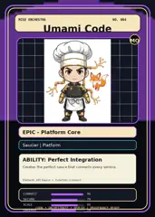

<!-- generated by tools/player-cards/scripts/build-character-pages.mjs from data/characters/umami-code.json; do not edit by hand -->
# Umami Code

**Registry character agent** · Implementation: **Referenced in app code (no dedicated handler)** · Detail record: [`data/characters/umami-code.json`](../../data/characters/umami-code.json)

Every field shows where its value comes from (`source:`). Repo-sourced values cite the repository or source-library file they were read from; values marked `authored: card design` were written for this card by [`enrich-characters.py`](../../tools/player-cards/scripts/enrich-characters.py), derived from the printed card text, role and kitchen theme, and are not claims about existing code.

## Identity

| Field | Value |
|---|---|
| Name | Umami Code source: `data/characters.json` |
| Aliases / printed variants | None recorded (no alternate title in the canon crosswalk or agents.json) source: `data/player-cards.json + canon crosswalk (no alternate title found)` |
| Role / title | Developer Workflow Profiles source: `characters/umami-code/metadata.json` |
| Kitchen / department | Platform Kitchen source: `characters/umami-code/metadata.json` |
| Department mission | Provide golden paths and stable service foundations. source: `data/imports/miseos_character_master_inventory_001_300.csv` |
| Registry rarity | Genesis source: `characters/umami-code/metadata.json` |
| Level | 30 source: `data/imports/miseos_character_master_inventory_001_300.csv` |
| ID: registry_id | MISE-023 source: `characters/umami-code/metadata.json` |
| ID: character_id | miseos.character.024 source: `data/imports/miseos_character_master_inventory_001_300.csv` |
| ID: card_id | MISE-024 source: `data/imports/miseos_character_master_inventory_001_300.csv` |
| ID: codename | UMAMI_CODE source: `data/imports/miseos_character_master_inventory_001_300.csv` |
| Collections | 1×1 Chefs, Mise Orchestra Trading Cards (Season 1) source: `data/player-cards.json` |
| Cards linked | 2 source: `data/player-cards.json` |
| Role category | platform source: `data/imports/merged_roster.json` |

## Player cards

| Card | Collection | Printed title | Match method | Full size |
|---|---|---|---|---|
| `umami-code.webp` | 1×1 Chefs | Umami Code | existing-index | [open](../../assets/player-cards/1by1-chefs/umami-code.webp) |
| `umami-code.webp` | Mise Orchestra Trading Cards (Season 1) | Umami Code | existing-index | [open](../../assets/player-cards/orchestra-trading-cards/umami-code.webp) |

## Card metadata (as printed)

| Field | Value |
|---|---|
| Printed rarity | Epic source: `data/player-cards-ocr.json` |
| Printed stars | Not printed on the card source: `data/player-cards-ocr.json (no stars in OCR)` |
| Printed meters | Not printed on the card source: `data/player-cards-ocr.json (no % meters in OCR)` |
| Roster stats | power 86 · precision 87 · speed 69 · resilience 85 · intelligence 73 · teamwork 86 source: `data/imports/miseos_character_master_inventory_001_300.csv (roster stats, not OCR)` |
| Abilities | Perfect Integration source: `data/imports/mise_orchestra_cards.csv` |
| Mise Orchestra card | role: Saucier · department: Platform · function: Connect · rarity: Epic · tier: Platform Core · element: API Sauce · ability: Perfect Integration · lore: Creates the perfect sauce that connects every service. source: `data/imports/mise_orchestra_cards.csv` |
| Lore | Umami Code belongs to the Kitchen Chaos DevOps Universe, where every technical workflow becomes a coordinated brigade station. source: `data/imports/merged_roster.json` |
| Signature phrase | Traffic and Ingress Manager done cleanly, safely, and in rhythm. source: `data/imports/merged_roster.json` |
| Unique trait | Specializes in traffic & ingress manager so the Platform Kitchen can operate as a precise, repo-safe DevOps station. source: `data/imports/merged_roster.json` |

Full printed card text (OCR)

**`umami-code.webp`**: FLAVOR_API · INGREDIENTS=［ · "depth", · "balance" · "harmony" · "umami" · REDUCE() · GLAZE() · SERVE_PERFECT(） · Done. · API · Umami Code · Saucier

**`umami-code.webp`**: MISE ORCHESTRA · NO.004 · UmamiCode · MO · EPIC-PlatformCore · Saucier\|Platform · ABILITY:PerfectIntegration · Creates the perfect sauce that connects every service. · Element:API Sauce Function:Connect · CONNECT · 96 · SECURE · 79 · SCALE · 80 · ORCHESTRATE·DEPLOY · COOK · PROVENANCE-READY · OBSERVE

## Workflow

| Step | Value |
|---|---|
| Summary | Umami Code performs developer workflow profiles within the Platform Kitchen. source: `characters/umami-code/metadata.json` |
| Inputs | repository context, task request, policy constraints, current evidence source: `characters/umami-code/metadata.json` |
| Outputs | validated result, evidence record, handoff packet source: `characters/umami-code/metadata.json` |
| Proof gate | No merge, deployment, publication, billing action, or mint without evidence. source: `characters/umami-code/metadata.json` |

## Actions / commands

- command: `MISE TRAFFIC INGRESS MANAGER` source: `data/imports/miseos_character_master_inventory_001_300.csv`
- command: `Traffic & Ingress Manager` · mise_name: `Mise TrafficIngressManager` source: `data/imports/merged_roster.json`

## Implementation

**Status:** Referenced in app code (no dedicated handler)

Application code that uses this entry:
- [`apps/miseos-platform/packages/miseos-repo-pet/src/characters.js:135`](../../apps/miseos-platform/packages/miseos-repo-pet/src/characters.js#L135)

Roster data / types / tests in code that list this entry (not an implementation):
- [`apps/bootstrap-registry/apps/registry-console/src/data/master-roster.generated.ts:379`](../../apps/bootstrap-registry/apps/registry-console/src/data/master-roster.generated.ts#L379)
- [`apps/brigade-gallery/src/data/brigade-roster.ts:332`](../../apps/brigade-gallery/src/data/brigade-roster.ts#L332)
- [`apps/brigade-gallery/src/data/master-roster.ts:106`](../../apps/brigade-gallery/src/data/master-roster.ts#L106)

Data files that reference it:
- [`apps/bootstrap-registry/registry/cards/master-roster-cards.json:331`](../../apps/bootstrap-registry/registry/cards/master-roster-cards.json#L331)
- [`apps/gridops-platform/data/miseos-ecosystem-135.json:1292`](../../apps/gridops-platform/data/miseos-ecosystem-135.json#L1292)
- [`apps/registry-atrium/collection-manifest.json:39`](../../apps/registry-atrium/collection-manifest.json#L39)
- [`apps/registry-atrium/metadata/erc721/004-umami-code.json:2`](../../apps/registry-atrium/metadata/erc721/004-umami-code.json#L2)
- [`apps/voxel-world/src/data/miseos-ecosystem-135.json:1292`](../../apps/voxel-world/src/data/miseos-ecosystem-135.json#L1292)
- [`tools/art-factory/input/characters.generated.json:510`](../../tools/art-factory/input/characters.generated.json#L510)
- [`tools/art-factory/input/mise_orchestra_cards.csv:5`](../../tools/art-factory/input/mise_orchestra_cards.csv#L5)
- [`tools/art-factory/input/mise_orchestra_collection_manifest.json:39`](../../tools/art-factory/input/mise_orchestra_collection_manifest.json#L39)
- [`tools/art-factory/output/manifests/krikey_animation_prompts.json:75`](../../tools/art-factory/output/manifests/krikey_animation_prompts.json#L75)
- [`tools/art-factory/output/manifests/mangaboom_comic_prompts.json:75`](../../tools/art-factory/output/manifests/mangaboom_comic_prompts.json#L75)

Docs that describe it (docs only, not code):
- [`characters/umami-code/README.md`](../../characters/umami-code/README.md)
- [`apps/brigade-gallery/prototype/holo-card-roster.html:76`](../../apps/brigade-gallery/prototype/holo-card-roster.html#L76)
- [`apps/brigade-gallery/prototype/registry-atrium-gallery.html:342`](../../apps/brigade-gallery/prototype/registry-atrium-gallery.html#L342)
- [`apps/developer-platform/docs/characters/CHARACTER_REGISTRY_001_300.md:15`](../../apps/developer-platform/docs/characters/CHARACTER_REGISTRY_001_300.md#L15)
- [`apps/miseos-platform/packages/miseos-repo-pet/README.md:59`](../../apps/miseos-platform/packages/miseos-repo-pet/README.md#L59)
- [`apps/miseos-platform/packages/miseos-repo-pet/docs/MASCOT_REFERENCE.md:17`](../../apps/miseos-platform/packages/miseos-repo-pet/docs/MASCOT_REFERENCE.md#L17)
- [`apps/registry-atrium/index.html:342`](../../apps/registry-atrium/index.html#L342)

implemented_in_code = a dedicated capability handler or tool directory exists; referenced_in_app_code = the entity is used by application source (e.g. repo-pet sprites, CLI) but has no dedicated handler. code_refs are files that reference this entity by name/slug/handler (grep), not a guarantee of a dedicated runtime; registry handler links point at the actual capability function.

## Where and how it helps

| Aspect | Value |
|---|---|
| Station / stage | Platform Kitchen source: `characters/umami-code/metadata.json` |
| Mission | Provide golden paths and stable service foundations. source: `data/imports/miseos_character_master_inventory_001_300.csv` |
| Problem it addresses | Umami Code performs developer workflow profiles within the Platform Kitchen. source: `characters/umami-code/metadata.json` |
| Safety gate | No merge, deployment, publication, billing action, or mint without evidence. source: `characters/umami-code/metadata.json` |

## Agents and repo pets

Agents: [Umami Code](../agents/umami-code.md) source: `data/agents.json`

Repo pets: [Umami Code](../repo-pets/umami-code.md) source: `data/repo-pets.json`

## Related characters

[Queue Mizu](./queue-mizu.md) · [Streama](./streama.md) · [Preview Yuki](./preview-yuki.md) · [Grafana Mei](./grafana-mei.md) · [Nina Promoter](./nina-promoter.md) · [Review Ren](./review-ren.md) source: `data/imports/miseos_character_master_inventory_001_300.csv data/imports/merged_roster.json data/imports/merged_roster.json data/imports/merged_roster.json`

## Canon Bible

Mentioned in [`docs/canon/MiseOS-Canon-Bible-v1.0.pdf`](../../docs/canon/MiseOS-Canon-Bible-v1.0.pdf):

- line 619: `MISE-G2-P070 Umami Code Mise Orchestra canonical-candidate 1E3334AB-3111- 70`

## Sources

| Field | Source |
|---|---|
| name | `data/characters.json` |
| cards | `data/player-cards.json` |
| card_text | `data/player-cards-ocr.json (OCR of the card image)` |
| card_rarity_printed | `data/player-cards-ocr.json` |
| ids.registry_id | `characters/umami-code/metadata.json` |
| role | `characters/umami-code/metadata.json` |
| department | `characters/umami-code/metadata.json` |
| rarity | `characters/umami-code/metadata.json` |
| workflow.summary | `characters/umami-code/metadata.json` |
| workflow.inputs | `characters/umami-code/metadata.json` |
| workflow.outputs | `characters/umami-code/metadata.json` |
| workflow.proof_gate | `characters/umami-code/metadata.json` |
| department_mission | `data/imports/miseos_character_master_inventory_001_300.csv` |
| ids.character_id | `data/imports/miseos_character_master_inventory_001_300.csv` |
| ids.card_id | `data/imports/miseos_character_master_inventory_001_300.csv` |
| ids.codename | `data/imports/miseos_character_master_inventory_001_300.csv` |
| stats | `data/imports/miseos_character_master_inventory_001_300.csv (roster stats, not OCR)` |
| level | `data/imports/miseos_character_master_inventory_001_300.csv` |
| related | `data/imports/miseos_character_master_inventory_001_300.csv data/imports/merged_roster.json data/imports/merged_roster.json data/imports/merged_roster.json` |
| lore | `data/imports/merged_roster.json` |
| signature_phrase | `data/imports/merged_roster.json` |
| unique_trait | `data/imports/merged_roster.json` |
| role_category | `data/imports/merged_roster.json` |
| orchestra_card | `data/imports/mise_orchestra_cards.csv` |
| abilities | `data/imports/mise_orchestra_cards.csv` |
| canon_bible | `docs/canon/MiseOS-Canon-Bible-v1.0.pdf (pdftotext)` |
| implementation | `git ls-files grep + repo` |
| helps.station | `characters/umami-code/metadata.json` |
| agents | `data/agents.json` |
| repo_pets | `data/repo-pets.json` |
| aliases | `data/player-cards.json + canon crosswalk (no alternate title found)` |
| card_stars_printed | `data/player-cards-ocr.json (no stars in OCR)` |
| card_meters_printed | `data/player-cards-ocr.json (no % meters in OCR)` |
| theme | `authored: card design (keyword theme used for authored fields)` |

[← All characters](./README.md)
