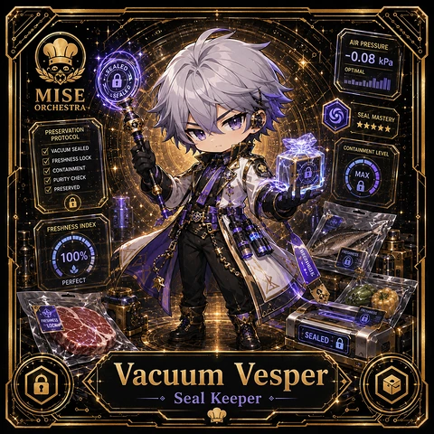

<!-- generated by tools/player-cards/scripts/build-character-pages.mjs from data/characters/vacuum-vesper.json; do not edit by hand -->
# Vacuum Vesper

**Registry character agent** · Implementation: **Described in docs only** · Detail record: [`data/characters/vacuum-vesper.json`](../../data/characters/vacuum-vesper.json)

Every field shows where its value comes from (`source:`). Repo-sourced values cite the repository or source-library file they were read from; values marked `authored: card design` were written for this card by [`enrich-characters.py`](../../tools/player-cards/scripts/enrich-characters.py), derived from the printed card text, role and kitchen theme, and are not claims about existing code.

## Identity

| Field | Value |
|---|---|
| Name | Vacuum Vesper source: `data/characters.json` |
| Aliases / printed variants | Vesper source: `card titles / OCR in data/player-cards-ocr.json` |
| Role / title | Seal Keeper source: `characters/vacuum-vesper/metadata.json` |
| Kitchen / department | Operations Kitchen source: `characters/vacuum-vesper/metadata.json` |
| Department mission | Keep the kitchen running smoothly. source: `data/imports/miseos_character_master_inventory_001_300.csv` |
| Registry rarity | Rare source: `characters/vacuum-vesper/metadata.json` |
| Level | 14 source: `data/imports/miseos_character_master_inventory_001_300.csv` |
| ID: registry_id | MISE-100 source: `characters/vacuum-vesper/metadata.json` |
| ID: character_id | miseos.character.100 source: `data/imports/miseos_character_master_inventory_001_300.csv` |
| ID: card_id | MISE-100 source: `data/imports/miseos_character_master_inventory_001_300.csv` |
| ID: codename | VACUUM_VESPER source: `data/imports/miseos_character_master_inventory_001_300.csv` |
| Collections | 1×1 Chefs source: `data/player-cards.json` |
| Cards linked | 1 source: `data/player-cards.json` |

## Player cards

| Card | Collection | Printed title | Match method | Full size |
|---|---|---|---|---|
| `vesper.webp` | 1×1 Chefs | Vesper | title | [open](../../assets/player-cards/1by1-chefs/vesper.webp) |

## Card metadata (as printed)

| Field | Value |
|---|---|
| Printed rarity | Not printed on the card source: `data/player-cards-ocr.json (no rarity word in OCR)` |
| Printed stars | 5 source: `data/player-cards-ocr.json` |
| Printed meters | 100% source: `data/player-cards-ocr.json` |
| Roster stats | power 61 · precision 69 · speed 80 · resilience 78 · intelligence 61 · teamwork 83 source: `data/imports/miseos_character_master_inventory_001_300.csv (roster stats, not OCR)` |
| Abilities | Airpressure, Aled, Seal Mastery, Preservation, Protocol, Containment Level source: `data/player-cards-ocr.json (printed card labels, glued OCR words segmented)` |
| Lore | Picture a shelf of labelled jars that each tell a story: that is where Vacuum Vesper is happiest. As Operations Kitchen's Seal Keeper, Vacuum Vesper manages slow processes (ferments, cures, brines) by tracking time, salinity and cultures until they are proven ready. The card calls out Airpressure, Aled, Seal Mastery: the checks Vacuum Vesper runs before calling anything ready. source: `authored: card design (derived from printed card text/role)` |
| Signature phrase | Start batch first, then service. source: `authored: card design (derived from printed card text/role)` |

Full printed card text (OCR)

**`vesper.webp`**: AIRPRESSURE · -0.08 kPa · ALED · OPTIMAL · MISE · ORCHESTRA · SEAL MASTERY · ★★★★★ · PRESERVATION · PROTOCOL · CONTAINMENT LEVEL · VACUUMSEALED · FRESHNESS LOCK · CONTAINMENT · MAX · PURITY CHECK · PRESERVED · FRESHNESSINDEX · RES · 100% · ANESS · PERFECT · FRESNESS · LOCK · SEALED · Vacuum · Vesper · Seal Keeper

## Workflow

| Step | Value |
|---|---|
| Summary | Vacuum Vesper performs seal keeper within the Operations Kitchen. source: `characters/vacuum-vesper/metadata.json` |
| Inputs | repository context, task request, policy constraints, current evidence source: `characters/vacuum-vesper/metadata.json` |
| Outputs | validated result, evidence record, handoff packet source: `characters/vacuum-vesper/metadata.json` |
| Proof gate | No merge, deployment, publication, billing action, or mint without evidence. source: `characters/vacuum-vesper/metadata.json` |

## Actions / commands

- command: `MISE SEAL KEEPER` source: `data/imports/miseos_character_master_inventory_001_300.csv`

## Implementation

**Status:** Described in docs only

Data files that reference it:
- [`apps/gridops-platform/data/miseos-ecosystem-135.json:6004`](../../apps/gridops-platform/data/miseos-ecosystem-135.json#L6004)
- [`apps/voxel-world/src/data/miseos-ecosystem-135.json:6004`](../../apps/voxel-world/src/data/miseos-ecosystem-135.json#L6004)

Docs that describe it (docs only, not code):
- [`characters/vacuum-vesper/README.md`](../../characters/vacuum-vesper/README.md)
- [`apps/developer-platform/docs/characters/CHARACTER_REGISTRY_001_300.md:31`](../../apps/developer-platform/docs/characters/CHARACTER_REGISTRY_001_300.md#L31)

implemented_in_code = a dedicated capability handler or tool directory exists; referenced_in_app_code = the entity is used by application source (e.g. repo-pet sprites, CLI) but has no dedicated handler. code_refs are files that reference this entity by name/slug/handler (grep), not a guarantee of a dedicated runtime; registry handler links point at the actual capability function.

## Where and how it helps

| Aspect | Value |
|---|---|
| Station / stage | Operations Kitchen source: `characters/vacuum-vesper/metadata.json` |
| Mission | Keep the kitchen running smoothly. source: `data/imports/miseos_character_master_inventory_001_300.csv` |
| Problem it addresses | Vacuum Vesper performs seal keeper within the Operations Kitchen. source: `characters/vacuum-vesper/metadata.json` |
| Safety gate | No merge, deployment, publication, billing action, or mint without evidence. source: `characters/vacuum-vesper/metadata.json` |

## Agents and repo pets

Agents: [Database](../agents/database.md) · [Logger](../agents/logger.md) · [Observatory](../agents/observatory.md) source: `authored: card design (closest agents for theme "ferment")`

Repo pets: [Mise Apprentice](../repo-pets/mise-apprentice.md) · [Mise Lattice](../repo-pets/mise-lattice.md) source: `authored: card design (closest repo pets for theme "ferment")`

## Related characters

[Flavor Scribe](./flavor-scribe.md) · [Prep Pulse](./prep-pulse.md) · [Queue Quartz](./queue-quartz.md) source: `data/imports/miseos_character_master_inventory_001_300.csv`

## Canon Bible

Mentioned in [`docs/canon/MiseOS-Canon-Bible-v1.0.pdf`](../../docs/canon/MiseOS-Canon-Bible-v1.0.pdf):

- line 579: `MISE-G2-P055 Vacuum Vesper Mise Orchestra canonical-candidate 1E3334AB-3111- 55`

## Sources

| Field | Source |
|---|---|
| name | `data/characters.json` |
| aliases | `card titles / OCR in data/player-cards-ocr.json` |
| cards | `data/player-cards.json` |
| card_text | `data/player-cards-ocr.json (OCR of the card image)` |
| card_stars_printed | `data/player-cards-ocr.json` |
| card_meters_printed | `data/player-cards-ocr.json` |
| ids.registry_id | `characters/vacuum-vesper/metadata.json` |
| role | `characters/vacuum-vesper/metadata.json` |
| department | `characters/vacuum-vesper/metadata.json` |
| rarity | `characters/vacuum-vesper/metadata.json` |
| workflow.summary | `characters/vacuum-vesper/metadata.json` |
| workflow.inputs | `characters/vacuum-vesper/metadata.json` |
| workflow.outputs | `characters/vacuum-vesper/metadata.json` |
| workflow.proof_gate | `characters/vacuum-vesper/metadata.json` |
| department_mission | `data/imports/miseos_character_master_inventory_001_300.csv` |
| ids.character_id | `data/imports/miseos_character_master_inventory_001_300.csv` |
| ids.card_id | `data/imports/miseos_character_master_inventory_001_300.csv` |
| ids.codename | `data/imports/miseos_character_master_inventory_001_300.csv` |
| stats | `data/imports/miseos_character_master_inventory_001_300.csv (roster stats, not OCR)` |
| level | `data/imports/miseos_character_master_inventory_001_300.csv` |
| related | `data/imports/miseos_character_master_inventory_001_300.csv` |
| canon_bible | `docs/canon/MiseOS-Canon-Bible-v1.0.pdf (pdftotext)` |
| implementation | `git ls-files grep + repo` |
| helps.station | `characters/vacuum-vesper/metadata.json` |
| card_rarity_printed | `data/player-cards-ocr.json (no rarity word in OCR)` |
| abilities | `data/player-cards-ocr.json (printed card labels, glued OCR words segmented)` |
| lore | `authored: card design (derived from printed card text/role)` |
| signature_phrase | `authored: card design (derived from printed card text/role)` |
| agents | `authored: card design (closest agents for theme "ferment")` |
| repo_pets | `authored: card design (closest repo pets for theme "ferment")` |
| theme | `authored: card design (keyword theme used for authored fields)` |

[← All characters](./README.md)
