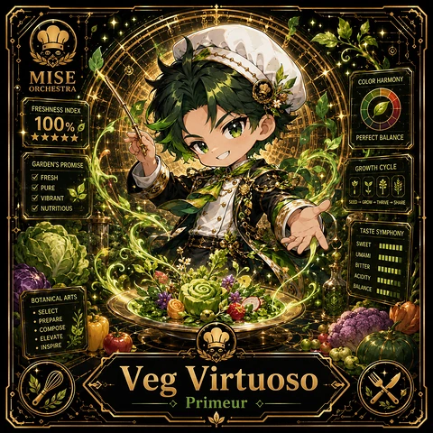

<!-- generated by tools/player-cards/scripts/build-character-pages.mjs from data/characters/veg-virtuoso.json; do not edit by hand -->
# Veg Virtuoso

**Card-defined chef (catalogue: visual reference only)** · Implementation: **Designed (not yet implemented in code)** · Detail record: [`data/characters/veg-virtuoso.json`](../../data/characters/veg-virtuoso.json)

Every field shows where its value comes from (`source:`). Repo-sourced values cite the repository or source-library file they were read from; values marked `authored: card design` were written for this card by [`enrich-characters.py`](../../tools/player-cards/scripts/enrich-characters.py), derived from the printed card text, role and kitchen theme, and are not claims about existing code.

## Identity

| Field | Value |
|---|---|
| Name | Veg Virtuoso source: `data/imports/photo-alignment.csv` |
| Aliases / printed variants | Virtuoso source: `card titles / OCR in data/player-cards-ocr.json` |
| Role / title | Primeur source: `data/player-cards-ocr.json (subtitle printed under the name)` |
| Kitchen / department | Operations Kitchen source: `authored: card design (kitchen chosen from role/printed text, theme "veg")` |
| Department mission | Keep the kitchen running smoothly. source: `data/imports/miseos_character_master_inventory_001_300.csv (mission of Operations Kitchen)` |
| Registry rarity | Legendary source: `authored: card design (from printed star count 5)` |
| Collections | 1×1 Chefs source: `data/player-cards.json` |
| Cards linked | 1 source: `data/player-cards.json` |
| Catalogue status | visual_reference_only source: `data/imports/photo-alignment.csv` |

## Player cards

| Card | Collection | Printed title | Match method | Full size |
|---|---|---|---|---|
| `virtuoso.webp` | 1×1 Chefs | Virtuoso | title | [open](../../assets/player-cards/1by1-chefs/virtuoso.webp) |

## Card metadata (as printed)

| Field | Value |
|---|---|
| Printed rarity | Not printed on the card source: `data/player-cards-ocr.json (no rarity word in OCR)` |
| Printed stars | 5 source: `data/player-cards-ocr.json` |
| Printed meters | Not printed on the card source: `data/player-cards-ocr.json (no % meters in OCR)` |
| Roster stats | power 86 · precision 79 · speed 89 · resilience 95 · intelligence 88 · teamwork 82 source: `authored: card design (6-axis roster scale; baseline from stars + theme "veg")` |
| Abilities | Color Harmony, Freshness Index, Perfect Balance, Growthcycle, Pure, Vibrant source: `data/player-cards-ocr.json (printed card labels, glued OCR words segmented)` |
| Lore | Picture crates of produce under cold running water: that is where Veg Virtuoso is happiest. As Operations Kitchen's specialist for primeur, Veg Virtuoso works through the produce: washing, prepping and seasoning vegetables at peak freshness. The card calls out Color Harmony, Freshness Index, Perfect Balance: the checks Veg Virtuoso runs before calling anything ready. source: `authored: card design (derived from printed card text/role)` |
| Signature phrase | Bitter: checked, not assumed. source: `authored: card design (derived from printed card text/role)` |

Full printed card text (OCR)

**`virtuoso.webp`**: MISE · COLOR HARMONY · ORCHESTRA · FRESHNESSINDEX · 100%克 · ★★★★★ · PERFECT BALANCE · GARDEN'SPROMISE · GROWTHCYCLE ·  FRESH ·  PURE · VIBRANT · SEED+GROW+THRIVE+SHARE · NUTRITIOUS · TASTE SYMPHONY · SWEET · UMAMI · BITTER · ACIDITY · BALANCE · BOTANICALARTS · ·SELECT · ·PREPARE · ·COMPOSE · ·ELEVATE · ·INSPIRE · Veg · Virtuoso · Primeur

## Workflow

| Step | Value |
|---|---|
| Summary | Veg Virtuoso works through the produce: washing, prepping and seasoning vegetables at peak freshness. source: `authored: card design (theme "veg")` |
| Inputs | produce delivery, prep list, freshness grades source: `authored: card design (theme "veg")` |
| Outputs | prepped produce, prep-list completion, freshness discard log source: `authored: card design (theme "veg")` |
| Proof gate | Freshness gate: produce below grade is composted, not prepped; prep list items are ticked only when done. source: `authored: card design (theme "veg")` |

## Actions / commands

- command: `mise roster run veg-virtuoso --dept operations-kitchen --solo --emit report` · status: `proposed` source: `authored: follows data/imports/master-roster-cards.csv (mise roster run command convention)`
- command: `mise veg-virtuoso prep` · reads: `produce delivery` · emits: `prepped produce` · status: `proposed` source: `authored: card design (theme "veg")`
- command: `mise veg-virtuoso grade` · reads: `prep list` · emits: `prep-list completion` · status: `proposed` source: `authored: card design (theme "veg")`
- command: `mise veg-virtuoso season` · reads: `freshness grades` · emits: `freshness discard log` · status: `proposed` source: `authored: card design (theme "veg")`

## Implementation

**Status:** Designed (not yet implemented in code)

- Proposed handler: `vegVirtuoso` (not written yet)
- Proposed command: `mise roster run veg-virtuoso --dept operations-kitchen --solo --emit report`
- Contract: inputs: produce delivery, prep list, freshness grades → outputs: prepped produce, prep-list completion, freshness discard log; refuses to emit 'ready' unless the proof gate passes

source: `git ls-files grep + repo (no code found) + authored: proposed handler spec`

implemented_in_code = a dedicated capability handler or tool directory exists; referenced_in_app_code = the entity is used by application source (e.g. repo-pet sprites, CLI) but has no dedicated handler. code_refs are files that reference this entity by name/slug/handler (grep), not a guarantee of a dedicated runtime; registry handler links point at the actual capability function.

## Where and how it helps

| Aspect | Value |
|---|---|
| Station / stage | Primeur source: `data/player-cards-ocr.json (subtitle printed under the name)` |
| Mission | Keep the kitchen running smoothly. source: `data/imports/miseos_character_master_inventory_001_300.csv (mission of Operations Kitchen)` |
| Problem it addresses | Prep falls behind and stale produce sneaks onto plates. source: `authored: card design (theme "veg")` |
| Safety gate | Freshness gate: produce below grade is composted, not prepped; prep list items are ticked only when done. source: `authored: card design (theme "veg")` |

## Agents and repo pets

Agents: [PrepBot](../agents/prepbot.md) · [Mizu](../agents/mizu.md) · [Steward Prime](../agents/steward-prime.md) source: `authored: card design (closest agents for theme "veg")`

Repo pets: [Mizu](../repo-pets/mizu.md) · [Mise Apprentice](../repo-pets/mise-apprentice.md) source: `authored: card design (closest repo pets for theme "veg")`

## Related characters

[Oil Oracle](./oil-oracle.md) · [Citrus Zest](./citrus-zest.md) · [Flavor Hacker](./flavor-hacker.md) · [Beacon Broil](./beacon-broil.md) · [Portion Paladin](./portion-paladin.md) · [Ticket Tactician](./ticket-tactician.md) source: `authored: card design (same theme "veg" / same department)`

## Sources

| Field | Source |
|---|---|
| name | `data/imports/photo-alignment.csv` |
| aliases | `card titles / OCR in data/player-cards-ocr.json` |
| cards | `data/player-cards.json` |
| card_text | `data/player-cards-ocr.json (OCR of the card image)` |
| card_stars_printed | `data/player-cards-ocr.json` |
| role | `data/player-cards-ocr.json (subtitle printed under the name)` |
| catalogue_status | `data/imports/photo-alignment.csv` |
| implementation | `git ls-files grep + repo (no code found) + authored: proposed handler spec` |
| helps.station | `data/player-cards-ocr.json (subtitle printed under the name)` |
| department | `authored: card design (kitchen chosen from role/printed text, theme "veg")` |
| department_mission | `data/imports/miseos_character_master_inventory_001_300.csv (mission of Operations Kitchen)` |
| card_rarity_printed | `data/player-cards-ocr.json (no rarity word in OCR)` |
| card_meters_printed | `data/player-cards-ocr.json (no % meters in OCR)` |
| rarity | `authored: card design (from printed star count 5)` |
| stats | `authored: card design (6-axis roster scale; baseline from stars + theme "veg")` |
| abilities | `data/player-cards-ocr.json (printed card labels, glued OCR words segmented)` |
| lore | `authored: card design (derived from printed card text/role)` |
| signature_phrase | `authored: card design (derived from printed card text/role)` |
| workflow.summary | `authored: card design (theme "veg")` |
| workflow.inputs | `authored: card design (theme "veg")` |
| workflow.outputs | `authored: card design (theme "veg")` |
| workflow.proof_gate | `authored: card design (theme "veg")` |
| actions | `authored: follows data/imports/master-roster-cards.csv (mise roster run command convention)` |
| helps.mission | `data/imports/miseos_character_master_inventory_001_300.csv (mission of Operations Kitchen)` |
| helps.problem | `authored: card design (theme "veg")` |
| helps.proof_gate | `authored: card design (theme "veg")` |
| agents | `authored: card design (closest agents for theme "veg")` |
| repo_pets | `authored: card design (closest repo pets for theme "veg")` |
| related | `authored: card design (same theme "veg" / same department)` |
| theme | `authored: card design (keyword theme used for authored fields)` |

[← All characters](./README.md)
