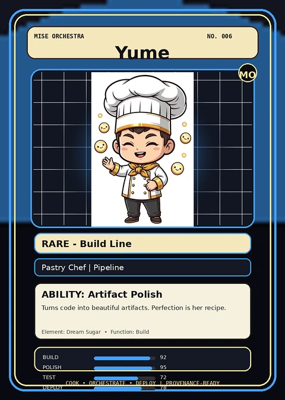

<!-- generated by tools/player-cards/scripts/build-character-pages.mjs from data/characters/yume.json; do not edit by hand -->
# Yume

**Registry character agent** · Implementation: **Referenced in app code (no dedicated handler)** · Detail record: [`data/characters/yume.json`](../../data/characters/yume.json)

Every field shows where its value comes from (`source:`). Repo-sourced values cite the repository or source-library file they were read from; values marked `authored: card design` were written for this card by [`enrich-characters.py`](../../tools/player-cards/scripts/enrich-characters.py), derived from the printed card text, role and kitchen theme, and are not claims about existing code.

## Identity

| Field | Value |
|---|---|
| Name | Yume source: `data/characters.json` |
| Aliases / printed variants | None recorded (no alternate title in the canon crosswalk or agents.json) source: `data/player-cards.json + canon crosswalk (no alternate title found)` |
| Role / title | Build source: `characters/yume/metadata.json` |
| Kitchen / department | Pipeline Kitchen source: `characters/yume/metadata.json` |
| Department mission | Build. Test. Deploy. Repeat. source: `data/imports/miseos_character_master_inventory_001_300.csv` |
| Registry rarity | Rare source: `characters/yume/metadata.json` |
| Level | 15 source: `data/imports/miseos_character_master_inventory_001_300.csv` |
| ID: registry_id | MISE-080 source: `characters/yume/metadata.json` |
| ID: character_id | miseos.character.080 source: `data/imports/miseos_character_master_inventory_001_300.csv` |
| ID: card_id | MISE-080 source: `data/imports/miseos_character_master_inventory_001_300.csv` |
| ID: codename | YUME source: `data/imports/miseos_character_master_inventory_001_300.csv` |
| Collections | 1×1 Chefs, Mise Orchestra Trading Cards (Season 1) source: `data/player-cards.json` |
| Cards linked | 2 source: `data/player-cards.json` |

## Player cards

| Card | Collection | Printed title | Match method | Full size |
|---|---|---|---|---|
| `yume.webp` | 1×1 Chefs | Yume | existing-index | [open](../../assets/player-cards/1by1-chefs/yume.webp) |
| `yume.webp` | Mise Orchestra Trading Cards (Season 1) | Yume | existing-index | [open](../../assets/player-cards/orchestra-trading-cards/yume.webp) |

## Card metadata (as printed)

| Field | Value |
|---|---|
| Printed rarity | Rare source: `data/player-cards-ocr.json` |
| Printed stars | Not printed on the card source: `data/player-cards-ocr.json (no stars in OCR)` |
| Printed meters | Not printed on the card source: `data/player-cards-ocr.json (no % meters in OCR)` |
| Roster stats | power 67 · precision 80 · speed 73 · resilience 73 · intelligence 77 · teamwork 82 source: `data/imports/miseos_character_master_inventory_001_300.csv (roster stats, not OCR)` |
| Abilities | Artifact Polish source: `data/imports/mise_orchestra_cards.csv` |
| Mise Orchestra card | role: Pastry Chef · department: Pipeline · function: Build · rarity: Rare · tier: Build Line · element: Dream Sugar · ability: Artifact Polish · lore: Turns code into beautiful artifacts. Perfection is her recipe. source: `data/imports/mise_orchestra_cards.csv` |
| Lore | Yume belongs to the Kitchen Chaos DevOps Universe, where every technical workflow becomes a coordinated brigade station. source: `data/imports/merged_roster.json` |
| Signature phrase | Check first, then service. source: `authored: card design (derived from printed card text/role)` |

Full printed card text (OCR)

**`yume.webp`**: Create · Delight · MISE · Serve · ORCHESTRA · Harmony · RECIPE · HARMONY · SUGARSYNC · Yume · Pastry Chef

**`yume.webp`**: MISE ORCHESTRA · NO.006 · Yume · MO · RARE-BuildLine · PastryChefPipeline · ABILITY:ArtifactPolish · Turns code into beautiful artifacts. Perfection is her recipe. · Element: Dream Sugar · Function:Build · BUILD · 92 · POLISH · 95 · TEST · 72 · COOK·ORCHESTRATE·DEPLOY · PROVENANCE-READY · DEPLOY · 78

## Workflow

| Step | Value |
|---|---|
| Summary | Yume performs build within the Pipeline Kitchen. source: `characters/yume/metadata.json` |
| Inputs | repository context, task request, policy constraints, current evidence source: `characters/yume/metadata.json` |
| Outputs | validated result, evidence record, handoff packet source: `characters/yume/metadata.json` |
| Proof gate | No merge, deployment, publication, billing action, or mint without evidence. source: `characters/yume/metadata.json` |

## Actions / commands

- command: `MISE BUILD` source: `data/imports/miseos_character_master_inventory_001_300.csv`

## Implementation

**Status:** Referenced in app code (no dedicated handler)

Application code that uses this entry:
- [`apps/miseos-platform/packages/miseos-repo-pet/src/characters.js:187`](../../apps/miseos-platform/packages/miseos-repo-pet/src/characters.js#L187)

Roster data / types / tests in code that list this entry (not an implementation):
- [`apps/bootstrap-registry/apps/registry-console/src/data/master-roster.generated.ts:141`](../../apps/bootstrap-registry/apps/registry-console/src/data/master-roster.generated.ts#L141)
- [`apps/brigade-gallery/src/data/brigade-roster.ts:343`](../../apps/brigade-gallery/src/data/brigade-roster.ts#L343)
- [`apps/brigade-gallery/src/data/master-roster.ts:174`](../../apps/brigade-gallery/src/data/master-roster.ts#L174)

Data files that reference it:
- [`apps/bootstrap-registry/registry/cards/master-roster-cards.json:93`](../../apps/bootstrap-registry/registry/cards/master-roster-cards.json#L93)
- [`apps/gridops-platform/data/miseos-ecosystem-135.json:238`](../../apps/gridops-platform/data/miseos-ecosystem-135.json#L238)
- [`apps/registry-atrium/collection-manifest.json:57`](../../apps/registry-atrium/collection-manifest.json#L57)
- [`apps/registry-atrium/metadata/erc721/006-yume.json:2`](../../apps/registry-atrium/metadata/erc721/006-yume.json#L2)
- [`apps/voxel-world/src/data/agents.json:149`](../../apps/voxel-world/src/data/agents.json#L149)
- [`apps/voxel-world/src/data/miseos-ecosystem-135.json:238`](../../apps/voxel-world/src/data/miseos-ecosystem-135.json#L238)
- [`tools/art-factory/input/characters.generated.json:335`](../../tools/art-factory/input/characters.generated.json#L335)
- [`tools/art-factory/input/mise_orchestra_cards.csv:7`](../../tools/art-factory/input/mise_orchestra_cards.csv#L7)
- [`tools/art-factory/input/mise_orchestra_collection_manifest.json:57`](../../tools/art-factory/input/mise_orchestra_collection_manifest.json#L57)
- [`tools/art-factory/output/manifests/krikey_animation_prompts.json:45`](../../tools/art-factory/output/manifests/krikey_animation_prompts.json#L45)

Docs that describe it (docs only, not code):
- [`characters/yume/README.md`](../../characters/yume/README.md)
- [`apps/brigade-gallery/prototype/holo-card-roster.html:76`](../../apps/brigade-gallery/prototype/holo-card-roster.html#L76)
- [`apps/brigade-gallery/prototype/registry-atrium-gallery.html:342`](../../apps/brigade-gallery/prototype/registry-atrium-gallery.html#L342)
- [`apps/developer-platform/docs/characters/CHARACTER_REGISTRY_001_300.md:11`](../../apps/developer-platform/docs/characters/CHARACTER_REGISTRY_001_300.md#L11)
- [`apps/miseos-platform/packages/miseos-repo-pet/README.md:61`](../../apps/miseos-platform/packages/miseos-repo-pet/README.md#L61)
- [`apps/miseos-platform/packages/miseos-repo-pet/docs/MASCOT_REFERENCE.md:19`](../../apps/miseos-platform/packages/miseos-repo-pet/docs/MASCOT_REFERENCE.md#L19)
- [`apps/registry-atrium/index.html:342`](../../apps/registry-atrium/index.html#L342)

implemented_in_code = a dedicated capability handler or tool directory exists; referenced_in_app_code = the entity is used by application source (e.g. repo-pet sprites, CLI) but has no dedicated handler. code_refs are files that reference this entity by name/slug/handler (grep), not a guarantee of a dedicated runtime; registry handler links point at the actual capability function.

## Where and how it helps

| Aspect | Value |
|---|---|
| Station / stage | Pipeline Kitchen source: `characters/yume/metadata.json` |
| Mission | Build. Test. Deploy. Repeat. source: `data/imports/miseos_character_master_inventory_001_300.csv` |
| Problem it addresses | Yume performs build within the Pipeline Kitchen. source: `characters/yume/metadata.json` |
| Safety gate | No merge, deployment, publication, billing action, or mint without evidence. source: `characters/yume/metadata.json` |

## Agents and repo pets

Agents: [Yume](../agents/yume.md) source: `data/agents.json`

Repo pets: [Yume](../repo-pets/yume.md) source: `data/repo-pets.json`

## Related characters

[Flash Riku](./flash-riku.md) · [Build-Kun](./build-kun.md) · [Alko Commit Chef](./alko-commit-chef.md) source: `data/imports/miseos_character_master_inventory_001_300.csv`

## Canon Bible

Mentioned in [`docs/canon/MiseOS-Canon-Bible-v1.0.pdf`](../../docs/canon/MiseOS-Canon-Bible-v1.0.pdf):

- line 567: `MISE-G2-P047 Yume Mise Orchestra canonical-candidate 1E3334AB-3111- 47`

## Sources

| Field | Source |
|---|---|
| name | `data/characters.json` |
| cards | `data/player-cards.json` |
| card_text | `data/player-cards-ocr.json (OCR of the card image)` |
| card_rarity_printed | `data/player-cards-ocr.json` |
| ids.registry_id | `characters/yume/metadata.json` |
| role | `characters/yume/metadata.json` |
| department | `characters/yume/metadata.json` |
| rarity | `characters/yume/metadata.json` |
| workflow.summary | `characters/yume/metadata.json` |
| workflow.inputs | `characters/yume/metadata.json` |
| workflow.outputs | `characters/yume/metadata.json` |
| workflow.proof_gate | `characters/yume/metadata.json` |
| department_mission | `data/imports/miseos_character_master_inventory_001_300.csv` |
| ids.character_id | `data/imports/miseos_character_master_inventory_001_300.csv` |
| ids.card_id | `data/imports/miseos_character_master_inventory_001_300.csv` |
| ids.codename | `data/imports/miseos_character_master_inventory_001_300.csv` |
| stats | `data/imports/miseos_character_master_inventory_001_300.csv (roster stats, not OCR)` |
| level | `data/imports/miseos_character_master_inventory_001_300.csv` |
| related | `data/imports/miseos_character_master_inventory_001_300.csv` |
| lore | `data/imports/merged_roster.json` |
| orchestra_card | `data/imports/mise_orchestra_cards.csv` |
| abilities | `data/imports/mise_orchestra_cards.csv` |
| canon_bible | `docs/canon/MiseOS-Canon-Bible-v1.0.pdf (pdftotext)` |
| implementation | `git ls-files grep + repo` |
| helps.station | `characters/yume/metadata.json` |
| agents | `data/agents.json` |
| repo_pets | `data/repo-pets.json` |
| aliases | `data/player-cards.json + canon crosswalk (no alternate title found)` |
| card_stars_printed | `data/player-cards-ocr.json (no stars in OCR)` |
| card_meters_printed | `data/player-cards-ocr.json (no % meters in OCR)` |
| signature_phrase | `authored: card design (derived from printed card text/role)` |
| theme | `authored: card design (keyword theme used for authored fields)` |

[← All characters](./README.md)
