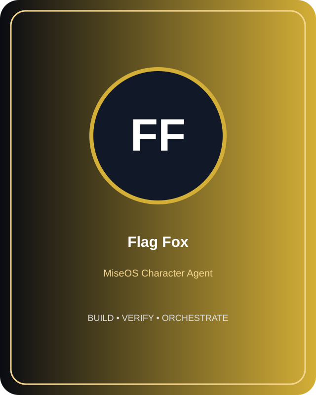

<!-- generated by tools/player-cards/scripts/build-character-pages.mjs from data/repo-pets.json; do not edit by hand -->
# Flag Fox

| Field | Value |
|---|---|
| Kind | animal_character |
| Species / animal | fox (animal word in the name) |
| Role | Feature Flag Analytics |
| Department | Data & Insight Kitchen |
| Glyph | Not yet defined in the source material |
| Catchphrase | Not yet defined in the source material |
| Source | `data/characters/flag-fox.json` |
| Character | [Flag Fox](../characters/flag-fox.md) |
| Agent | Not yet defined in the source material |
| Cards | Not yet defined in the source material |
| Pet folder | [`assets/repo-pets/flag-fox`](../../assets/repo-pets/flag-fox) |

## Behaviors

_Not yet defined in the source material_

## Sprites

 [`assets/characters/flag-fox/profile.svg`](../../assets/characters/flag-fox/profile.svg) 

[← All repo pets](./README.md)
