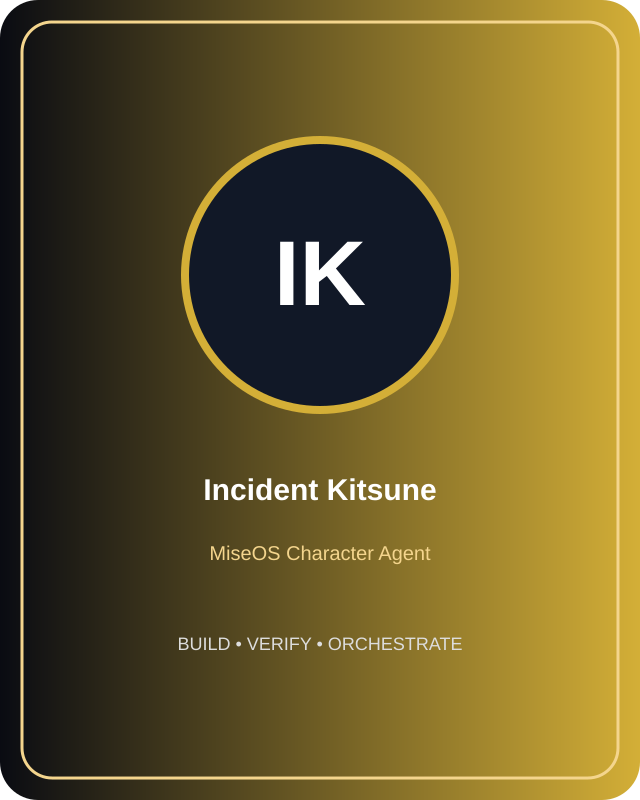
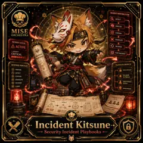

<!-- generated by tools/player-cards/scripts/build-character-pages.mjs from data/repo-pets.json; do not edit by hand -->
# Incident Kitsune

| Field | Value |
|---|---|
| Kind | animal_character |
| Species / animal | fox (kitsune) (animal word in the name) |
| Role | Security Incident Playbooks |
| Department | Security Kitchen |
| Glyph | Not yet defined in the source material |
| Catchphrase | Not yet defined in the source material |
| Source | `data/characters/incident-kitsune.json` |
| Character | [Incident Kitsune](../characters/incident-kitsune.md) |
| Agent | Not yet defined in the source material |
| Cards | [incident-kitsune](../characters/incident-kitsune.md) |
| Pet folder | [`assets/repo-pets/incident-kitsune`](../../assets/repo-pets/incident-kitsune) |

## Behaviors

_Not yet defined in the source material_

## Sprites

 [`assets/characters/incident-kitsune/profile.svg`](../../assets/characters/incident-kitsune/profile.svg) 
 [`assets/player-cards/1by1-chefs/thumbs/incident-kitsune.webp`](../../assets/player-cards/1by1-chefs/thumbs/incident-kitsune.webp) 

[← All repo pets](./README.md)
