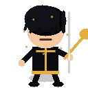
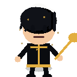
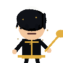
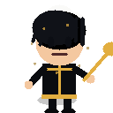
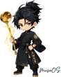

<!-- generated by tools/player-cards/scripts/build-character-pages.mjs from data/repo-pets.json; do not edit by hand -->
# Kurogami Senpai

| Field | Value |
|---|---|
| Kind | terminal_repo_pet+shimeji |
| Species / animal | Not yet defined in the source material |
| Role | Chef de Cuisine |
| Department | Operations |
| Glyph | 🥢 |
| Catchphrase | Plans every move with precision. |
| Source | `tools/repo-pet/src/characters.js` and `extract/code/repopet2/repo-pet-update/src/characters.js` |
| Character | [Kurogami Senpai](../characters/kurogami-senpai.md) |
| Agent | Not yet defined in the source material |
| Cards | [kurogami-senpai](../characters/kurogami-senpai.md), [kurogami-senpai](../characters/kurogami-senpai.md), [kurogami-senpai](../characters/kurogami-senpai.md) |
| Pet folder | [`assets/repo-pets/kurogami-senpai`](../../assets/repo-pets/kurogami-senpai) |

## Behaviors

- **preferred_paths**: 0: src · 1: docs · 2: agents · 3: workflows
- **roaming_bias**: directories: 6 · files: 2 · parent: 2 · config: 4 · docs: 2 · tests: 2
- **verbs**: enterDirectory: steps into the next station · inspectFile: checks the recipe logic · inspectConfig: aligns the service board · inspectDocs: studies the kitchen lore · inspectTests: verifies the plating standard · retreat: returns to the pass
- **shimeji_states**: 0: climb · 1: idle · 2: perch · 3: walk

## Sprites

 [`assets/repo-pets/sprites/kurogami/climb/frame_001.png`](../../assets/repo-pets/sprites/kurogami/climb/frame_001.png) 
 [`assets/repo-pets/sprites/kurogami/idle/frame_001.png`](../../assets/repo-pets/sprites/kurogami/idle/frame_001.png) 
 [`assets/repo-pets/sprites/kurogami/perch/frame_001.png`](../../assets/repo-pets/sprites/kurogami/perch/frame_001.png) 
 [`assets/repo-pets/sprites/kurogami/walk/frame_001.png`](../../assets/repo-pets/sprites/kurogami/walk/frame_001.png) 
 [`assets/repo-pets/cutouts/kurogami-senpai.png`](../../assets/repo-pets/cutouts/kurogami-senpai.png) 

[← All repo pets](./README.md)
