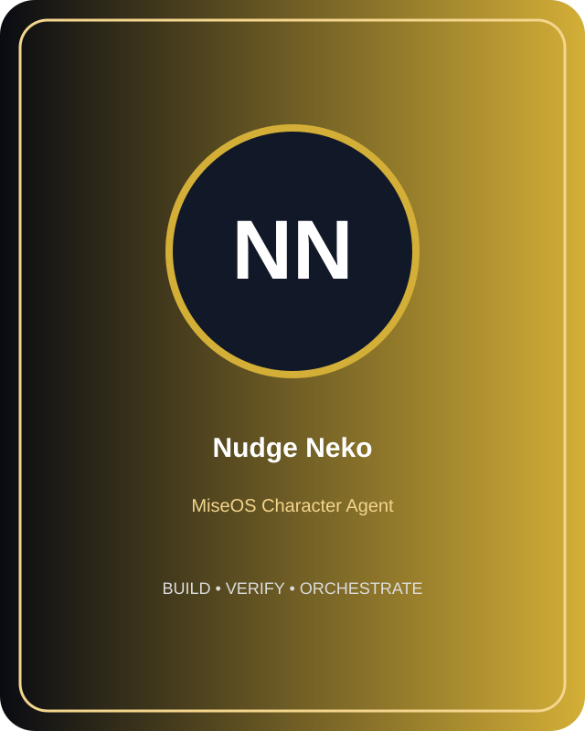
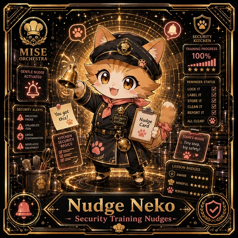
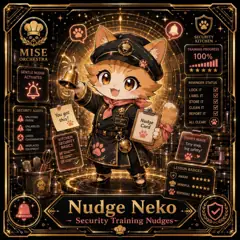

<!-- generated by tools/player-cards/scripts/build-character-pages.mjs from data/repo-pets.json; do not edit by hand -->
# Nudge Neko

| Field | Value |
|---|---|
| Kind | animal_character |
| Species / animal | cat (neko) (animal word in the name) |
| Role | Security Training Nudges |
| Department | Security Kitchen |
| Glyph | Not yet defined in the source material |
| Catchphrase | Not yet defined in the source material |
| Source | `data/characters/nudge-neko.json` |
| Character | [Nudge Neko](../characters/nudge-neko.md) |
| Agent | Not yet defined in the source material |
| Cards | [nudge-neko](../characters/nudge-neko.md), [nudge-neko](../characters/nudge-neko.md) |
| Pet folder | [`assets/repo-pets/nudge-neko`](../../assets/repo-pets/nudge-neko) |

## Behaviors

_Not yet defined in the source material_

## Sprites

 [`assets/characters/nudge-neko/profile.svg`](../../assets/characters/nudge-neko/profile.svg) 
 [`assets/player-cards/1by1-chefs/thumbs/nudge-neko.webp`](../../assets/player-cards/1by1-chefs/thumbs/nudge-neko.webp) 
 [`assets/player-cards/registry-pages/thumbs/nudge-neko.webp`](../../assets/player-cards/registry-pages/thumbs/nudge-neko.webp) 

[← All repo pets](./README.md)
