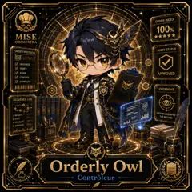

<!-- generated by tools/player-cards/scripts/build-character-pages.mjs from data/repo-pets.json; do not edit by hand -->
# Orderly Owl

| Field | Value |
|---|---|
| Kind | animal_character |
| Species / animal | owl (animal word in the name) |
| Role | Controleur |
| Department | Not yet defined in the source material |
| Glyph | Not yet defined in the source material |
| Catchphrase | Not yet defined in the source material |
| Source | `data/characters/orderly-owl.json` |
| Character | [Orderly Owl](../characters/orderly-owl.md) |
| Agent | Not yet defined in the source material |
| Cards | [orderly-owl](../characters/orderly-owl.md) |
| Pet folder | [`assets/repo-pets/orderly-owl`](../../assets/repo-pets/orderly-owl) |

## Behaviors

_Not yet defined in the source material_

## Sprites

 [`assets/player-cards/1by1-chefs/thumbs/orderly-owl.webp`](../../assets/player-cards/1by1-chefs/thumbs/orderly-owl.webp) 

[← All repo pets](./README.md)
