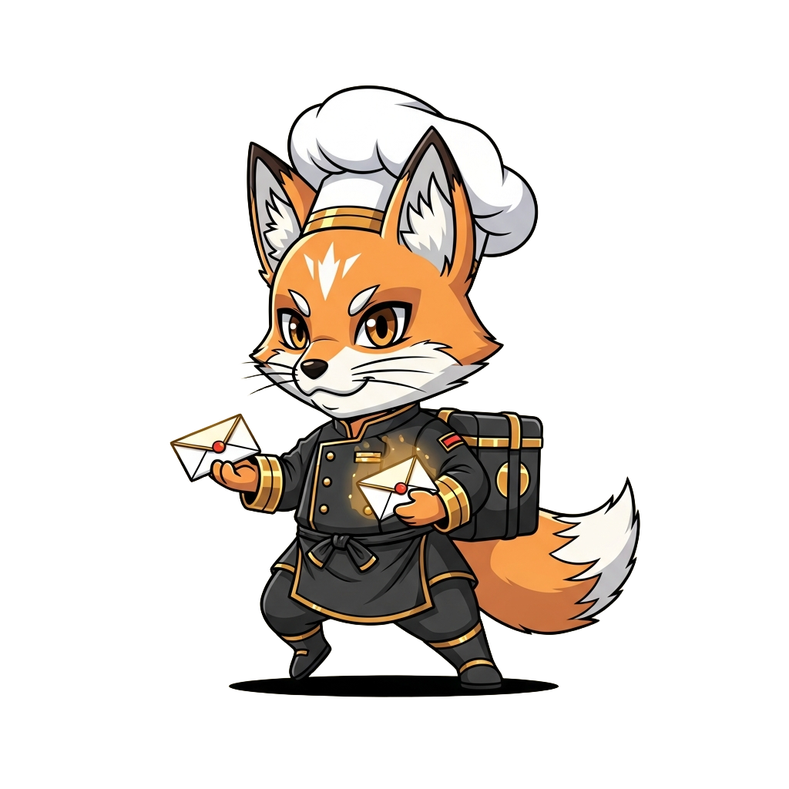
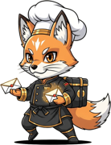

<!-- generated by tools/player-cards/scripts/build-character-pages.mjs from data/repo-pets.json; do not edit by hand -->
# Relay Fox

| Field | Value |
|---|---|
| Kind | brigade_mascot |
| Species / animal | fox (animal word in the name) |
| Role | Message Relay |
| Department | Service Layer |
| Glyph | Not yet defined in the source material |
| Catchphrase | Not yet defined in the source material |
| Source | `icloud/Mise-OS-main.zip/Mise-OS-main/artifacts/dashboard/src/lib/brigade-data.ts:96`; art `icloud/Mise-OS-main.zip/Mise-OS-main/attached_assets/miseos_agents/03_service_layer/Relay-Fox.png` |
| Character | Not yet defined in the source material |
| Agent | [Relay Fox](../agents/relay-fox.md) |
| Cards | Not yet defined in the source material |
| Pet folder | [`assets/repo-pets/relay-fox`](../../assets/repo-pets/relay-fox) |

## Behaviors

- **walks_in_readme_strip**: true

## Sprites

 [`assets/repo-pets/relay-fox/Relay-Fox.png`](../../assets/repo-pets/relay-fox/Relay-Fox.png) 
 [`assets/repo-pets/cutouts/relay-fox.png`](../../assets/repo-pets/cutouts/relay-fox.png) 

[← All repo pets](./README.md)
