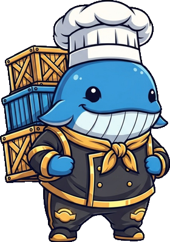

<!-- generated by tools/player-cards/scripts/build-character-pages.mjs from data/repo-pets.json; do not edit by hand -->
# Streama

| Field | Value |
|---|---|
| Kind | terminal_repo_pet |
| Species / animal | Not yet defined in the source material |
| Role | Poissonnier |
| Department | Infrastructure Department |
| Glyph | 🌊 |
| Catchphrase | Streams data like water. Flow never stops. |
| Source | `extract/code/repopet2/repo-pet-update/src/characters.js` |
| Character | [Streama](../characters/streama.md) |
| Agent | [Streama](../agents/streama.md) |
| Cards | [streama](../characters/streama.md), [streama](../characters/streama.md) |
| Pet folder | [`assets/repo-pets/streama`](../../assets/repo-pets/streama) |

## Behaviors

- **roaming_bias**: directories: 4 · files: 4 · parent: 2 · data: 10 · api: 4 · logs: 6
- **verbs**: enterDirectory: flows through · inspectFile: channels data currents in · inspectConfig: checks the stream valve in · inspectDocs: reads the current map in · inspectTests: watches the flow tests in · retreat: drifts back to calm water

## Sprites

 [`assets/repo-pets/cutouts/streama.png`](../../assets/repo-pets/cutouts/streama.png) 

[← All repo pets](./README.md)
