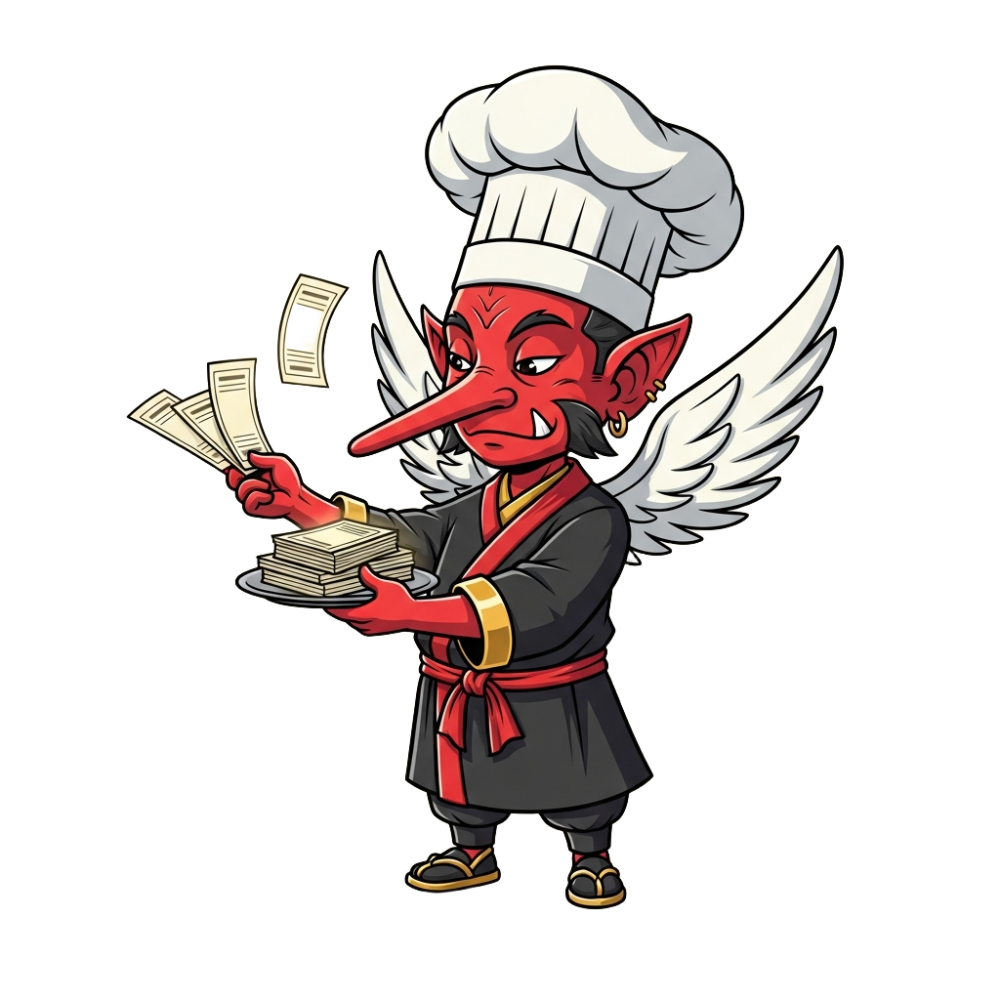

<!-- generated by tools/player-cards/scripts/build-character-pages.mjs from data/repo-pets.json; do not edit by hand -->
# Ticket Tengu

| Field | Value |
|---|---|
| Kind | brigade_mascot |
| Species / animal | tengu (crow-like yōkai) (animal word in the name) |
| Role | Ticket Router |
| Department | Service Layer |
| Glyph | Not yet defined in the source material |
| Catchphrase | Not yet defined in the source material |
| Source | `icloud/Mise-OS-main.zip/Mise-OS-main/artifacts/dashboard/src/lib/brigade-data.ts:98`; art `icloud/Mise-OS-main.zip/Mise-OS-main/attached_assets/miseos_agents/03_service_layer/Ticket-Tengu.png` |
| Character | Not yet defined in the source material |
| Agent | [Ticket Tengu](../agents/ticket-tengu.md) |
| Cards | Not yet defined in the source material |
| Pet folder | [`assets/repo-pets/ticket-tengu`](../../assets/repo-pets/ticket-tengu) |

## Behaviors

- **walks_in_readme_strip**: true

## Sprites

 [`assets/repo-pets/ticket-tengu/Ticket-Tengu.png`](../../assets/repo-pets/ticket-tengu/Ticket-Tengu.png) 
 [`assets/repo-pets/cutouts/ticket-tengu.png`](../../assets/repo-pets/cutouts/ticket-tengu.png) 

[← All repo pets](./README.md)
