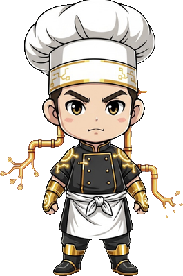

<!-- generated by tools/player-cards/scripts/build-character-pages.mjs from data/repo-pets.json; do not edit by hand -->
# Umami Code

| Field | Value |
|---|---|
| Kind | terminal_repo_pet |
| Species / animal | Not yet defined in the source material |
| Role | Saucier |
| Department | Platform Department |
| Glyph | 🍜 |
| Catchphrase | Creates the API sauce that connects everything. |
| Source | `extract/code/repopet2/repo-pet-update/src/characters.js` |
| Character | [Umami Code](../characters/umami-code.md) |
| Agent | [Umami Code](../agents/umami-code.md) |
| Cards | [umami-code](../characters/umami-code.md), [umami-code](../characters/umami-code.md) |
| Pet folder | [`assets/repo-pets/umami-code`](../../assets/repo-pets/umami-code) |

## Behaviors

- **roaming_bias**: directories: 4 · files: 4 · parent: 2 · api: 8 · config: 3 · docs: 2
- **verbs**: enterDirectory: follows an API aroma into · inspectFile: tastes the integration sauce in · inspectConfig: balances the connector seasoning · inspectDocs: reads the service menu · inspectTests: samples the contract tests · retreat: returns to the sauce station

## Sprites

 [`assets/repo-pets/cutouts/umami-code.png`](../../assets/repo-pets/cutouts/umami-code.png) 

[← All repo pets](./README.md)
