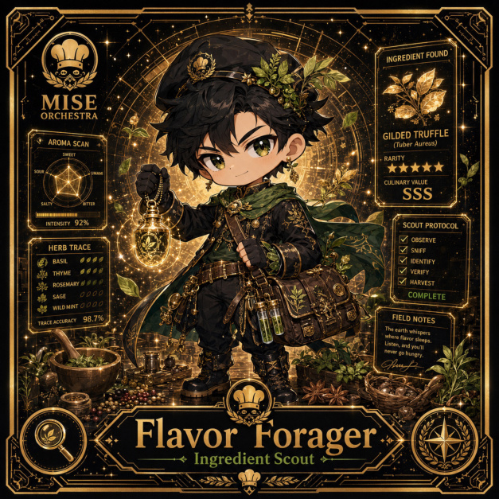

# Flavor Forager

**Rare | Operations Kitchen | Ingredient Scout**

## Identity

| Field | Value |
|---|---|
| Character ID | `miseos.character.094` |
| Codename | `FLAVOR_FORAGER` |
| Collection | MiseOS Character Agents |
| Department | Operations Kitchen |
| Mission | Keep the kitchen running smoothly. |
| Function | Ingredient Scout |
| Rarity | Rare |
| Status | photo_aligned_canonical_completion |
| Confidence | medium |

## Workflow

Flavor Forager performs ingredient scout within the Operations Kitchen.

**Inputs:** repository context, task request, policy constraints, current evidence

**Outputs:** validated result, evidence record, handoff packet

**Synced agents:** Crate Courier, Ledger Ladle, Beacon Broil

> **Proof gate:** No merge, deployment, publication, billing action, or mint without evidence.

## Stats

| Power | Precision | Speed | Resilience | Intelligence | Teamwork |
|---:|---:|---:|---:|---:|---:|
| 65 | 70 | 70 | 76 | 61 | 83 |

## Metadata

[`metadata.json`](./metadata.json) contains this character's machine-readable registry record.
