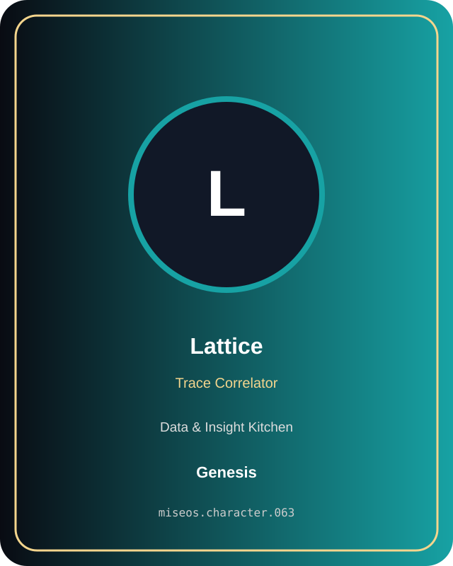

# Lattice

**Genesis | Data & Insight Kitchen | Trace Correlator**

## Identity

| Field | Value |
|---|---|
| Character ID | `miseos.character.063` |
| Codename | `LATTICE` |
| Collection | MiseOS Character Agents |
| Department | Data & Insight Kitchen |
| Mission | Learn. Optimize. Evolve. |
| Function | Trace Correlator |
| Rarity | Genesis |
| Status | canonical |
| Confidence | high |

## Workflow

Lattice performs trace correlator within the Data & Insight Kitchen.

**Inputs:** repository context, task request, policy constraints, current evidence

**Outputs:** validated result, evidence record, handoff packet

**Synced agents:** Repo Ranger, DORA Daichi, Flag Fox

> **Proof gate:** No merge, deployment, publication, billing action, or mint without evidence.

## Stats

| Power | Precision | Speed | Resilience | Intelligence | Teamwork |
|---:|---:|---:|---:|---:|---:|
| 74 | 92 | 58 | 74 | 67 | 83 |

## Metadata

[`metadata.json`](./metadata.json) contains this character's machine-readable registry record.
