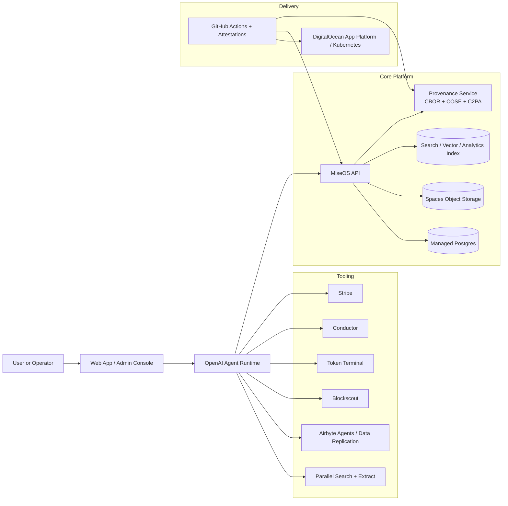
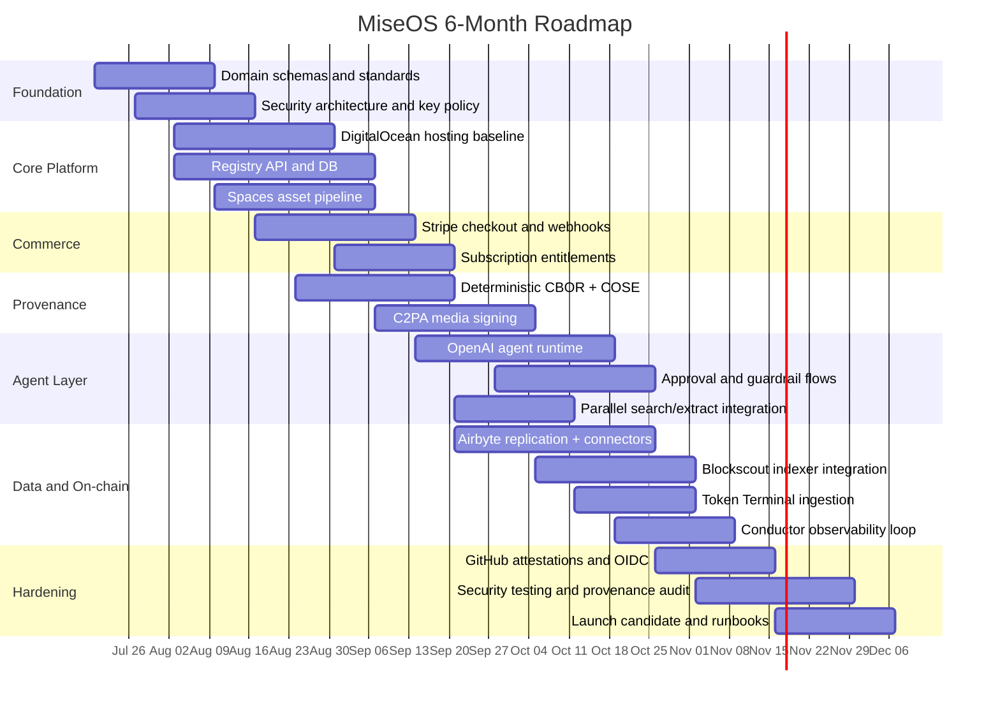

# UNIC Blockchain and Digital Assets MOOC Applied to MiseOS Product Strategy

## Executive summary

The University of Nicosia’s free MOOC page presents a practical, industry-linked blockchain course that has run since 2014, has enrolled more than 150,000 learners from 120+ countries, and is structured as an eight-week free Introductory Track plus an optional four-week paid Advanced Track. The free track covers Web3 foundations, wallets and security, DeFi and markets, and money, policy, and power; the advanced track adds NFTs and digital ownership, regulation and policy, and AI–blockchain convergence. The page explicitly states that learners earn a UNIC Certificate of Completion by passing the final quiz on the Introductory Track, while Advanced Track learners receive a blockchain-verifiable certificate. It also states that no prior experience is required and that the course is aimed at professionals, students, and lifelong learners. However, the page does **not** publish a formal syllabus with weekly readings, formal learning outcomes, a grading rubric beyond the final quiz, or any open-content licensing terms for the course materials; those items are therefore best treated as **unspecified** on the public MOOC page. citeturn1view0turn2view0

For MiseOS, the course is most valuable not as an academic endpoint but as a product framing device. Its topic sequence maps cleanly onto a production stack for digital assets and AI agents: Web3 foundations map to asset identity, ledger selection, trust boundaries, and payment rails; wallet security maps to key custody, signing, and credential issuance; DeFi and markets map to tokenized asset monetization, analytics, and treasury features; money, policy, and power map to compliance, governance, revocation, and human review; NFTs and digital ownership map to provenance and collectible asset models; regulation and policy map to auditability and policy enforcement; and AI–blockchain convergence maps directly to multi-agent orchestration, on-chain verification, and tool-using assistants. citeturn2view0turn20search0turn20search2turn20search5

The strongest implementation pattern is a layered architecture. OpenAI should provide the agent runtime, tool orchestration, guardrails, tracing, and evaluation. Stripe should handle fiat payments, subscriptions, and—if needed—stablecoin financial features. DigitalOcean should host the application plane, managed databases, object storage, and optionally Kubernetes. GitHub should manage CI/CD, reusable workflows, OIDC-based trust, and artifact attestations. Airbyte should power both batch data movement and agent-facing typed connectors. Parallel Search should provide web discovery and extraction for AI research. Conductor should monitor AI-search visibility and citations for owned content. Blockscout should provide multichain EVM indexing, balances, transfers, and contract context. Token Terminal should ingest standardized on-chain financial metrics. A generic Agent Engine should tie all of these into specialist workflows with approvals and provenance. citeturn16search6turn16search18turn15search5turn15search23turn14search2turn14search4turn13search25turn13search1turn8search0turn17search5turn10search10turn10search14turn10search0turn8search5turn9search1

For MiseOS characters and assets specifically, the right durable design is to separate **definition**, **distribution**, and **provenance**. Character and workflow data should use deterministic CBOR for compact machine-readable payloads and COSE for signatures and envelopes; UUIDv7 should identify entities and events; X.509 should bind organizational and service identities where needed; and C2PA should carry media provenance for character images, videos, PDFs, and other public assets. This lets the same character exist as a typed application object, a signed portable artifact, and a provenance-rich media package. RFC 8949 defines CBOR deterministic encoding requirements, RFCs 9052 and 9053 define current COSE structures and algorithms, RFC 9562 defines UUIDs including UUIDv7, RFC 3279 defines legacy PKIX algorithm identifiers for X.509, and the C2PA specification defines manifest-based content provenance and tamper-evident media credentials. citeturn11search1turn11search2turn11search6turn11search3turn12search0turn11search4turn11search25

The recommended six-month roadmap is to ship in four waves. First, establish the data model, provenance model, payments model, and deployment baseline. Second, ship core MiseOS character and asset services, plus Stripe commerce, Spaces-backed asset storage, and GitHub CI/CD. Third, add agent tooling, Airbyte-based data access, Parallel Search, and on-chain indexing with Blockscout and Token Terminal. Fourth, harden governance, evaluations, observability, artifact attestations, C2PA validation, and revocation flows. If followed rigorously, that sequence yields a system that is technically coherent with the MOOC’s curriculum while also being production-credible for real digital-asset products. citeturn14search2turn13search20turn20search15turn19search6turn16search0

## What the UNIC MOOC page actually specifies

The public course page describes a free online “Blockchain and Digital Assets” MOOC that starts in **September 2026**, runs for **12 weeks total** with **8 free weeks** plus an **optional 4-week Advanced Track**, is delivered fully online via **recorded lectures and weekly live Q&A**, is taught in **English**, and is available **worldwide**. The page also says the course has been running since **2014**, has served **150,000+ learners** from **120+ countries**, and is taught by UNIC faculty alongside contributors from Ledger, Ripple, and Cardano, with guest figures including Punk6529, Garrick Hileman, and Jeff Bandman. citeturn1view0turn2view0

The page’s explicit topic structure is unusually clear for a MOOC landing page. Weeks 1–3 cover “Foundations of Web3,” including blockchain and Web3 basics, Bitcoin and digital money, and programmable blockchains with Cardano. Week 4 covers wallets, security, and privacy with Ledger Academy. Weeks 5–6 cover DeFi and prediction markets. Weeks 7–8 cover the geopolitics of cryptocurrency, tokenization, and stablecoins. The optional Advanced Track covers NFTs and digital ownership, regulation and policy, and the convergence of AI and blockchain. citeturn1view0turn2view0

The course page **does** specify a basic assessment and credential model. It states that learners on the Introductory Track must **pass the final quiz** to earn a **University of Nicosia Certificate of Completion**. It also states that Advanced Track learners earn a **blockchain-verifiable certificate** and may become eligible for a UNIC-engraved Ledger Flex wallet and for a Ripple scholarship that covers 50% of tuition for UNIC’s MSc in Blockchain and Digital Currency. What it does **not** specify is the passing threshold, any project-based assessment, participation requirements, peer review, proctoring, or how the blockchain-verifiable certificate is technically implemented. citeturn2view0

The target audience is broad and explicitly beginner-friendly. The page says **no prior experience is required** and that the course is built for **professionals, students, and lifelong learners**, starting from first principles and moving to more advanced topics. The application form also shows a wide range of academic statuses, from high school through completed master’s degree, reinforcing that the entry gate is inclusive rather than specialized. citeturn1view0turn2view0

The public page does **not** expose a formal academic syllabus in the stricter sense: there is no reading list, required texts, weekly assignments, grading breakdown, class policies, learner support policy, credential verification procedure, or content license governing reuse of lectures and materials. The footer does show “© 2026 University of Nicosia. All rights reserved,” and the page links to a privacy policy and cookie policy, but it does not state an open educational license for the course content itself. For this report, those areas should therefore be recorded as **unspecified on the MOOC page** rather than inferred. citeturn2view0

The summary below distinguishes between **specified** and **unspecified** fields.

| Course dimension | What the page specifies | What remains unspecified on the public page |
|---|---|---|
| Duration and format | 12 weeks total; 8 free + optional 4 paid; recorded lectures + weekly live Q&A; fully online; English; worldwide | Time commitment per week; downloadable material policy |
| Modules | Web3 foundations; wallets and security; DeFi and markets; money, policy, and power; NFTs/digital ownership; regulation/policy; AI + blockchain | Formal reading list; exact weekly lesson plan beyond the topic headings |
| Audience | Professionals, students, lifelong learners; no prior experience required | Any formal admissions filter beyond account creation/application |
| Assessment | Final quiz on Introductory Track | Quiz weighting, passing score, retakes, projects, grading rubric |
| Credentials | UNIC Certificate of Completion; blockchain-verifiable certificate for Advanced Track | Verification protocol details; issuing chain/standard; revocation method |
| Licensing | Copyright notice and privacy/cookie links | Open-content license for videos, slides, or assignments |

This table is a direct extraction and normalization of the course page; the “unspecified” cells are intentionally conservative because the public page does not publish those details. citeturn2view0

A practical set of learning outcomes can still be stated, but only as **inferred** outcomes from the published module descriptions. A learner who completes the Introductory Track should be able to explain blockchain and digital-money basics, reason about wallets and operational security, understand core DeFi constructs and prediction markets, and discuss tokenization, stablecoins, and the geopolitical context of digital assets. A learner who also completes the Advanced Track should additionally be able to reason about NFTs and digital ownership, regulatory and policy considerations, and high-level patterns at the AI–blockchain boundary. Because the page does not publish a formal outcome list, these outcomes should be read as a synthesis rather than a verbatim articulation by UNIC. citeturn2view0

## How the course topics map to stakeholder product opportunities

The most effective way to use the MOOC for product work is to treat each topic as a capability domain rather than a classroom topic. The mappings below are implementation-oriented recommendations: the **left-hand side** comes directly from the UNIC page, while the **right-hand side** is a synthesis grounded in official platform capabilities from OpenAI, Stripe, DigitalOcean, GitHub, Airbyte, Parallel, Conductor, Blockscout, and Token Terminal. citeturn2view0turn16search6turn15search5turn14search2turn13search25turn8search0turn10search10turn10search0turn8search5turn9search1

| UNIC topic | Product meaning | OpenAI Developers | Stripe | DigitalOcean | GitHub | Parallel Search | Airbyte | Conductor | Token Terminal | Blockscout Blockchain Data | Generic Agent Engine |
|---|---|---|---|---|---|---|---|---|---|---|---|
| Foundations of Web3 | Identity, assets, ledgers, smart-contract mental model | Agent that explains asset states, generates typed manifests, and plans token flows with function calling and built-in tools | Asset purchase flows, subscriptions, and fiat on-ramps; optional stablecoin treasury flows | App Platform for APIs; Managed Databases for registries; Spaces for media and manifest storage | Source control for contracts, schemas, and manifests; CI for validation | Pull market/news/docs context for asset explanations | Sync product data, user records, asset metadata into DB/vector systems | Track whether docs and product pages are visible/cited in AI search | Pull comparable on-chain financial metrics for pricing dashboards | Read balances, transfers, NFTs, and contracts across EVM chains | Route tasks between asset, commerce, and compliance specialists |
| Wallets and security | Custody, signing, key isolation, verification | Use Responses + Agents SDK guardrails; avoid long-lived keys via workload identity federation | Webhook verification, payment secret handling, treasury account controls | Store keys server-side; use managed infra, S3-compatible Spaces, isolated services | OIDC, environment secrets, approval gates, artifact attestations | Search/extract threat intel and latest docs for security operations | Keep connector credentials server-side; typed auth flows; token refresh | Observe crawl or content-health issues that affect trust and verification surfaces | Treat API keys as secrets; backend-only ingestion | Use PRO API keys and chain_id-based access; never expose server-side keys | Human approvals for sensitive tool calls; audit trace every action |
| DeFi and markets | Revenue, liquidity, pricing, market intelligence | Multi-agent research loop for pricing, treasury, protocol comparisons | Stablecoin payments, platform payouts, treasury balances, subscriptions | Host dashboards, workers, and tsdb/warehouse consumers | CI tests for financial calculations and indexers | Gather market narratives and source citations | Move finance and ops data into analytics layer | Monitor market-facing visibility and citations | Use standardized fees/revenue/active-user metrics | Use balances, transfers, logs, and token events for real-time state | Launch risk-scored workflows for treasury moves or listings |
| Money, policy, and power | Governance, stablecoins, geopolitical context, compliance | Policy-aware agents with guardrails and approvals | Compliance-friendly payment and payout orchestration; event-driven entitlement changes | Region-aware deployment, backups, secure sign-in, team controls | Policy-as-code, reusable workflows, approval-protected envs | Gather primary-source policy and standards documents | Replicate policy sources, support tickets, CRM, and audit trails | Track AI-search sentiment and topic coverage | Compare protocol economics by sector/project | Inspect contract activity and token movement for operational/compliance signals | Route high-risk actions through approval and evidence collection |
| NFTs and digital ownership | Provenance, royalty logic, media binding, collector UX | Generate metadata, moderate prompts, orchestrate C2PA assertions, answer collector questions | Sell editions, memberships, or drops; settle via Checkout or subscriptions | Host media on Spaces; APIs on App Platform; relational store for ownership state | Build/release pipelines for metadata and provenance bundles | Research collection references and market context | Sync customer, asset, CRM, and support context into product systems | Measure discoverability of collection pages and lore pages in AI search | Benchmark collections or ecosystems indirectly with protocol metrics | Read NFT ownership and token transfer data | Coordinate mint, reveal, transfer, and support workflows |
| Regulation and policy | Rules, auditability, revocation, disclosure | Structured outputs for policies and review packets; webhooks for async approvals | Verified webhook flows, account events, dispute/review ops | Managed DB backups, controlled deploys, change audit through platform/team settings | Provenance-rich builds with attestation verification | Continuously pull policy pages, regulatory guidance, and public announcements | Build audit pipelines and rejected-record handling | Track compliance content visibility in answer engines | Maintain cache of supported metrics and changed datasets | Keep indexed evidence of on-chain actions and decoded logs | Implement evidence packs, revocation, exception paths, and reviewer queues |
| AI and blockchain convergence | Tool-using agents with verifiable outputs | Responses API, built-in tools, Agents SDK, tracing, handoffs, evals | Event-driven commerce tools and treasury actions callable by agents | Sandboxed microservices and managed hosting for agent backends | Automated tests, reusable workflows, provenance attestations | Search + extract tools directly exposed to agents | Agent SDK or MCP connectors for live business data | AI visibility and citation feedback loop for generated public content | Metrics tool for protocol intelligence inside agent loops | Structured on-chain retrieval for agent decisions | Orchestrator over specialists, approvals, memory, and provenance |
| Career launchpad / transition | Operational adoption, not just theory | Build internal copilots and research agents | Monetize learning products and memberships | Ship MVPs quickly via managed services | Standardize team workflows | Speed research and content acquisition | Reduce connector engineering time | Improve discoverability and category authority | Add credible crypto analytics | Add real on-chain evidence | Package the whole system into reusable product capabilities |

The critical lesson from this matrix is that the course topics are not siloed. In a real product, wallet security is inseparable from payments, provenance, deployment, and approvals; tokenization is inseparable from content discovery, analytics, and compliance; and AI–blockchain convergence only works if the agent layer can safely access payments, search, operational data, and on-chain evidence through typed tools and reviewed workflows. That is exactly the pattern supported by the current OpenAI Responses API and Agents SDK, Airbyte Agents, Parallel’s Search and Extract APIs, and the official C2PA and COSE standards. citeturn16search6turn20search0turn20search2turn17search0turn17search5turn10search10turn10search14turn11search2turn11search4

## Integration architectures and implementation guidance

A production-grade implementation should center on a canonical asset-and-character domain model, then expose that model through specialist services and tools. OpenAI’s Responses API can call built-in tools, MCP tools, and function tools; the Agents SDK sits one level higher and adds orchestration, handoffs, guardrails, approvals, tracing, and evaluation-oriented workflows. OpenAI’s documentation explicitly describes tool use in the Responses API, built-in tools such as file search and web search, MCP integrations, and programmatic tool calling for bounded tool-heavy workflows. It also documents background responses and webhooks for asynchronous tasks. citeturn7view0turn7view1turn7view2turn7view3turn16search1turn16search6turn16search18turn20search0turn20search2turn20search5turn20search17

A reference architecture for MiseOS can look like this:



This architecture is compatible with DigitalOcean’s managed PaaS and storage model. App Platform deploys applications from Git repositories or container images and handles build/deploy/scale automatically. Its local filesystem is ephemeral, so durable assets and manifests should live in Spaces or Managed Databases rather than on instance disk. Spaces is S3-compatible and can be used with AWS S3 SDKs, which makes it a natural home for character assets, C2PA sidecars, and signed release bundles. citeturn14search2turn3search2turn3search5turn14search1turn14search4turn14search7turn14search10

### A core feature stack

The most important concrete features to build from the course concepts are these:

| Feature family | Course topic origin | Primary implementation pattern |
|---|---|---|
| Tokenized characters and editions | Tokenization, NFTs, digital ownership | Character registry + asset manifest + optional on-chain token or off-chain certificate |
| Commerce for memberships, drops, and subscriptions | Markets, tokenization, stablecoins | Stripe Checkout / PaymentIntents / subscriptions / webhooks |
| On-chain indexing and ownership views | Web3 basics, programmable blockchains, NFTs | Blockscout for balances, transfers, logs, NFTs, contract metadata |
| Protocol intelligence dashboards | DeFi and markets | Token Terminal metrics ingestion + internal analytics store |
| Live data context for agents | AI + blockchain convergence | OpenAI tools + Airbyte Agents connectors + Parallel Search/Extract |
| Public provenance and authenticity | Wallets/security, digital ownership | COSE/CBOR for internal artifacts + C2PA for external media |
| AI-search discoverability | Money/policy/power, distribution strategy | Conductor visibility tracking + content optimization loop |
| Operational governance | Regulation/policy | GitHub approvals/attestations + OpenAI guardrails + immutable logs |

That stack is not theoretical. Each component has a current official path. Stripe’s Payment Intents API is designed around one PaymentIntent per order or session, while Checkout Sessions provide a hosted checkout flow for one-time or subscription payments; webhooks are the official mechanism for asynchronous payment lifecycle changes. Stripe’s docs also expose stablecoin-related features in Treasury and crypto payment surfaces, though some of those remain in preview. citeturn3search16turn15search13turn15search21turn15search0turn15search4turn15search10turn15search26

Blockscout offers both explorer-style REST endpoints and a newer multichain PRO API. Its documentation emphasizes one API key across many EVM chains, a `chain_id` switch for multichain access, explorer-enriched data, and ready-made routes for balances, token transfers, NFTs, logs, and JSON-RPC-compatible methods. Token Terminal offers a standardized on-chain data platform, an authenticated REST API, dataset and metric discovery endpoints, documented rate limiting, and explicit advice to cache project and metric lists locally. citeturn8search5turn18search10turn18search4turn18search3turn18search7turn9search1turn9search2turn9search10turn9search15

Airbyte should be used in two distinct modes. First, the traditional data-replication platform can move CRM, ticketing, billing, and application data into warehouses and databases using connectors and sync modes such as full refresh and incremental sync, with state/checkpointing and schema-resilient behavior. Second, Airbyte Agents or Agent Engine can expose live typed connectors and MCP/SDK-based access from agents directly to third-party systems with managed credentials and per-customer isolation. That distinction matters: batch replication is ideal for analytics and consistent feature stores, while agent connectors are ideal for real-time reads and writes during a run. citeturn8search0turn8search2turn8search6turn8search10turn17search0turn17search5turn17search6turn17search7turn17search15

Parallel Search should be attached where the product needs current public information. Its docs describe natural-language web search returning ranked LLM-optimized excerpts and an Extract API that turns public URLs and PDFs into clean markdown or focused excerpts. Parallel also recommends exposing both Search and Extract to the agent, and its MCP server documentation explains that it wraps both APIs in a lower-latency, output-bounded interface. citeturn10search2turn10search10turn10search14turn10search18turn10search6turn10search26

Conductor belongs in the loop after publication rather than before it. Its platform is designed to track AI visibility, mentions, citations, sentiment, topic performance, and site health across answer engines and search experiences. For MiseOS, that makes it a post-launch optimization surface: once character pages, lore pages, product docs, or provenance explainers exist, Conductor can report how often they appear in AI search and where optimization work should be focused. citeturn10search0turn10search19turn10search20turn10search27

### Recommended tools, APIs, and managed services

This table prioritizes official or primary implementation paths.

| Platform | Recommended implementation surface | Why it fits |
|---|---|---|
| OpenAI | Responses API; Agents SDK; built-in web search/file search; function calling; programmatic tool calling; webhooks; workload identity federation | Best fit for agent orchestration, tools, tracing, approvals, async tasks, and avoiding long-lived API keys in CI/CD citeturn16search6turn16search18turn16search1turn16search4turn20search0turn20search17 |
| Stripe | Checkout Sessions; PaymentIntents; webhook endpoints; Billing subscriptions; Connect payouts; stablecoin features where appropriate | Strong event model for monetization, entitlements, platform payouts, and optional stablecoin treasury/payments citeturn15search13turn3search16turn15search0turn15search4turn15search23turn15search10 |
| DigitalOcean | App Platform; Managed Databases; Spaces; optional Kubernetes for more complex control planes | Managed hosting with clear separation of app, database, and object storage; S3 compatibility simplifies asset handling citeturn14search2turn3search14turn14search4turn14search10turn14search21 |
| GitHub | Actions; reusable workflows; environment secrets; OIDC; artifact attestations | Strong CI/CD, approval workflows, supply-chain provenance, and secret reduction through OIDC citeturn13search25turn13search2turn3search24turn13search9turn13search1turn13search18 |
| Airbyte | Data replication connectors; Agent SDK; Agent MCP / Agent API | Batch ETL plus typed real-time agent access using one ecosystem citeturn8search0turn17search5turn17search1turn17search9 |
| Parallel Search | Search API; Extract API; MCP server | Efficient web discovery and extraction for LLM loops, with PDF-aware extraction and objective-based compression citeturn10search10turn10search14turn10search18turn10search26 |
| Conductor | AI Search Performance / visibility intelligence | Best used as an observability and optimization loop on public content and discoverability citeturn10search0turn10search19 |
| Token Terminal | REST API datasets, projects, metrics, sectors; local cache/index of metadata | Useful for analytics and treasury intelligence, not canonical on-chain truth citeturn9search2turn9search10turn9search15 |
| Blockscout | PRO API; REST address/token/NFT endpoints; ETH JSON-RPC | Practical multichain indexing and explorer-enriched operational state citeturn8search5turn18search10turn18search4turn18search7 |
| C2PA / content authenticity | C2PA spec + CAI open-source SDKs (`c2pa-rs`, `c2pa-python`, `c2pa-js`) | Official/primary provenance stack for public media assets citeturn11search4turn19search2turn19search3turn19search5turn19search15 |

### Critical integration blueprints

The code below is deliberately opinionated: it assumes server-side execution, typed schemas, and an event-driven model.

#### OpenAI agent orchestration with tool calls and approvals

OpenAI’s docs describe function calling, built-in tools, Agents SDK orchestration, handoffs, guardrails, and tracing as first-class patterns. citeturn16search2turn16search6turn20search2turn20search5turn20search17

```ts
import OpenAI from "openai";
import { Agent, run } from "@openai/agents";

const client = new OpenAI();

async function getCharacterOwnership(params: {
  chainId: number;
  wallet: string;
}) {
  const resp = await fetch(
    `https://api.blockscout.com/v2/api?chain_id=${params.chainId}&module=account&action=tokenlist&address=${params.wallet}`,
    { headers: { Authorization: `Bearer ${process.env.BLOCKSCOUT_API_KEY}` } }
  );
  if (!resp.ok) throw new Error(`Blockscout failed: ${resp.status}`);
  return await resp.json();
}

const ownershipTool = {
  type: "function" as const,
  name: "get_character_ownership",
  description: "Return on-chain token/NFT holdings for a wallet",
  parameters: {
    type: "object",
    properties: {
      chainId: { type: "integer" },
      wallet: { type: "string" },
    },
    required: ["chainId", "wallet"],
    additionalProperties: false
  },
  strict: true
};

const commerceAgent = new Agent({
  name: "MiseOS Commerce Agent",
  instructions:
    "Help users buy editions, verify ownership, and explain provenance. " +
    "Use tools for on-chain facts. Never invent payment or ownership state."
});

export async function answerUser(input: string) {
  const response = await client.responses.create({
    model: "gpt-5.6",
    input,
    tools: [ownershipTool, { type: "web_search_preview" }],
    tool_choice: "auto",
    background: false
  });

  // If function call returned, execute and continue
  // In production, use SDK helpers, tracing, and approval gates.
  return response;
}
```

#### Stripe Checkout and webhook handling

Stripe recommends creating a new Checkout Session for each attempt and using webhooks for asynchronous updates. Its webhook docs also emphasize validation of incoming events. citeturn15search13turn15search21turn15search0turn15search24

```ts
import Stripe from "stripe";
import express from "express";

const stripe = new Stripe(process.env.STRIPE_SECRET_KEY!);
const app = express();

// Create checkout session
app.post("/api/checkout/mint-pass", express.json(), async (req, res) => {
  const { userId, planId } = req.body;

  const session = await stripe.checkout.sessions.create({
    mode: "payment",
    line_items: [
      { price: planId, quantity: 1 }
    ],
    success_url: "https://miseos.example/success?session_id={CHECKOUT_SESSION_ID}",
    cancel_url: "https://miseos.example/cancel",
    metadata: { userId, entitlementType: "mint-pass" }
  });

  res.json({ url: session.url });
});

// Raw body required for webhook signature verification
app.post(
  "/api/stripe/webhook",
  express.raw({ type: "application/json" }),
  async (req, res) => {
    const sig = req.headers["stripe-signature"]!;
    const event = stripe.webhooks.constructEvent(
      req.body,
      sig,
      process.env.STRIPE_WEBHOOK_SECRET!
    );

    switch (event.type) {
      case "checkout.session.completed": {
        const session = event.data.object as Stripe.Checkout.Session;
        // grant entitlement, create provenance event, enqueue mint flow
        break;
      }
      case "customer.subscription.deleted": {
        // revoke subscription-backed access
        break;
      }
    }

    res.json({ received: true });
  }
);
```

#### Airbyte Agent SDK connector use

Airbyte Agents provides a Python SDK with typed connectors, automatic credential handling, and direct execution; the hosted platform keeps Airbyte credentials separate from connector-specific credentials. citeturn17search5turn17search7

```python
import asyncio
from airbyte_agent_sdk import connect

async def fetch_github_issues():
    github = connect(
        "github",
        client_id=os.environ["AIRBYTE_CLIENT_ID"],
        client_secret=os.environ["AIRBYTE_CLIENT_SECRET"],
    )
    try:
        result = await github.execute(
            "issues",
            "list",
            params={"owner": "your-org", "repo": "miseos", "per_page": 20},
        )
        return result
    finally:
        await github.close()

if __name__ == "__main__":
    print(asyncio.run(fetch_github_issues()))
```

#### DigitalOcean App Platform specification

DigitalOcean’s app spec is the canonical declarative shape for App Platform deployments, and the platform is built to deploy from Git repositories or container images. citeturn14search12turn14search2

```yaml
name: miseos-platform
region: nyc
services:
  - name: api
    github:
      repo: your-org/miseos
      branch: main
      deploy_on_push: true
    source_dir: apps/api
    http_port: 3000
    instance_size_slug: professional-xs
    instance_count: 2
    envs:
      - key: NODE_ENV
        value: production
      - key: DATABASE_URL
        scope: RUN_TIME
        value: ${db.DATABASE_URL}
      - key: SPACES_ENDPOINT
        value: nyc3.digitaloceanspaces.com

databases:
  - name: db
    engine: PG
    production: true
```

#### GitHub CI/CD with attestations and environment approvals

GitHub Actions is a CI/CD platform; reusable workflows reduce duplication, OIDC can replace long-lived cloud credentials, and artifact attestations establish build provenance. Environment secrets can be protected by required reviewers. citeturn13search25turn13search2turn13search9turn13search1turn13search7turn3search24

```yaml
name: build-test-deploy

on:
  push:
    branches: [main]

jobs:
  test:
    runs-on: ubuntu-latest
    permissions:
      contents: read
      id-token: write
      attestations: write
    steps:
      - uses: actions/checkout@v4
      - uses: actions/setup-node@v4
        with:
          node-version: 22
      - run: npm ci
      - run: npm test
      - run: npm run build
      - name: Generate provenance attestation
        uses: actions/attest-build-provenance@v1
        with:
          subject-path: dist/**

  deploy:
    needs: test
    runs-on: ubuntu-latest
    environment: production
    steps:
      - uses: actions/checkout@v4
      - run: echo "Deploy via doctl or App Platform GitHub integration"
```

#### Blockscout query for balances and transfers

Blockscout exposes address-level and token-transfer endpoints and a unified PRO API for multichain use. citeturn18search4turn18search5turn8search5turn18search10

```python
import os
import requests

API_KEY = os.environ["BLOCKSCOUT_API_KEY"]

def get_address_info(chain_id: int, address: str):
    base = "https://api.blockscout.com/v2/api"
    params = {
        "chain_id": chain_id,
        "module": "account",
        "action": "balance",
        "address": address,
        "apikey": API_KEY,
    }
    return requests.get(base, params=params, timeout=20).json()

def get_token_transfers(instance_base: str, address: str):
    url = f"{instance_base}/api/v2/addresses/{address}/token-transfers"
    return requests.get(url, timeout=20).json()
```

#### Token Terminal metrics ingestion

Token Terminal authenticates with a bearer token, documents a 1000 requests/minute rate limit, and recommends caching `/projects` and `/metrics` metadata. citeturn9search2turn9search15

```python
import os
import requests

HEADERS = {"Authorization": f"Bearer {os.environ['TOKENTERMINAL_API_KEY']}"}

def list_datasets():
    url = "https://api.tokenterminal.com/v2/datasets"
    return requests.get(url, headers=HEADERS, timeout=30).json()

def get_asset_metrics(asset_id: str):
    url = f"https://api.tokenterminal.com/v2/assets/{asset_id}"
    return requests.get(url, headers=HEADERS, timeout=30).json()
```

#### COSE signing for internal artifacts

COSE structures and algorithms are defined by RFCs 9052 and 9053; deterministic CBOR should be used before signing when byte-level reproducibility matters. RFC 8152 is the historical predecessor, but current implementations should target RFCs 9052/9053. citeturn11search2turn11search6turn11search12turn11search5

```python
# Pseudocode using a COSE-capable Python library
from uuid import uuid7
from cbor2 import dumps
from pycose.messages import Sign1Message
from pycose.keys import CoseKey
from pycose.algorithms import EdDSA

payload = {
    "schema": "miseos.character.v1",
    "character_id": str(uuid7()),
    "version": 1,
    "name": "Mise Maestro",
    "media_hash": "sha256:..."
}

cbor_payload = dumps(payload)  # validate deterministic behavior in your codec

msg = Sign1Message(phdr={1: EdDSA}, payload=cbor_payload)
msg.key = CoseKey.from_dict({...})  # private signing key material
signed_bytes = msg.encode()
```

#### C2PA manifest creation for public assets

The C2PA spec defines manifests and assertions for verifiable provenance, and the CAI open-source SDK provides Rust, Python, and JS tooling for creating, signing, validating, and embedding manifests. citeturn11search4turn19search2turn19search5turn19search15turn19search21

```python
# Pseudocode for c2pa-python style usage
from c2pa import Builder, Reader

manifest = {
    "claim_generator": "MiseOS Asset Pipeline 1.0",
    "title": "Mise Maestro Character Card",
    "assertions": [
        {
            "label": "c2pa.actions",
            "data": {
                "actions": [
                    {"action": "c2pa.created"},
                    {"action": "c2pa.edited"},
                    {"action": "c2pa.ai_generated"}
                ]
            }
        },
        {
            "label": "com.miseos.character",
            "data": {
                "character_id": "0190....",
                "asset_role": "primary-card",
                "registry_hash": "sha256:..."
            }
        }
    ]
}

builder = Builder.from_json(manifest)
builder.sign_file(
    "input.webp",
    "output-with-credentials.webp",
    cert="c2pa_signing_cert.pem",
    key="c2pa_signing_key.pem"
)
```

## MiseOS data models, event design, and security controls

The right mental model is to treat every MiseOS character as a **portable software-defined asset** and every public media derivative as a **provenance-bearing publication artifact**. That means internal records and workflows should favor compact deterministic encodings and typed events, while externally distributed media should favor standards that the ecosystem can verify. RFC 8949 is the right base for compact structured payloads; RFCs 9052 and 9053 are the right base for COSE signatures and encryption; RFC 9562 is the right base for identifiers; RFC 3279 and RFC 5280 remain relevant to X.509 certificate semantics; and C2PA is the right base for public-facing media provenance. citeturn11search1turn11search5turn11search2turn11search6turn11search3turn12search0turn12search9turn11search4turn11search25

### Canonical domain schemas

A robust minimum viable model should separate entity identity from version identity and artifact identity.

```typescript
type UUIDv7 = string;

interface MiseOSCharacter {
  id: UUIDv7;                  // permanent entity ID
  canonicalId: `miseos.character.${string}`;
  currentVersionId: UUIDv7;
  name: string;
  department: string;
  rarity: "common" | "rare" | "epic" | "ultra" | "mythic";
  status: "draft" | "published" | "revoked" | "retired";
  createdAt: string;
  updatedAt: string;
}

interface MiseOSCharacterVersion {
  id: UUIDv7;                  // version record
  characterId: UUIDv7;
  version: number;
  payloadCborSha256: string;
  coseSign1Sha256: string;
  previousVersionId?: UUIDv7;
  schemaVersion: 1;
  publishedAt?: string;
}

interface MiseOSAsset {
  id: UUIDv7;
  characterId: UUIDv7;
  role: "primary-card" | "thumbnail" | "animation" | "pdf" | "audio" | "3d";
  mimeType: string;
  objectUrl: string;
  byteLength: number;
  sha256: string;
  c2paManifestUrl?: string;
}
```

The identity policy should use UUIDv7 for time-ordered entities and events because RFC 9562 defines UUIDs as 128-bit identifiers and formalizes modern UUID versions including UUIDv7. UUIDv7 is especially appropriate for append-heavy registries, event logs, provenance chains, and release timelines because it preserves chronological sortability better than random UUIDv4. citeturn11search3

### Event model

The event layer should unify payments, provenance, agent execution, and on-chain state.

| Event name | Producer | Core keys | Purpose |
|---|---|---|---|
| `character.created` | Registry API | `event_id`, `character_id`, `version_id`, `actor_id` | Initial character registration |
| `character.published` | Registry API | `artifact_id`, `cose_hash`, `published_at` | Public release of signed record |
| `asset.generated` | Asset pipeline | `asset_id`, `character_id`, `sha256`, `generator` | New media artifact exists |
| `asset.provenance_embedded` | Provenance service | `asset_id`, `c2pa_manifest_id`, `cert_thumbprint` | C2PA attached or updated |
| `commerce.checkout_completed` | Stripe webhook | `checkout_session_id`, `customer_id`, `user_id` | Grant tentative entitlement |
| `commerce.subscription_changed` | Stripe webhook | `subscription_id`, `status`, `user_id` | Update long-lived access |
| `ownership.synced` | On-chain indexer | `wallet`, `chain_id`, `token_ids` | Reflect wallet/token state |
| `metrics.ingested` | Token Terminal job | `dataset`, `window`, `rows` | Refresh protocol analytics |
| `agent.run_completed` | Agent runtime | `run_id`, `trace_id`, `result_hash` | Finish a tool-using workflow |
| `security.revoked` | Governance service | `subject_type`, `subject_id`, `reason` | Revoke cert, key, asset, or character |

These events are not copied from a standard; they are a recommended product model aligned to how Stripe, OpenAI webhooks, GitHub attestations, and C2PA/COSE provenance naturally behave. Stripe webhooks deliver JSON payloads for payment lifecycle changes; OpenAI webhooks deliver events for asynchronous API outcomes such as completed batches or background responses; GitHub attestations create signed provenance claims for build artifacts; and C2PA manifests attach signed provenance assertions to media. citeturn15search0turn15search4turn16search1turn16search13turn13search1turn13search23turn11search4turn11search25

### Security and privacy controls

The security stack should align with the course’s wallet-and-security and regulation-and-policy themes.

| Control area | Recommended pattern | Standard / platform basis |
|---|---|---|
| Service authentication | Prefer workload identity and OIDC over static API keys where supported | OpenAI WIF for GitHub Actions; GitHub OIDC for cloud auth citeturn16search0turn16search4turn13search9 |
| Secret handling | Keep secrets server-side; environment-scoped secrets with reviewers | GitHub environment secrets/read timing; Airbyte SDK server-side guidance citeturn3search24turn3search12turn17search7 |
| Artifact integrity | Deterministic CBOR + COSE_Sign1 for internal signed artifacts | RFCs 8949, 9052, 9053 citeturn11search5turn11search2turn11search6 |
| Media provenance | C2PA signed manifests and embedded or sidecar credentials | C2PA 2.4; CAI SDKs citeturn11search4turn19search2turn19search5 |
| Certificate trust | X.509 v3 claim-signing certs for C2PA and service identity | RFC 3279, RFC 5280, CAI signing guidance citeturn12search0turn12search9turn19search17turn19search12 |
| Build provenance | GitHub artifact attestations, offline verification for high assurance | GitHub attestations docs citeturn13search1turn13search18turn13search20 |
| Review gates | Human review for payments, minting, revocation, customer-impacting writes | OpenAI guardrails/human review; GitHub environments citeturn20search5turn3search24 |
| Public-data minimization | Redact sensitive user metadata from claims and manifests | C2PA security guidance notes redactable metadata considerations citeturn11search18 |

A few choices deserve explicit recommendations.

**CBOR and COSE.** Use deterministic CBOR for any bytes that will be hashed, compared, or signed; then use COSE_Sign1 for single-signer internal records and COSE_Sign for releases that require more than one signer. RFC 8152 is historically relevant, but RFCs 9052 and 9053 are the correct current standards for new implementations. citeturn11search5turn11search2turn11search6turn11search12

**UUIDv7.** Use UUIDv7 for `character_id`, `version_id`, `asset_id`, `event_id`, `trace_id`, and `release_id`. Use UUIDv4 only where unpredictability matters more than sortability, such as opaque invitation or recovery records. RFC 9562 gives the normative baseline. citeturn11search3

**X.509.** Use end-entity X.509 certificates for organizational services that sign C2PA claims or other externally verifiable artifacts. Avoid treating each fictional character as a legal certificate subject unless that abstraction is useful inside a purely internal trust domain. For public provenance, the signer should normally be the organization or service pipeline, not the fictional character itself. citeturn12search0turn12search9turn19search17turn19search12

**C2PA.** Use C2PA on public images, videos, PDFs, and audio. Use a custom assertion namespace for MiseOS-specific application fields, but keep legally or privacy-sensitive items out of places that are difficult to redact later. Version 2.4’s security guidance explicitly recommends placing potentially sensitive title information in a metadata assertion rather than in less-redactable claims locations. citeturn11search4turn11search18turn19search21

## Delivery roadmap and developer workplan

The roadmap below assumes no major budget constraints and aims to reach a secure, verifiable, monitored production release in six months. Effort estimates are approximate team effort, expressed as person-weeks, and dependencies are design-oriented rather than contractual.

### Product epics

| Epic | Duration | Estimated effort | Dependencies | Deliverables |
|---|---|---:|---|---|
| Domain and standards foundation | Weeks 1–3 | 6–8 pw | None | Schemas for characters/assets/events; UUIDv7 policy; COSE/C2PA design brief |
| Core platform and hosting | Weeks 2–6 | 8–10 pw | Foundation | DigitalOcean app spec; Managed Postgres; Spaces buckets; baseline API service |
| Commerce and entitlement flows | Weeks 4–8 | 6–8 pw | Core platform | Stripe Checkout, subscriptions, webhooks, entitlement service |
| Registry and provenance pipeline | Weeks 5–10 | 8–12 pw | Foundation, hosting | Deterministic CBOR encoder, COSE signing, C2PA media pipeline |
| Agent runtime and tools | Weeks 7–14 | 10–14 pw | Core platform | OpenAI Responses/Agents integration, tool registry, approval flows |
| Data integrations and indexing | Weeks 8–16 | 10–14 pw | Core platform, agent runtime | Airbyte jobs/connectors, Parallel Search/Extract, Blockscout and Token Terminal ingestion |
| Public content and visibility loop | Weeks 12–18 | 5–7 pw | Registry, provenance | Public character pages, lore pages, discoverability instrumentation, Conductor integration |
| Security hardening and verification | Weeks 14–22 | 8–10 pw | All previous | GitHub attestations, key rotation, offline verification, security reviews |
| Beta and operational readiness | Weeks 20–24 | 6–8 pw | All previous | Runbooks, monitoring, test packs, provenance audit report, launch checklist |

### Milestones

| Milestone | Target | Exit criteria |
|---|---|---|
| Architecture freeze | End of month 1 | Canonical schemas, service boundaries, standards choices approved |
| MVP alpha | End of month 2 | Hosted app exists; Stripe checkout and a minimal character registry work |
| Provenance alpha | Mid month 3 | COSE-signed records and C2PA-signed media produced in CI |
| Tooling beta | End of month 4 | OpenAI agents can use search, Airbyte, and on-chain tools safely |
| Analytics beta | Mid month 5 | Token Terminal and Blockscout data refresh on schedule; dashboards live |
| Launch candidate | End of month 6 | Monitoring, approvals, provenance verification, CI/CD, and rollback all operational |

### Developer task breakdown

| Workstream | Key tasks |
|---|---|
| Backend | Build registry API; event bus; signer service; provenance service; ownership sync service; entitlement service |
| Frontend | Character pages; purchase flows; asset inspector; provenance viewer; admin release console |
| Data | Airbyte source/destination setup; analytics schema; protocol metrics jobs; ETL quality checks |
| AI | Agent definitions; tool schemas; prompt contracts; approval nodes; eval sets; trace dashboards |
| Ops | DO app specs; DB migrations; Spaces lifecycle rules; GitHub Actions; backups; incident runbooks |
| Security | Key store integration; cert issuance; revocation endpoints; secret rotation; webhook signature checks |
| QA | Contract tests; canary releases; provenance regression tests; replayable webhook tests; browser and API tests |

### Gantt timeline



The roadmap is intentionally staged so that public distribution and discoverability come **after** the provenance and entitlement layers are working. That ordering matters: it is much easier to expose a secure, attributable artifact than to retrofit trust and auditability after customer-facing assets and agent workflows already exist. This is also consistent with GitHub’s artifact-attestation model, OpenAI’s emphasis on guardrails and evaluation, and C2PA’s focus on signed provenance as a first-class property rather than an afterthought. citeturn13search1turn13search20turn20search5turn20search15turn11search4

## Monitoring, testing, verification, and option comparisons

Production readiness here has three layers: conventional software quality, agent-quality evaluation, and provenance verification. Conventional software quality covers normal unit and integration tests, database migrations, and CI/CD. Agent-quality evaluation covers correctness, tool usage, hallucination control, and policy compliance. Provenance verification covers signed artifacts, manifest validation, attestation verification, and media credential inspection. OpenAI documents evaluation and agent-evaluation workflows; GitHub documents artifact attestations and offline verification; and the CAI/C2PA ecosystem provides conformance and validation tools for content credentials. citeturn20search1turn20search15turn13search1turn13search18turn19search6turn19search13

### Monitoring and quality strategy

| Layer | Primary risks | Monitoring / verification approach |
|---|---|---|
| API and app platform | Latency, error rate, failed deploys | App logs, uptime checks, deployment dashboards, synthetic user journeys |
| Payments | Missed entitlements, duplicate fulfillment, webhook failures | Stripe event replay tests, webhook dead-letter queue, signature validation, payment-state reconciliation |
| Agent workflows | Wrong tools, unsafe actions, stale context | OpenAI traces, eval suites, approval logs, tool-call audits |
| Data pipelines | Drift, schema mismatch, rejected records, stale analytics | Airbyte sync history, schema checks, rejected-record reporting, freshness SLAs |
| On-chain state | Slow index updates, chain mismatch, rate limits | Blockscout response monitoring, per-chain freshness markers, retry queues |
| Metrics ingestion | API quota, stale metadata, wrong joins | Token Terminal cache refresh job, dataset checksum, lag alerting |
| Provenance | Broken signatures, missing manifests, unverifiable media | COSE verification tests, C2PA validator/conformance runs, certificate-chain checks |
| Build supply chain | Artifact tampering, untrusted releases | GitHub attestations, offline attestation verification, protected environments |

A good test pyramid for this system looks like this.

**Unit tests.** Schema encoding/decoding, event mappers, entitlement logic, parser/serializer stability, and prompt-contract validation.

**Integration tests.** Stripe session creation + webhook replay, OpenAI tool calling with mocked responses, Airbyte connector execution in a sandbox account, Blockscout and Token Terminal API smoke tests, and Spaces object lifecycle tests.

**Security tests.** Secret-scanning, webhook signature tests, OIDC/WIF auth path tests, privilege-boundary tests for admin/provenance actions, and key-rotation drills.

**Provenance audits.** Verify COSE signatures over canonical CBOR payloads; verify C2PA manifests in output media; verify GitHub build attestations offline; and check that every published asset can be traced back to a signed character version, a build, and a release record. citeturn15search24turn16search16turn20search15turn17search7turn8search12turn9search15turn13search18turn19search6

### Option comparisons

#### Connectors and data-access patterns

| Option | Best for | Strengths | Tradeoffs |
|---|---|---|---|
| Airbyte replication connectors | Analytics, warehouses, durable context stores | Large connector catalog; incremental syncs; checkpointing; destinations | Less suitable for low-latency in-loop reads/writes citeturn8search0turn8search2turn8search6 |
| Airbyte Agent SDK / Agent MCP | Live agent access to SaaS APIs | Typed tools, managed credentials, connector isolation | Best for supported connectors and backend/server-side use citeturn17search1turn17search5turn17search7 |
| Parallel Search + Extract | Public-web research and current facts | LLM-optimized excerpts; public URL/PDF extraction; MCP support | Public web only; requires ranking/extraction policy per use case citeturn10search10turn10search14turn10search26 |
| Blockscout | On-chain operational truth on EVM chains | Multichain explorer-enriched data; NFT/transfers/logs | EVM-focused; PRO API key management needed for scale citeturn8search5turn18search10 |
| Token Terminal | Standardized finance/business metrics | Comparable KPI layer across projects and chains | Not canonical for chain-state truth; cache metadata locally citeturn9search1turn9search15 |

#### Signing and provenance formats

| Format | Best scope | Pros | Cons |
|---|---|---|---|
| CBOR + COSE_Sign1 | Internal application artifacts | Compact, typed, cryptographically strong, machine-friendly | Not human-friendly; ecosystem familiarity lower than JSON/JWS citeturn11search1turn11search2turn11search6 |
| CBOR + COSE_Sign | Multi-signer releases | Same as above plus multi-signature support | More complex verification logic citeturn11search2turn11search6 |
| C2PA | Public media provenance | Industry-standard content credentials and asset history | Focused on media assets, not general app objects citeturn11search4turn11search25 |
| GitHub artifact attestations | Build and release provenance | Tight CI/CD integration; supply-chain evidence; offline verification | Scope is build artifacts, not end-user media provenance citeturn13search1turn13search18 |
| Plain JSON + hash only | Low-assurance internal systems | Easy to inspect | Weakest verifiability; easier to misuse or serialize inconsistently |

#### Hosting options on DigitalOcean

| Option | Best for | Pros | Cons |
|---|---|---|---|
| App Platform | Fast MVP and managed services | Git/container deploys, managed builds and scaling | Less control than full Kubernetes or raw VMs citeturn14search2turn14search12 |
| Managed Databases | Registry and transaction data | Managed operations, easier backups and security | Higher cost/less low-level control than self-managed DBs citeturn3search14turn3search29 |
| Spaces | Asset and manifest storage | S3-compatible, CDN-backed, good for immutable bundles | Object storage, not transactional DB citeturn14search1turn14search4turn14search10 |
| Kubernetes | Complex agent backplanes and custom networking | More control and scale patterns | More operational overhead citeturn14search21turn14search6 |

#### Key-store and secret strategies

| Strategy | Best use | Recommendation |
|---|---|---|
| Long-lived repo secrets | Legacy integrations only | Avoid where OIDC/WIF or managed identity exists citeturn13search9turn16search4 |
| GitHub environment secrets with reviewers | Protected deployment steps | Good baseline for deployment approvals citeturn3search24turn3search12 |
| OpenAI workload identity federation | CI/CD access to OpenAI | Preferred for GitHub Actions or cloud workloads to avoid static API keys citeturn16search0turn16search4 |
| HSM/KMS-backed signing keys | COSE/C2PA production signing | Preferred for public trust surfaces and claim signing citeturn19search12turn19search17 |
| Local file-system cert/key pairs | Development only | Acceptable for prototypes, not for production publishing citeturn19search12turn19search20 |

### Final assessment

The UNIC MOOC page does not provide enough public detail to function as a full academic syllabus, but it provides more than enough structure to serve as a high-quality product curriculum. Its most useful contribution is the sequence of concepts: foundations, wallets/security, DeFi/markets, policy, tokenization, digital ownership, regulation, and AI–blockchain convergence. Those map cleanly onto a deployable MiseOS stack built with OpenAI for orchestration, Stripe for monetization, DigitalOcean for hosting, GitHub for delivery and provenance, Airbyte for operational data access, Parallel Search for public-web intelligence, Conductor for visibility measurement, Blockscout for EVM indexing, Token Terminal for protocol finance metrics, and C2PA/COSE/CBOR/UUID/X.509 for durable trust and provenance. citeturn2view0turn20search0turn15search5turn14search2turn13search25turn17search0turn10search10turn10search0turn8search5turn9search1turn11search4turn11search2turn11search1turn11search3turn12search9

If the goal is to use the course not merely to learn blockchain but to ship product, the highest-leverage interpretation is this: **treat the course topics as a specification for verifiable digital products**. Build characters and assets as typed records. Sign them. Attach provenance. Sell them through evented payment flows. Expose them to agents through typed tools. Observe their discoverability. Measure their on-chain and market footprint. And make every release auditable from Git commit to public media artifact. That is the practical bridge from the UNIC MOOC page to a full MiseOS platform. citeturn13search1turn16search1turn20search15turn19search6turn11search25