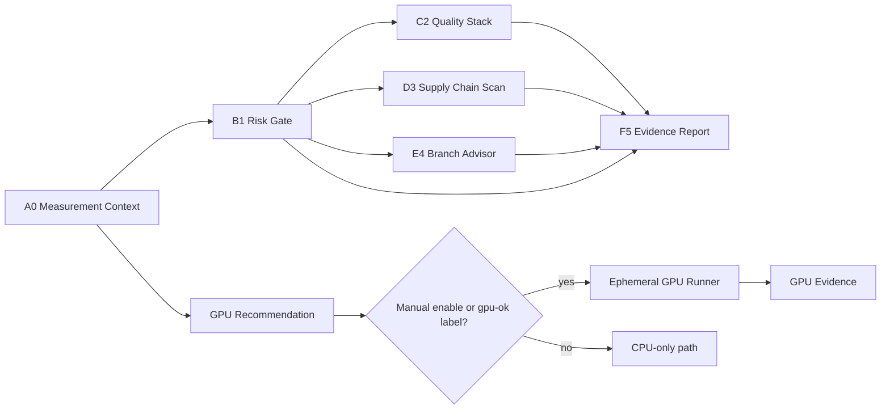

# Architecture

Mise Enhanced GPU Pack-a-Punch is a stacked workflow processor.

## Signal model

The system treats a repository like a measurement network:

| Coordinate | Meaning |
|---|---|
| A0 | Measure context before action. |
| B1 | Gate irreversible or risky changes. |
| C2 | Validate the changed repository with native tooling. |
| D3 | Surface dependency and supply-chain risk. |
| E4 | Advise branch/review ordering. |
| F5 | Preserve evidence for humans and agents. |

## Implementation model

- Node scripts perform repository measurement, policy checks, quality routing, supply-chain summaries, branch advice, and report generation.
- Python scripts perform complexity scoring, GPU preflight evidence, and GPU smoke tests.
- JSON policy files keep thresholds and sensitive path rules outside workflow YAML.
- Artifacts are uploaded as Markdown/JSON evidence instead of being committed back into the repository.
