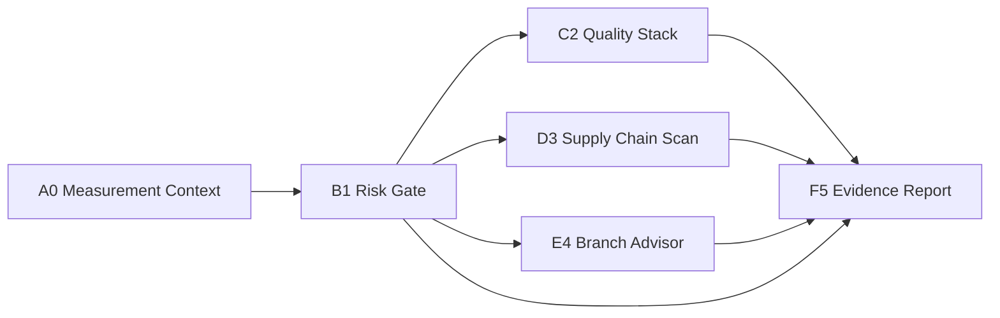

# Architecture

## Concept map

This project borrows the structure of a scientific measurement network: many imperfect signals are not treated as isolated truth claims; they are combined into one traceable evaluation path.

In repository terms:

- changed files = observed quantities
- quality checks = estimators
- secret scan = hard safety constraint
- workflow-file changes = covariance risk
- branch advisor = routing estimate
- evidence report = consensus output

## Why this shape works

A single linter cannot protect a repository. A single test command cannot decide branch readiness. A single branch-name heuristic cannot know whether a workflow change is safe. The Pack-a-Punch machine stacks these signals and keeps the final output explainable.

## Data flow

## Trust boundary

The trusted boundary is the workflow itself plus the policy file. Third-party repository code is treated as input. The workflow avoids privileged fork execution and avoids mutating repository content.
