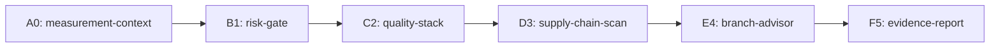

<!-- mise-pack-a-punch-report -->
# Mise Pack-a-Punch Workflow Machine Report

**Final state:** PASS

| Gate | Signal |
|---|---:|
| A0 measurement files | 15 |
| B1 risk level | pass |
| B1 risk score | 37/100 |
| C2 quality | pass |
| D3 supply chain | pass |
| E4 recommended branch | none |

## Stack Map

## Branch Advice

No branch recommendation available.

## Risk Blocks

- None

## Operating Rule

This workflow enhances repository quality by measuring, gating, testing, auditing, and reporting. It does not auto-commit, auto-merge, bypass protection, or run privileged fork code.
