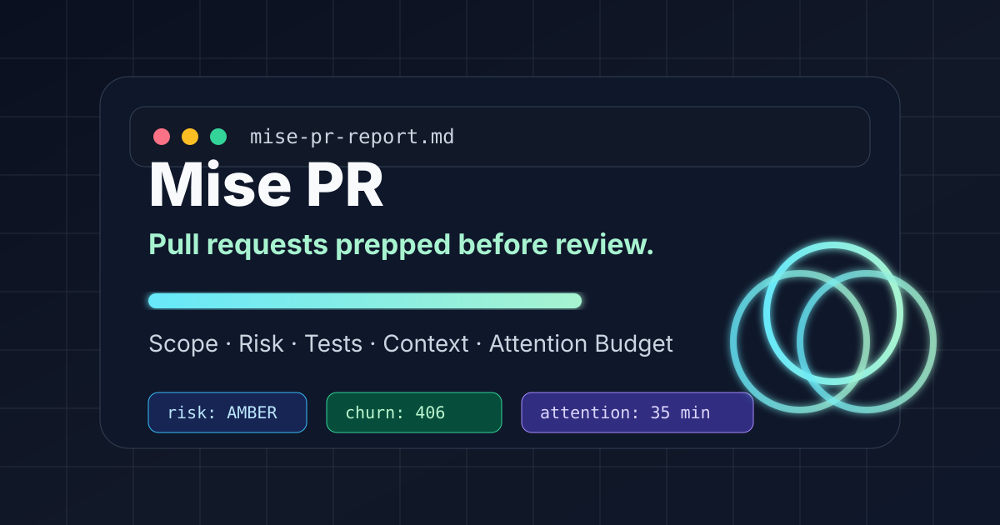

<p align="center">
  
</p>

<h1 align="center">Mise PR</h1>

<p align="center"><strong>Pull requests prepped before review.</strong></p>

<p align="center">
  <a href="#quick-start">Quick Start</a> ·
  <a href="#why-this-exists">Why</a> ·
  <a href="#what-it-checks">Checks</a> ·
  <a href="docs/product-hunt/PH-LAUNCH-KIT.md">Product Hunt Kit</a>
</p>

---

## What is Mise PR?

Mise PR is a lightweight GitHub Action that turns messy pull requests into clean, review-ready packets.

It does **not** try to be another AI code reviewer. It prepares the work before review begins:

- PR size and churn
- risky path detection
- missing tests
- weak descriptions
- missing issue/spec links
- changed-file map
- estimated reviewer attention budget
- a Markdown + JSON packet for humans, AI coding agents, and enterprise workflows

The core analyzer is deterministic, local, and free by default.

## Why this exists

AI coding agents made it easier to produce more code. They did not magically create more senior reviewer attention.

Most review tools ask: **“Is this code good?”**

Mise PR asks the earlier question: **“Is this PR even reviewable yet?”**

That small shift is the product wedge.

## Quick Start

Add this workflow to `.github/workflows/mise-pr.yml`:

```yaml
name: Mise PR

on:
  pull_request:
    types: [opened, synchronize, reopened, edited]

permissions:
  contents: read
  pull-requests: read
  issues: write

jobs:
  review-packet:
    runs-on: ubuntu-latest
    steps:
      - uses: actions/checkout@v4
        with:
          fetch-depth: 0
      - name: Generate review packet
        uses: GoodshytGroup/mise-pr@v0
        with:
          base-ref: origin/${{ github.base_ref }}
          head-ref: HEAD
          fail-on: red
          comment: true
```

Local usage:

```bash
python -m pip install .
mise-pr analyze --base origin/main --head HEAD --output mise-pr-report.md
```

## What it checks

| Signal | Why it matters |
|---|---|
| Files changed | Big PRs slow review and hide risk. |
| Churn | Large diffs need more attention. |
| Risky paths | Auth, payments, infra, migrations, secrets, and workflows deserve extra scrutiny. |
| Missing tests | Source changes without tests should be explained. |
| Weak PR description | Reviewers need intent, validation, and rollback context. |
| Missing issue/spec link | Reviewers need the original source of truth. |

## Example output

```md
## Mise PR Review Packet

Risk: AMBER · Score: 58/100 · Estimated attention: 35 min

### Scope
- Files changed: 9
- Additions: 312
- Deletions: 94
- Churn: 406
- Shape: source=5, test=1, config=2, docs=1

### Warnings
- Source changed without test files in the same PR.
- PR description is short; reviewers may lack intent, risk, and validation context.

### Recommended next moves
- Add tests, link existing coverage, or explain why tests are not required.
- Require explicit human review for risky paths: touches auth, touches payment.
```

## Configuration

Create `.mise-pr.yml`:

```yaml
max_files: 12
max_churn: 450
max_single_file_churn: 180
require_issue_link: true
require_tests_for_source: true
require_description: true
risky_path_patterns:
  - auth
  - security
  - payment
  - billing
  - migration
  - github/workflows
```

## Product tiers

### Open Source
- GitHub Action
- Local CLI
- Markdown + JSON output
- Deterministic risk scoring

### Team
- hosted GitHub App
- PR comments
- org policy templates
- review-readiness trends
- Slack/Linear/Jira routing

### Enterprise
- self-hosted mode
- SSO/SAML
- audit logs
- policy packs
- data residency controls
- custom risk rules

## Roadmap

- CODEOWNERS-aware reviewer routing
- AI-agent context handoff templates
- PR split suggestions
- GitHub App hosted dashboard
- Slack and Linear integrations
- policy packs for fintech, health, infra, and open source maintainers

## Product Hunt assets

Launch materials are included in [`docs/product-hunt`](docs/product-hunt):

- Product Hunt draft: [`product-hunt-draft.md`](docs/product-hunt/product-hunt-draft.md)
- Demo GIF: [`mise-pr-demo.gif`](docs/product-hunt/assets/mise-pr-demo.gif)
- Gallery images: [`assets/`](docs/product-hunt/assets)
- 60-second demo script: [`demo-video-script.md`](docs/product-hunt/demo-video-script.md)

## Publish to GitHub

Use the GitHub CLI helper after extracting this repo:

```bash
bash scripts/create-and-push-github.sh
```

See [`docs/github-publish.md`](docs/github-publish.md).

## License

Apache-2.0
