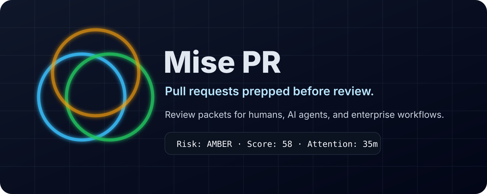
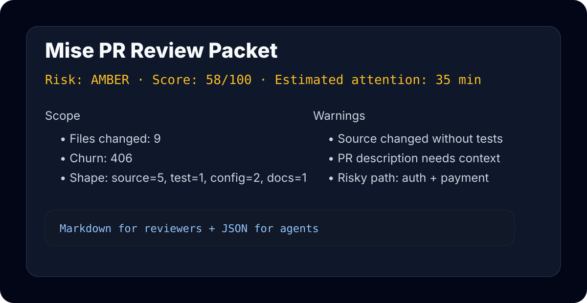
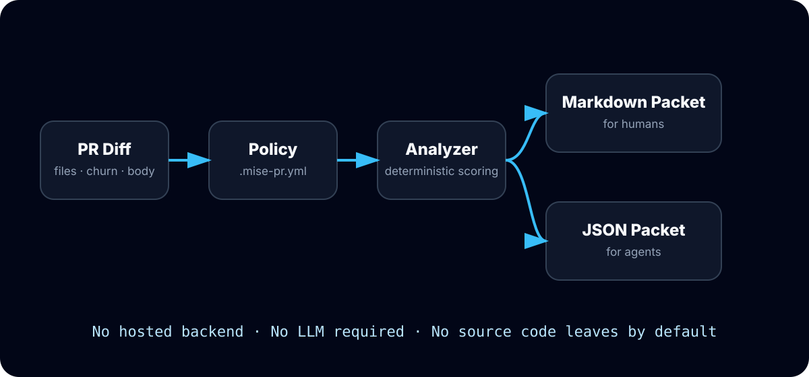

<p align="center">
  
</p>

<h1 align="center">Mise PR</h1>

<p align="center"><strong>Pull requests prepped before review.</strong></p>

<p align="center">
  <a href="https://github.com/DeontewattsV1/mise-pr/actions"></a>
  <a href="LICENSE"></a>
  <a href="docs/marketplace/MARKETPLACE_LISTING.md"></a>
  <a href="docs/product-hunt/product-hunt-draft.md"></a>
</p>

<p align="center">
  <a href="#quick-start">Quick Start</a> ·
  <a href="#why-this-exists">Why</a> ·
  <a href="#what-it-checks">Checks</a> ·
  <a href="#marketplace">Marketplace</a> ·
  <a href="docs/product-hunt/product-hunt-draft.md">Product Hunt Kit</a>
</p>

---

## What is Mise PR?

**Mise PR** is a lightweight GitHub Action and CLI that turns messy pull requests into clean, review-ready packets.

It does **not** try to be another AI code reviewer. It prepares the work before review begins.

Mise PR checks:

- PR size and churn
- risky paths such as auth, payments, infra, migrations, secrets, and workflows
- missing tests
- weak PR descriptions
- missing issue/spec links
- changed-file shape
- estimated reviewer attention budget

It outputs:

- one Markdown packet for human reviewers
- one JSON packet for AI agents, CI pipelines, and enterprise automation

The core analyzer is deterministic, local, and free by default.

<p align="center">
  
</p>

## Why this exists

AI coding agents made it easier to produce more code. They did not magically create more senior reviewer attention.

Most review tools ask:

> Is this code good?

Mise PR asks the earlier productivity question:

> Is this PR actually reviewable yet?

That is the product wedge: **review readiness before review judgment**.

## Quick Start

Create `.github/workflows/mise-pr.yml` in the repository where you want to use Mise PR:

```yaml
name: Mise PR

on:
  pull_request:
    types: [opened, synchronize, reopened, edited]

permissions:
  contents: read
  pull-requests: read
  issues: write

jobs:
  review-packet:
    runs-on: ubuntu-latest
    steps:
      - uses: actions/checkout@v4
        with:
          fetch-depth: 0
      - name: Generate review packet
        uses: DeontewattsV1/mise-pr@v0.1.0
        with:
          base-ref: origin/${{ github.base_ref }}
          head-ref: HEAD
          fail-on: red
          comment: true
```

A copyable workflow example also lives at [`docs/examples/workflows/mise-pr.yml`](docs/examples/workflows/mise-pr.yml).

### Local CLI

```bash
python -m pip install .
mise-pr analyze --base origin/main --head HEAD --output mise-pr-report.md --json-output mise-pr-report.json
```

## What it checks

| Signal | Why it matters |
|---|---|
| Files changed | Big PRs slow review and hide risk. |
| Churn | Large diffs require more reviewer attention. |
| Risky paths | Auth, payments, infra, migrations, secrets, and workflows need deliberate review. |
| Missing tests | Source changes without tests should be explained. |
| Weak PR description | Reviewers need intent, validation, and rollback context. |
| Missing issue/spec link | Reviewers need the original source of truth. |
| Attention budget | Teams need to know whether the PR fits a quick review or needs deeper focus. |

## Example output

```md
## Mise PR Review Packet

Risk: AMBER · Score: 58/100 · Estimated attention: 35 min

### Scope
- Files changed: 9
- Additions: 312
- Deletions: 94
- Churn: 406
- Shape: source=5, test=1, config=2, docs=1

### Warnings
- Source changed without test files in the same PR.
- PR description is short; reviewers may lack intent, risk, and validation context.

### Recommended next moves
- Add tests, link existing coverage, or explain why tests are not required.
- Require explicit human review for risky paths: touches auth, touches payment.
```

## Configuration

Create `.mise-pr.yml` in the repository using Mise PR:

```yaml
max_files: 12
max_churn: 450
max_single_file_churn: 180
require_issue_link: true
require_tests_for_source: true
require_description: true
risky_path_patterns:
  - auth
  - security
  - payment
  - billing
  - migration
  - github/workflows
generated_path_patterns:
  - dist/
  - build/
  - coverage/
  - node_modules/
  - package-lock.json
```

## Architecture

<p align="center">
  
</p>

Mise PR runs inside GitHub Actions. It reads local git metadata and the pull request event payload, scores review readiness, then writes Markdown and JSON outputs. No LLM is required. No source code is sent to an external service by default.

## Product tiers

### Open Source

- GitHub Action
- Local CLI
- Markdown + JSON output
- deterministic risk scoring

### Team

- hosted GitHub App
- org policy templates
- review-readiness trends
- Slack, Linear, and Jira routing

### Enterprise

- self-hosted mode
- SSO/SAML roadmap
- audit logs roadmap
- policy packs
- data residency controls
- custom risk rules

## Marketplace

Mise PR is packaged as a single-root GitHub Action with `action.yml` at the repository root. Marketplace launch copy, release instructions, and listing assets live in [`docs/marketplace`](docs/marketplace).

Important: GitHub Marketplace publishing still requires the repo owner to publish a GitHub Release and select **Publish this Action to the GitHub Marketplace** in GitHub's release UI.

## Launch assets

- Product Hunt draft: [`docs/product-hunt/product-hunt-draft.md`](docs/product-hunt/product-hunt-draft.md)
- Launch command center: [`LAUNCH-NOW-COMMAND-CENTER.md`](LAUNCH-NOW-COMMAND-CENTER.md)
- Marketplace listing: [`docs/marketplace/MARKETPLACE_LISTING.md`](docs/marketplace/MARKETPLACE_LISTING.md)
- Release notes: [`docs/releases/v0.1.0.md`](docs/releases/v0.1.0.md)
- Demo GIF: [`docs/product-hunt/assets/mise-pr-demo.gif`](docs/product-hunt/assets/mise-pr-demo.gif)
- Gallery assets: [`docs/product-hunt/upload-ready`](docs/product-hunt/upload-ready)

## Roadmap

- CODEOWNERS-aware reviewer routing
- PR split suggestions
- AI-agent context handoff templates
- hosted GitHub App dashboard
- Slack and Linear integrations
- enterprise policy packs for fintech, health, infra, and open source maintainers

## License

Apache-2.0
