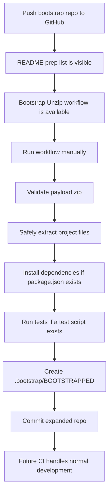

<p align="center">
  
</p>

<p align="center">
  
  
  
  
</p>

# Mise-en-Preplist Self-Unzip GitHub Bootstrap

A GitHub-ready bootstrap repository that works like a clean prep kitchen:

- the **README** is the prep list
- the **workflow** is the oven timer and expo rail
- the **payload zip** is the prepped ingredient box
- the **safe unzip script** is quality control
- the **final commit** is the plated project

Use this guide step by step. Do each station in order and check the boxes as you go.

---

## Brand Pantry

This repo includes a small brand kit so the project feels complete the moment it lands on GitHub.

```text
assets/brand/logo.svg
assets/brand/logo-dark.svg
assets/brand/logo-mark.svg
assets/brand/github-banner.svg
assets/brand/social-preview.svg
docs/BRAND_KIT.md
docs/REPO_COPY.md
docs/ASSET_INDEX.md
```

Use these assets for the README hero, GitHub social preview, repo avatar, release notes, and launch copy.

<details>
<summary>Brand quick use</summary>

- Use `assets/brand/github-banner.svg` at the top of the README.
- Use `assets/brand/logo-mark.svg` as the square repo/avatar mark.
- Use `assets/brand/social-preview.svg` for GitHub social preview after exporting to PNG if needed.
- Use `docs/BRAND_KIT.md` for color, voice, tagline, and badge guidance.
- Use `docs/REPO_COPY.md` for GitHub About text, launch posts, and short descriptions.

</details>

---

## Station Map

This repo starts small, then expands itself into a working project after you push it to GitHub and run the bootstrap workflow.

```text
README.md
.github/workflows/bootstrap-unzip.yml
.github/workflows/ci.yml
scripts/safe_unzip.py
bootstrap/payload.zip
bootstrap/payload-manifest.txt
docs/BOOTSTRAP_ORDER.md
.gitignore
LICENSE
```

When the prep run starts, GitHub Actions will:

- [ ] confirm `bootstrap/payload.zip` exists
- [ ] list the payload ingredients from `bootstrap/payload-manifest.txt`
- [ ] reject unsafe zip paths like `../secret` or absolute paths
- [ ] safely unpack the payload into the repo root
- [ ] install dependencies when `package.json` exists
- [ ] run tests when a test script exists
- [ ] write `.bootstrap/BOOTSTRAPPED`
- [ ] commit the expanded project back to the same branch

---

## Mise-en-Preplist

Use this as the operating checklist before the project goes into service.

### Station 1 — Pull the ingredients

- [ ] Download or unzip this repository package.
- [ ] Open a terminal inside the project folder.
- [ ] Confirm the required prep tools exist:

```bash
ls README.md .github/workflows/bootstrap-unzip.yml bootstrap/payload.zip scripts/safe_unzip.py
```

Expected result:

```text
README.md
.github/workflows/bootstrap-unzip.yml
bootstrap/payload.zip
scripts/safe_unzip.py
```

<details>
<summary>What this station proves</summary>

This confirms the four required pieces are on the board: the operating guide, the GitHub automation, the compressed payload, and the safe extraction script.

</details>

---

### Station 2 — Set up the GitHub kitchen

- [ ] Go to GitHub.
- [ ] Create a new empty repository.
- [ ] Do **not** initialize it with another README, license, or `.gitignore`.
- [ ] Copy the repository URL.

Example remote URL:

```text
https://github.com/<your-user>/<your-repo>.git
```

<details>
<summary>Why the repo should start empty</summary>

This package already brings its own README, license, `.gitignore`, workflows, bootstrap files, and payload. Starting empty prevents merge conflicts during the first push.

</details>

---

### Station 3 — Fire the first push

Run these commands from the project folder:

```bash
git init
git add .
git commit -m "init: mise-en-preplist bootstrap repo"
git branch -M main
git remote add origin https://github.com/<your-user>/<your-repo>.git
git push -u origin main
```

Then verify the repo is stocked:

- [ ] `README.md` appears on the repo homepage.
- [ ] `.github/workflows/bootstrap-unzip.yml` exists.
- [ ] `bootstrap/payload.zip` exists.
- [ ] The **Actions** tab is visible.

<details>
<summary>If git says the branch already exists</summary>

Use this:

```bash
git branch -M main
git push -u origin main
```

</details>

<details>
<summary>If the remote already exists</summary>

Check the current remote:

```bash
git remote -v
```

Replace it if needed:

```bash
git remote set-url origin https://github.com/<your-user>/<your-repo>.git
```

</details>

---

### Station 4 — Check workflow permissions

Before running the bootstrap workflow:

- [ ] Open the GitHub repository.
- [ ] Go to **Settings**.
- [ ] Go to **Actions**.
- [ ] Go to **General**.
- [ ] Under **Workflow permissions**, select **Read and write permissions** if your repo or organization requires it.
- [ ] Save the setting.

<details>
<summary>Why this station matters</summary>

The bootstrap workflow needs permission to commit the expanded files back into the repository. The workflow already requests:

```yaml
permissions:
  contents: write
```

Some repositories or organizations still require the repository setting to allow write access before that permission can be used.

</details>

---

### Station 5 — Run the prep service

Use the GitHub UI:

```text
Actions → Bootstrap Unzip → Run workflow → Run workflow
```

Watch the workflow stations in this order:

- [ ] Checkout repository
- [ ] Stop if already bootstrapped
- [ ] Verify payload exists
- [ ] List payload manifest
- [ ] Safely extract payload
- [ ] Write bootstrap marker
- [ ] Set up Node when `package.json` exists
- [ ] Install dependencies when `package.json` exists
- [ ] Run tests when `package.json` defines a test script
- [ ] Commit expanded repository

<details>
<summary>What a clean service looks like</summary>

After the workflow finishes, GitHub should show a new commit named:

```text
chore: unzip bootstrap payload
```

The repository should now contain the extracted payload files, including the starter app files from `bootstrap/payload.zip`.

</details>

<details>
<summary>If the workflow button does not appear</summary>

The workflow must exist on the default branch before GitHub shows manual run controls. Confirm that `.github/workflows/bootstrap-unzip.yml` is committed to `main`, then refresh the **Actions** tab.

</details>

---

## Correct Service Order

The repository is designed to run like a clean line:

```text
01 README deployed
02 GitHub workflow available
03 Payload archive detected
04 Payload manifest listed
05 Payload safety validation passed
06 Payload extracted into repo root
07 Bootstrap marker written
08 Dependencies installed when needed
09 Tests executed when available
10 Expanded repository committed
11 Normal CI takes over for future pushes and PRs
```



---

## After-Service Operating Flow

After the first successful bootstrap, use the repo like a normal project.

### Daily line check

```bash
git pull origin main
npm install
npm test
```

### Make a new feature

```bash
git checkout -b feature/my-change
git add .
git commit -m "feat: describe the change"
git push -u origin feature/my-change
```

Then open a pull request on GitHub. The normal CI workflow will run automatically.

---

## Replace the Payload Ingredients

Use this when you want the repo to unzip a different app, starter kit, or project template.

### 1. Create a payload prep folder

```bash
mkdir -p payload-src
```

Place your project files inside `payload-src`.

Example:

```text
payload-src/
  package.json
  src/
  test/
  docs/
```

### 2. Build a new payload zip

From inside `payload-src`:

```bash
cd payload-src
zip -r ../bootstrap/payload.zip .
cd ..
```

### 3. Update the manifest ticket

```bash
python3 - <<'PY'
import zipfile
from pathlib import Path

payload = Path("bootstrap/payload.zip")
manifest = Path("bootstrap/payload-manifest.txt")

with zipfile.ZipFile(payload) as zf:
    names = sorted(name for name in zf.namelist() if not name.endswith("/"))

manifest.write_text("\n".join(names) + "\n", encoding="utf-8")
print(manifest.read_text())
PY
```

### 4. Commit the new payload box

```bash
git add bootstrap/payload.zip bootstrap/payload-manifest.txt
git commit -m "chore: update bootstrap payload"
git push
```

### 5. Re-run the prep service with force

```text
Actions → Bootstrap Unzip → Run workflow → force = true → Run workflow
```

---

## Re-running the Bootstrap

The workflow stops automatically if this marker exists:

```text
.bootstrap/BOOTSTRAPPED
```

To run anyway:

```text
Actions → Bootstrap Unzip → Run workflow → force = true
```

Use `force = true` only when you intentionally want to re-extract the payload.

---

## Food Safety Rules for the Zip

The script `scripts/safe_unzip.py` protects the repo by rejecting risky archive entries.

Blocked examples:

```text
../outside-file
/absolute/path
folder/../../escape
```

Allowed examples:

```text
package.json
src/index.js
test/index.test.js
docs/APP_README.md
```

<details>
<summary>Why this safety layer exists</summary>

Zip files can contain paths that try to write outside the target folder. This repo validates the archive before extraction so the workflow does not blindly unpack unsafe paths.

</details>

---

## Troubleshooting: Line Cook Notes

### Workflow fails with permission denied

Check:

- [ ] Repository settings allow GitHub Actions to write.
- [ ] The workflow contains `permissions: contents: write`.
- [ ] Branch protection is not blocking direct workflow commits.

If branch protection blocks commits, use a pull-request based workflow instead of direct pushes.

---

### Workflow says repository is already bootstrapped

That means this marker exists:

```text
.bootstrap/BOOTSTRAPPED
```

Run the workflow manually with:

```text
force = true
```

---

### Payload extraction fails

Check the payload contents:

```bash
python3 - <<'PY'
import zipfile
with zipfile.ZipFile("bootstrap/payload.zip") as zf:
    for name in zf.namelist():
        print(name)
PY
```

Look for unsafe paths such as:

```text
../
/absolute/path
```

Rebuild the payload zip from inside the project folder instead of zipping the parent folder.

---

### Tests fail after extraction

Run locally:

```bash
npm install
npm test
```

Then fix the app or test files before running the workflow again.

---

## Operator Quick Reference

| Goal | Mise-en-preplist action |
|---|---|
| First-time deploy | Push repo to GitHub, then run **Bootstrap Unzip** |
| Re-run bootstrap | Run workflow with `force = true` |
| Replace project files | Rebuild `bootstrap/payload.zip` |
| Verify payload contents | Read `bootstrap/payload-manifest.txt` |
| Check bootstrap status | Look for `.bootstrap/BOOTSTRAPPED` |
| Run normal validation | Push or open a PR and let CI run |

---

## File Station Map

```text
.github/workflows/bootstrap-unzip.yml  # Main self-unzip automation
.github/workflows/ci.yml               # Normal CI after bootstrap
scripts/safe_unzip.py                  # Safe archive extraction script
bootstrap/payload.zip                  # Compressed project payload
bootstrap/payload-manifest.txt         # Human-readable payload file list
docs/BOOTSTRAP_ORDER.md                # Execution order reference
README.md                              # Mise-en-preplist operating guide
```

---

## Clean First Service

For the smoothest first run:

- [ ] Push the repo to `main`.
- [ ] Confirm Actions are enabled.
- [ ] Run **Bootstrap Unzip** manually.
- [ ] Confirm the workflow commits expanded files.
- [ ] Pull the new commit locally:

```bash
git pull origin main
```

Then continue development normally.
