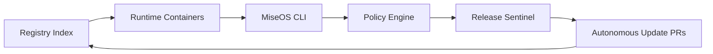

# MiseOS Bootstrap Registry

**Everything in its place before it hits production.**

The MiseOS Bootstrap Registry is the bootloader for the MiseOS operating system. It provides a trusted, machine-readable catalog for packages, containers, agents, workflows, policies, templates, and release metadata.

This repository is designed to answer eight questions for every registered capability:

1. What is this?
2. What does it do?
3. Who owns it?
4. What permissions does it need?
5. What package registry hosts it?
6. What changed since the last version?
7. Is it safe to use?
8. Can an agent execute it without guessing?

## Core boot sequence



## Primary artifacts

| Layer | Artifact | Purpose |
|---|---|---|
| Repository | `miseos-bootstrap-registry` | Canonical index, schemas, manifests, workflows, and docs |
| Primary package | `@miseos/cli` | CLI for validating, inspecting, syncing, and bootstrapping MiseOS |
| Primary container | `ghcr.io/mise-os/miseos-runner` | Stable runtime image for validation, policy checks, and automation |
| Primary automation | `@miseos/release-sentinel` | Scheduled drift detection and update PR generator |
| Governance layer | `@miseos/policy-engine` | Safety, permissions, provenance, and registry policy enforcement |

## Launch phases

### Phase 1 — Bootstrap

- Create `miseos-bootstrap-registry`
- Add `registry/index.json`
- Add schemas
- Add package manifests
- Add validation workflow

### Phase 2 — Runtime

- Publish `ghcr.io/mise-os/miseos-runner`
- Publish `ghcr.io/mise-os/miseos-policy-checker`
- Publish `ghcr.io/mise-os/miseos-docs-builder`

### Phase 3 — Developer tools

- Publish `@miseos/cli`
- Publish `@miseos/agent-sdk`
- Publish `@miseos/policy-engine`

### Phase 4 — Autonomy

- Publish `@miseos/release-sentinel`
- Add scheduled release scan workflow
- Open automated PRs for registry drift

### Phase 5 — Expansion

- Add RubyGems, Maven, Gradle, and NuGet lanes

## Quick start

```bash
corepack enable
pnpm install
pnpm validate
pnpm test
```

Bootstrap locally:

```bash
pnpm --filter @miseos/cli miseos doctor
pnpm --filter @miseos/cli miseos registry validate
pnpm --filter @miseos/cli miseos registry inspect
```

Build the runner container:

```bash
docker build -t ghcr.io/mise-os/miseos-runner:local containers/runner
```

## Registry layout

```txt
registry/
  index.json                 # Canonical machine-readable registry
  manifests/                 # One manifest per capability
schemas/
  mise.registry.schema.json  # Strict registry entry schema
docs/
  trust-model.md
  package-lifecycle.md
  naming-conventions.md
  launch-plan.md
packages/
  cli/
  agent-sdk/
  policy-engine/
  release-sentinel/
  repo-steward/
containers/
  runner/
  policy-checker/
  docs-builder/
.github/workflows/
  validate-registry.yml
  publish-npm.yml
  publish-container.yml
  release-sentinel.yml
```

## Trust model

The registry is intentionally strict. Every entry must define:

- Stable ID
- Owner
- Type
- Version
- Artifact locations
- Required permissions
- Trust requirements
- Safety gates
- Change policy
- Agent execution contract

Agents should treat missing metadata as a failed validation, not an invitation to guess.

## Default safety posture

- No silent permission expansion
- No major updates without review
- No untracked package source changes
- No unsafe autonomous execution
- No release promotion without manifest validation
- No registry drift without a visible issue or pull request

## GitHub Packages lanes

| Lane | Registry | MiseOS usage |
|---|---|---|
| Container | `ghcr.io` | Runtime images, scanners, validators, agent runners |
| npm | `npm.pkg.github.com` | CLI, TypeScript SDKs, agent packages, policy libraries |
| RubyGems | `rubygems.pkg.github.com` | Ruby automation helpers |
| Maven / Gradle | `maven.pkg.github.com` | JVM libraries and Gradle plugins |
| NuGet | `nuget.pkg.github.com` | .NET clients and registry integrations |

## Token-light principle

This repo stores compact machine-readable manifests. Agents should load only the specific manifest, schema, and policy they need for the current task. Avoid full-repo context loading unless performing a registry audit.

## License

Apache-2.0. See [`LICENSE`](LICENSE).
