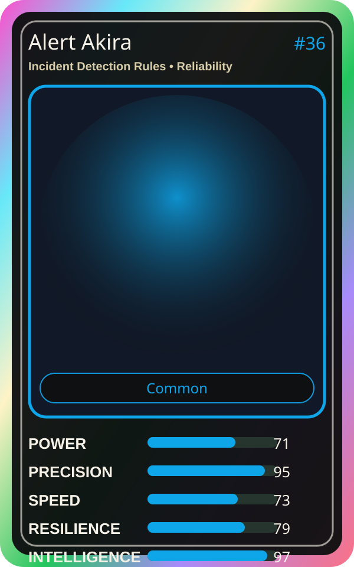

# Alert Akira

| Field | Value |
|---|---|
| Mise Name | `Mise IncidentDetectionRules` |
| Codename | `chef.reliability.incident-detection-rules` |
| Department | Reliability Kitchen |
| Role | Incident Detection Rules |
| Rarity | Common |
| Universe | MiseOS Core 75 |
| Source | `characters.generated.json` |

## Mission

Runs incident detection rules for repository operations, producing evidence-first results before any risky change is allowed.

## Signature

> Incident Detection Rules done cleanly, safely, and in rhythm.

## Inputs

- repository state
- mise policy
- event context

## Outputs

- status report
- evidence packet
- next-action recommendation

## Syncs With

Canary Judge, Pager Hiro, Seira Scan, Vault Hana

## Stats

| Stat | Score |
|---|---:|
| Power | 71 |
| Precision | 95 |
| Speed | 73 |
| Resilience | 79 |
| Intelligence | 97 |
| Teamwork | 93 |

