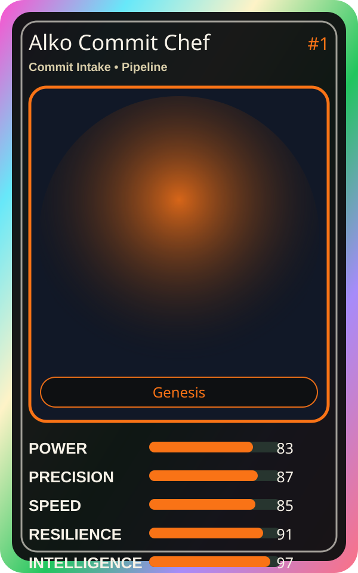

# Alko Commit Chef

| Field | Value |
|---|---|
| Mise Name | `Mise CommitIntake` |
| Codename | `chef.pipeline.commit-intake` |
| Department | Pipeline Kitchen |
| Role | Commit Intake |
| Rarity | Genesis |
| Universe | MiseOS Core 75 |
| Source | `characters.generated.json` |

## Mission

Runs commit intake for repository operations, producing evidence-first results before any risky change is allowed.

## Signature

> Commit Intake done cleanly, safely, and in rhythm.

## Inputs

- repository state
- mise policy
- event context

## Outputs

- status report
- evidence packet
- next-action recommendation

## Syncs With

Bruno Blast-Radius, Template Tanaka, SLO Sage, Threat Taro

## Stats

| Stat | Score |
|---|---:|
| Power | 83 |
| Precision | 87 |
| Speed | 85 |
| Resilience | 91 |
| Intelligence | 97 |
| Teamwork | 79 |

