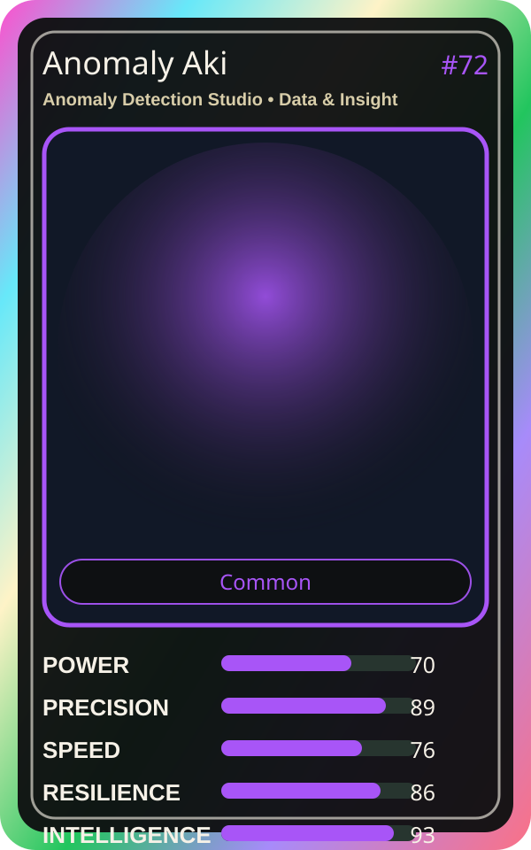

# Anomaly Aki

| Field | Value |
|---|---|
| Mise Name | `Mise AnomalyDetectionStudio` |
| Codename | `chef.data-insight.anomaly-detection-studio` |
| Department | Data & Insight Kitchen |
| Role | Anomaly Detection Studio |
| Rarity | Common |
| Universe | MiseOS Core 75 |
| Source | `characters.generated.json` |

## Mission

Runs anomaly detection studio for repository operations, producing evidence-first results before any risky change is allowed.

## Signature

> Anomaly Detection Studio done cleanly, safely, and in rhythm.

## Inputs

- repository state
- mise policy
- event context

## Outputs

- status report
- evidence packet
- next-action recommendation

## Syncs With

Apprentice Kai, Leaderboard Leo, Tariq Notesmith, Preview Yuki

## Stats

| Stat | Score |
|---|---:|
| Power | 70 |
| Precision | 89 |
| Speed | 76 |
| Resilience | 86 |
| Intelligence | 93 |
| Teamwork | 84 |

