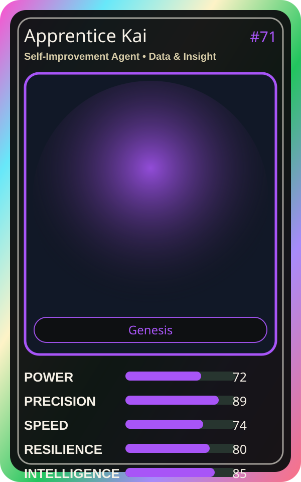

# Apprentice Kai

| Field | Value |
|---|---|
| Mise Name | `Mise SelfImprovementAgent` |
| Codename | `chef.data-insight.self-improvement-agent` |
| Department | Data & Insight Kitchen |
| Role | Self-Improvement Agent |
| Rarity | Genesis |
| Universe | MiseOS Core 75 |
| Source | `characters.generated.json` |

## Mission

Runs self-improvement agent for repository operations, producing evidence-first results before any risky change is allowed.

## Signature

> Self-Improvement Agent done cleanly, safely, and in rhythm.

## Inputs

- repository state
- mise policy
- event context

## Outputs

- status report
- evidence packet
- next-action recommendation

## Syncs With

Risk Ryota, Anomaly Aki, Felix Rollback, Streama

## Stats

| Stat | Score |
|---|---:|
| Power | 72 |
| Precision | 89 |
| Speed | 74 |
| Resilience | 80 |
| Intelligence | 85 |
| Teamwork | 96 |

