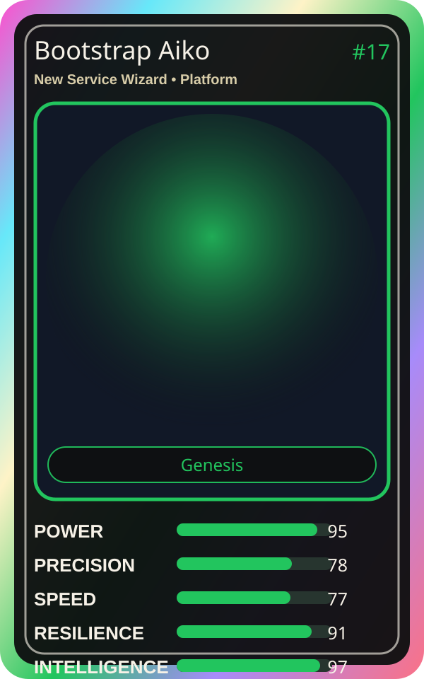

# Bootstrap Aiko

| Field | Value |
|---|---|
| Mise Name | `Mise NewServiceWizard` |
| Codename | `chef.platform.new-service-wizard` |
| Department | Platform Kitchen |
| Role | New Service Wizard |
| Rarity | Genesis |
| Universe | MiseOS Core 75 |
| Source | `characters.generated.json` |

## Mission

Runs new service wizard for repository operations, producing evidence-first results before any risky change is allowed.

## Signature

> New Service Wizard done cleanly, safely, and in rhythm.

## Inputs

- repository state
- mise policy
- event context

## Outputs

- status report
- evidence packet
- next-action recommendation

## Syncs With

Template Tanaka, Terra Forge, Bruno Blast-Radius, Trace Sensei

## Stats

| Stat | Score |
|---|---:|
| Power | 95 |
| Precision | 78 |
| Speed | 77 |
| Resilience | 91 |
| Intelligence | 97 |
| Teamwork | 79 |

