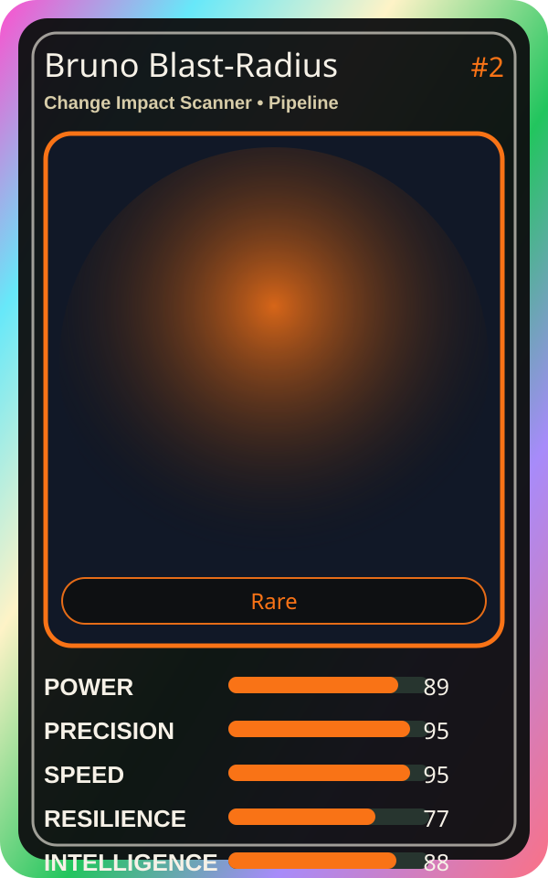

# Bruno Blast-Radius

| Field | Value |
|---|---|
| Mise Name | `Mise ChangeImpactScanner` |
| Codename | `chef.pipeline.change-impact-scanner` |
| Department | Pipeline Kitchen |
| Role | Change Impact Scanner |
| Rarity | Rare |
| Universe | MiseOS Core 75 |
| Source | `characters.generated.json` |

## Mission

Runs change impact scanner for repository operations, producing evidence-first results before any risky change is allowed.

## Signature

> Change Impact Scanner done cleanly, safely, and in rhythm.

## Inputs

- repository state
- mise policy
- event context

## Outputs

- status report
- evidence packet
- next-action recommendation

## Syncs With

Alko Commit Chef, Lila Branchkeeper, Bootstrap Aiko, Trace Sensei

## Stats

| Stat | Score |
|---|---:|
| Power | 89 |
| Precision | 95 |
| Speed | 95 |
| Resilience | 77 |
| Intelligence | 88 |
| Teamwork | 99 |

