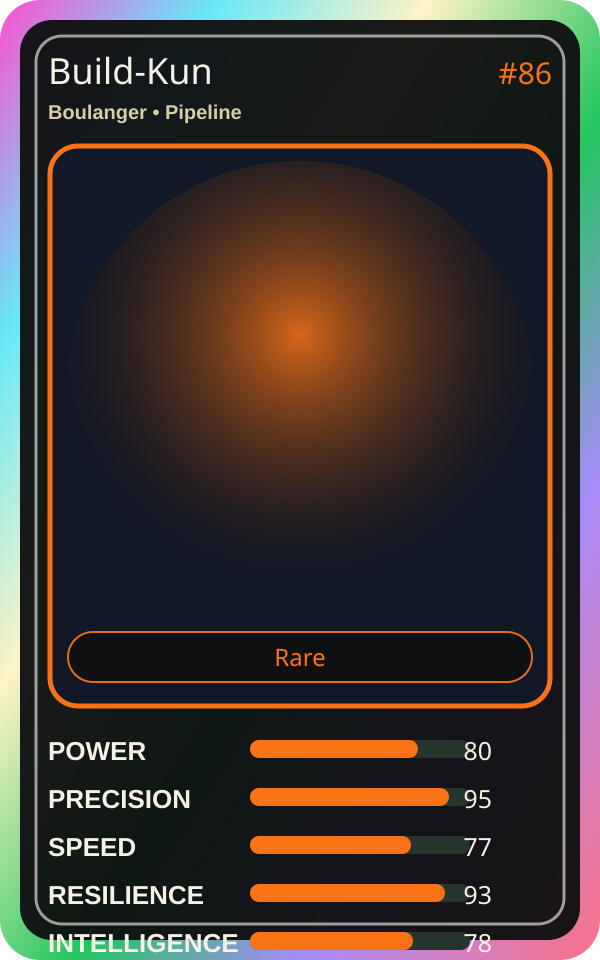

# Build-Kun

| Field | Value |
|---|---|
| Mise Name | `Mise Build` |
| Codename | `chef.pipeline.build` |
| Department | Pipeline Kitchen |
| Role | Boulanger |
| Rarity | Rare |
| Universe | Mise Orchestra Expansion |
| Source | `mise_orchestra_cards.csv` |

## Mission

Bakes container images fresh and fully. Always experimenting.

## Signature

> Build-Kun keeps the kitchen rhythm clean, useful, and observable.

## Inputs

- repository state
- incident context
- team signal

## Outputs

- status report
- next-action recommendation
- clean handoff

## Syncs With

Flash Riku, Alko Commit Chef

## Stats

| Stat | Score |
|---|---:|
| Power | 80 |
| Precision | 95 |
| Speed | 77 |
| Resilience | 93 |
| Intelligence | 78 |
| Teamwork | 72 |

## Season 1 Trading Card Overlay

| Field | Value |
|---|---|
| Function | Build |
| Element | Container Dough |
| Ability | Image Bake |
| Lore | Bakes container images fresh and fully. Always experimenting. |
| Source image | `cards/png/013-build-kun.png` |
| Metadata | `metadata/erc721/013-build-kun.json` |

