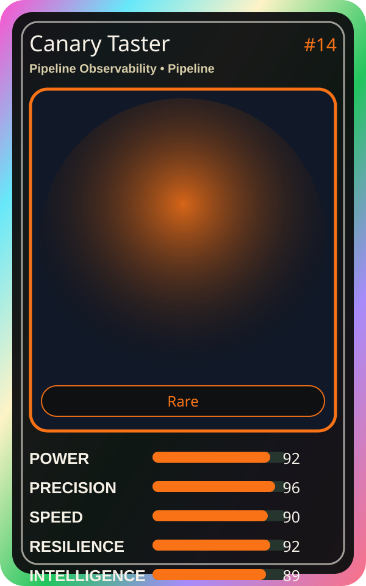

# Canary Taster

| Field | Value |
|---|---|
| Mise Name | `Mise PipelineObservability` |
| Codename | `chef.pipeline.pipeline-observability` |
| Department | Pipeline Kitchen |
| Role | Pipeline Observability |
| Rarity | Rare |
| Universe | MiseOS Core 75 |
| Source | `characters.generated.json` |

## Mission

Runs pipeline observability for repository operations, producing evidence-first results before any risky change is allowed.

## Signature

> Pipeline Observability done cleanly, safely, and in rhythm.

## Inputs

- repository state
- mise policy
- event context

## Outputs

- status report
- evidence packet
- next-action recommendation

## Syncs With

Ivun Cache, Pipeline Sensei, Guardrail Goro, Impact Ichi

## Stats

| Stat | Score |
|---|---:|
| Power | 92 |
| Precision | 96 |
| Speed | 90 |
| Resilience | 92 |
| Intelligence | 89 |
| Teamwork | 82 |

## Season 1 Trading Card Overlay

| Field | Value |
|---|---|
| Function | Test |
| Element | Canary Signal |
| Ability | First Bite Test |
| Lore | Tests the waters first. Ensures safe rollouts with canary releases. |
| Source image | `cards/png/016-canary-taster.png` |
| Metadata | `metadata/erc721/016-canary-taster.json` |

