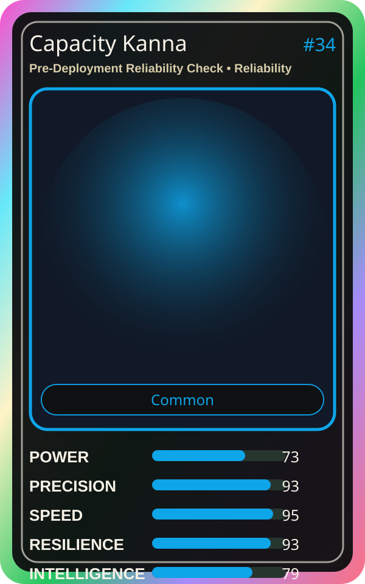

# Capacity Kanna

| Field | Value |
|---|---|
| Mise Name | `Mise PreDeploymentReliabilityCheck` |
| Codename | `chef.reliability.pre-deployment-reliability-check` |
| Department | Reliability Kitchen |
| Role | Pre-Deployment Reliability Check |
| Rarity | Common |
| Universe | MiseOS Core 75 |
| Source | `characters.generated.json` |

## Mission

Runs pre-deployment reliability check for repository operations, producing evidence-first results before any risky change is allowed.

## Signature

> Pre-Deployment Reliability Check done cleanly, safely, and in rhythm.

## Inputs

- repository state
- mise policy
- event context

## Outputs

- status report
- evidence packet
- next-action recommendation

## Syncs With

Chaos Kaito, Canary Judge, Omar Reviewer, Schema Sora

## Stats

| Stat | Score |
|---|---:|
| Power | 73 |
| Precision | 93 |
| Speed | 95 |
| Resilience | 93 |
| Intelligence | 79 |
| Teamwork | 91 |

