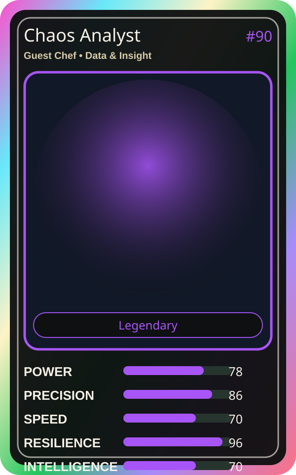

# Chaos Analyst

| Field | Value |
|---|---|
| Mise Name | `Mise Learn` |
| Codename | `chef.data-insight.learn` |
| Department | Data & Insight Kitchen |
| Role | Guest Chef |
| Rarity | Legendary |
| Universe | Mise Orchestra Expansion |
| Source | `mise_orchestra_cards.csv` |

## Mission

Embraces the chaos. Turns incidents into opportunities.

## Signature

> Chaos Analyst keeps the kitchen rhythm clean, useful, and observable.

## Inputs

- repository state
- incident context
- team signal

## Outputs

- status report
- next-action recommendation
- clean handoff

## Syncs With

Insight Sensei, Growth Guru

## Stats

| Stat | Score |
|---|---:|
| Power | 78 |
| Precision | 86 |
| Speed | 70 |
| Resilience | 96 |
| Intelligence | 70 |
| Teamwork | 91 |

## Season 1 Trading Card Overlay

| Field | Value |
|---|---|
| Function | Learn |
| Element | Kitsune Chaos |
| Ability | Postmortem Bloom |
| Lore | Embraces the chaos. Turns incidents into opportunities. |
| Source image | `cards/png/021-chaos-analyst.png` |
| Metadata | `metadata/erc721/021-chaos-analyst.json` |

