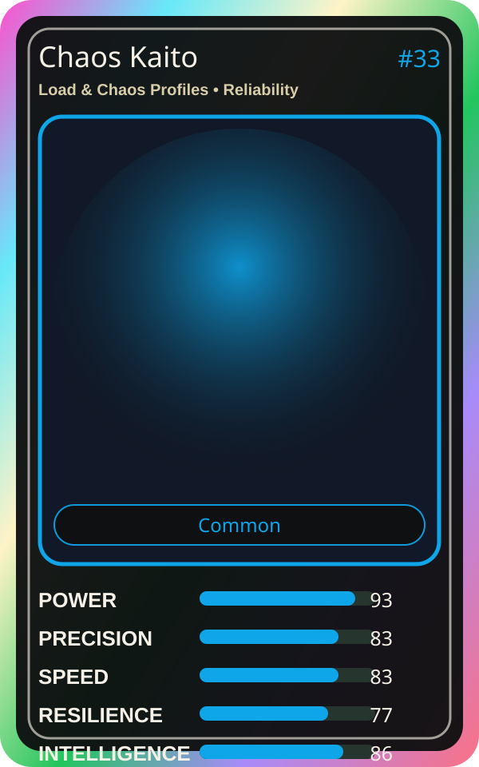

# Chaos Kaito

| Field | Value |
|---|---|
| Mise Name | `Mise LoadChaosProfiles` |
| Codename | `chef.reliability.load-chaos-profiles` |
| Department | Reliability Kitchen |
| Role | Load & Chaos Profiles |
| Rarity | Common |
| Universe | MiseOS Core 75 |
| Source | `characters.generated.json` |

## Mission

Runs load & chaos profiles for repository operations, producing evidence-first results before any risky change is allowed.

## Signature

> Load and Chaos Profiles done cleanly, safely, and in rhythm.

## Inputs

- repository state
- mise policy
- event context

## Outputs

- status report
- evidence packet
- next-action recommendation

## Syncs With

Trace Sensei, Capacity Kanna, Lila Branchkeeper, Terra Forge

## Stats

| Stat | Score |
|---|---:|
| Power | 93 |
| Precision | 83 |
| Speed | 83 |
| Resilience | 77 |
| Intelligence | 86 |
| Teamwork | 93 |

