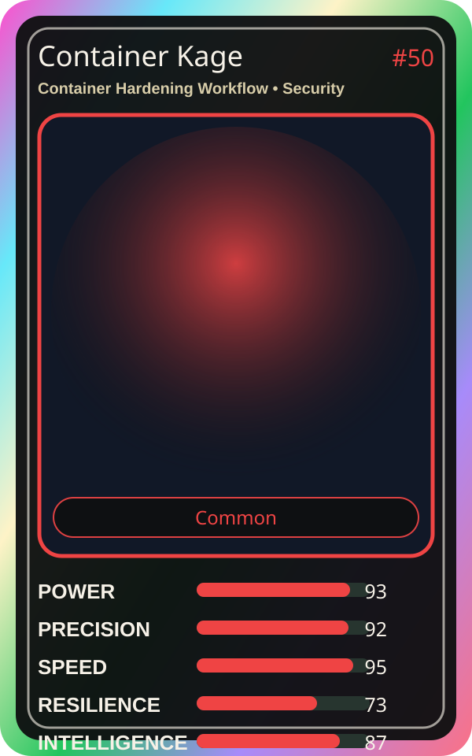

# Container Kage

| Field | Value |
|---|---|
| Mise Name | `Mise ContainerHardeningWorkflow` |
| Codename | `chef.security.container-hardening-workflow` |
| Department | Security Kitchen |
| Role | Container Hardening Workflow |
| Rarity | Common |
| Universe | MiseOS Core 75 |
| Source | `characters.generated.json` |

## Mission

Runs container hardening workflow for repository operations, producing evidence-first results before any risky change is allowed.

## Signature

> Container Hardening Workflow done cleanly, safely, and in rhythm.

## Inputs

- repository state
- mise policy
- event context

## Outputs

- status report
- evidence packet
- next-action recommendation

## Syncs With

CVE Kumo, Seira Vaultkeeper, Hugo Matrix, Runtime Riku

## Stats

| Stat | Score |
|---|---:|
| Power | 93 |
| Precision | 92 |
| Speed | 95 |
| Resilience | 73 |
| Intelligence | 87 |
| Teamwork | 99 |

