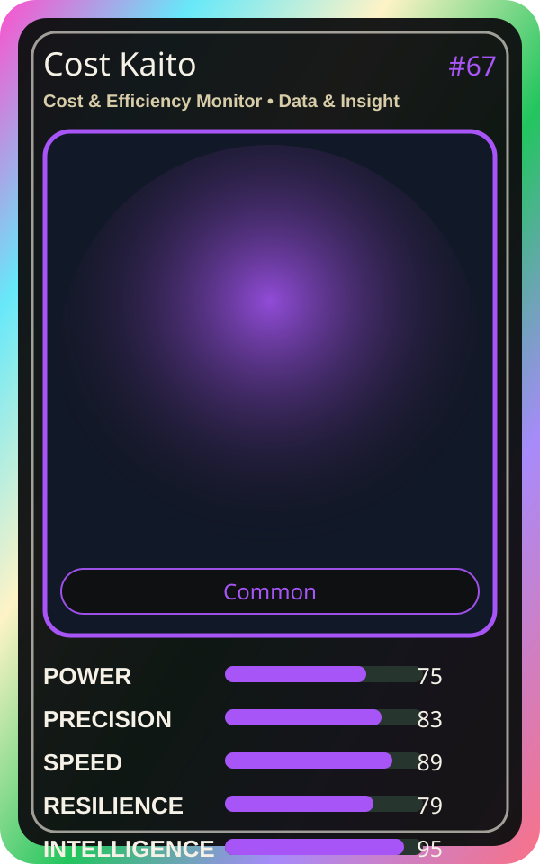

# Cost Kaito

| Field | Value |
|---|---|
| Mise Name | `Mise CostEfficiencyMonitor` |
| Codename | `chef.data-insight.cost-efficiency-monitor` |
| Department | Data & Insight Kitchen |
| Role | Cost & Efficiency Monitor |
| Rarity | Common |
| Universe | MiseOS Core 75 |
| Source | `characters.generated.json` |

## Mission

Runs cost & efficiency monitor for repository operations, producing evidence-first results before any risky change is allowed.

## Signature

> Cost and Efficiency Monitor done cleanly, safely, and in rhythm.

## Inputs

- repository state
- mise policy
- event context

## Outputs

- status report
- evidence packet
- next-action recommendation

## Syncs With

Flag Fox, DX Mei, Yume Builder, Policy Kenji

## Stats

| Stat | Score |
|---|---:|
| Power | 75 |
| Precision | 83 |
| Speed | 89 |
| Resilience | 79 |
| Intelligence | 95 |
| Teamwork | 87 |

