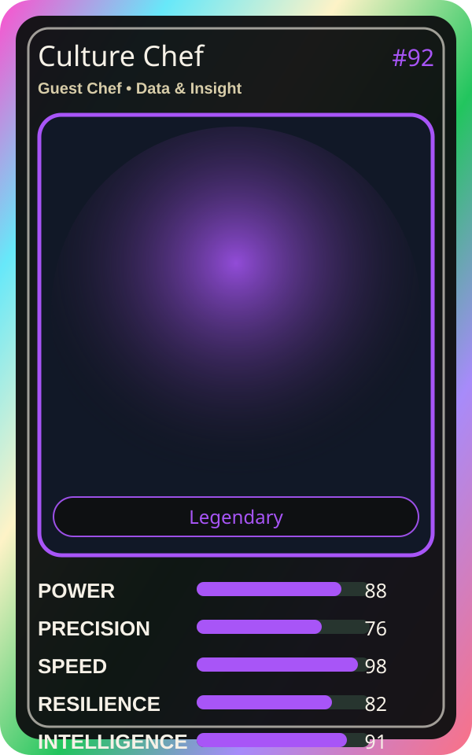

# Culture Chef

| Field | Value |
|---|---|
| Mise Name | `Mise Grow` |
| Codename | `chef.data-insight.grow` |
| Department | Data & Insight Kitchen |
| Role | Guest Chef |
| Rarity | Legendary |
| Universe | Mise Orchestra Expansion |
| Source | `mise_orchestra_cards.csv` |

## Mission

Nurtures the team and culture. Happy chefs cook best.

## Signature

> Culture Chef keeps the kitchen rhythm clean, useful, and observable.

## Inputs

- repository state
- incident context
- team signal

## Outputs

- status report
- next-action recommendation
- clean handoff

## Syncs With

Growth Guru, Taxonomy Taka

## Stats

| Stat | Score |
|---|---:|
| Power | 88 |
| Precision | 76 |
| Speed | 98 |
| Resilience | 82 |
| Intelligence | 91 |
| Teamwork | 98 |

## Season 1 Trading Card Overlay

| Field | Value |
|---|---|
| Function | Grow |
| Element | Living Root |
| Ability | Team Bloom |
| Lore | Nurtures the team and culture. Happy chefs cook best. |
| Source image | `cards/png/023-culture-chef.png` |
| Metadata | `metadata/erc721/023-culture-chef.json` |

