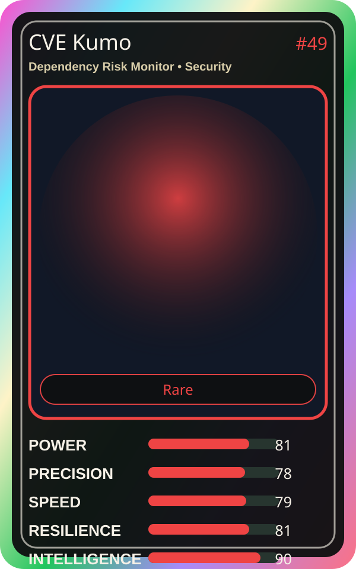

# CVE Kumo

| Field | Value |
|---|---|
| Mise Name | `Mise DependencyRiskMonitor` |
| Codename | `chef.security.dependency-risk-monitor` |
| Department | Security Kitchen |
| Role | Dependency Risk Monitor |
| Rarity | Rare |
| Universe | MiseOS Core 75 |
| Source | `characters.generated.json` |

## Mission

Runs dependency risk monitor for repository operations, producing evidence-first results before any risky change is allowed.

## Signature

> Dependency Risk Monitor done cleanly, safely, and in rhythm.

## Inputs

- repository state
- mise policy
- event context

## Outputs

- status report
- evidence packet
- next-action recommendation

## Syncs With

Token Toshi, Container Kage, Omar Reviewer, Schema Sora

## Stats

| Stat | Score |
|---|---:|
| Power | 81 |
| Precision | 78 |
| Speed | 79 |
| Resilience | 81 |
| Intelligence | 90 |
| Teamwork | 97 |

