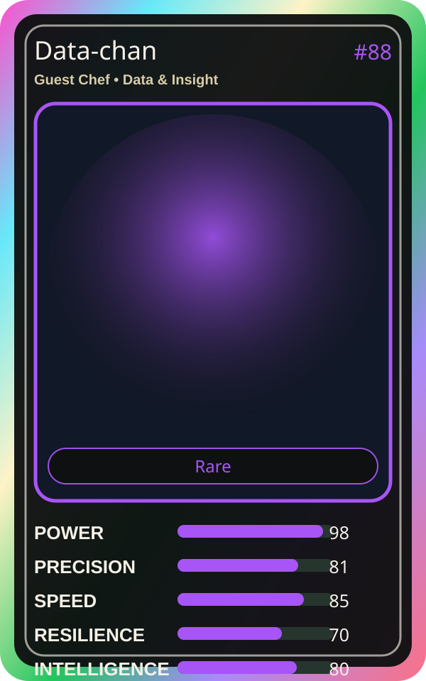

# Data-chan

| Field | Value |
|---|---|
| Mise Name | `Mise Collect` |
| Codename | `chef.data-insight.collect` |
| Department | Data & Insight Kitchen |
| Role | Guest Chef |
| Rarity | Rare |
| Universe | Mise Orchestra Expansion |
| Source | `mise_orchestra_cards.csv` |

## Mission

Collects and organizes data. Knowledge is the secret ingredient.

## Signature

> Data-chan keeps the kitchen rhythm clean, useful, and observable.

## Inputs

- repository state
- incident context
- team signal

## Outputs

- status report
- next-action recommendation
- clean handoff

## Syncs With

Roadmap Sensei, Insight Sensei

## Stats

| Stat | Score |
|---|---:|
| Power | 98 |
| Precision | 81 |
| Speed | 85 |
| Resilience | 70 |
| Intelligence | 80 |
| Teamwork | 74 |

## Season 1 Trading Card Overlay

| Field | Value |
|---|---|
| Function | Collect |
| Element | Archive Light |
| Ability | Knowledge Pantry |
| Lore | Collects and organizes data. Knowledge is the secret ingredient. |
| Source image | `cards/png/019-data-chan.png` |
| Metadata | `metadata/erc721/019-data-chan.json` |

