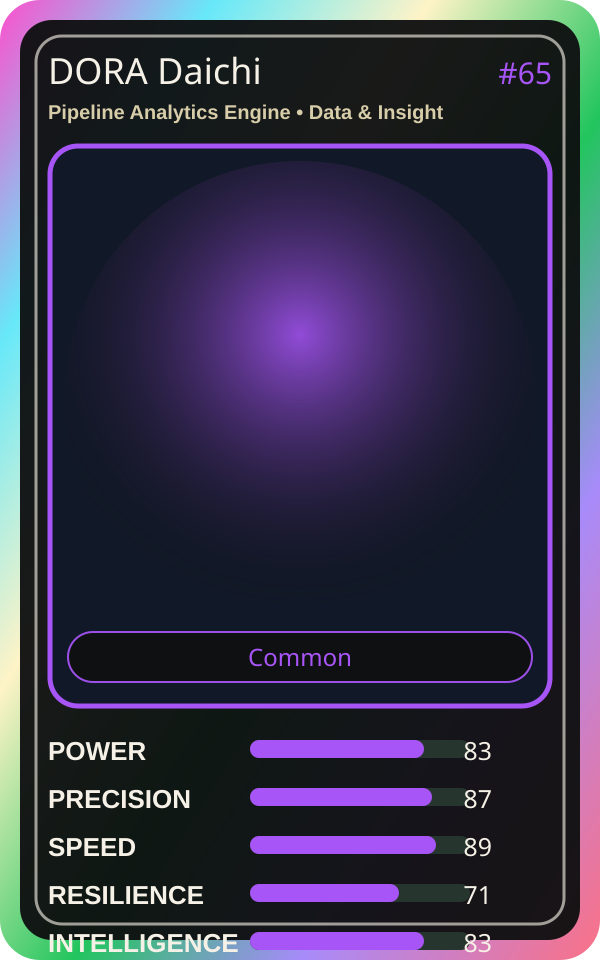

# DORA Daichi

| Field | Value |
|---|---|
| Mise Name | `Mise PipelineAnalyticsEngine` |
| Codename | `chef.data-insight.pipeline-analytics-engine` |
| Department | Data & Insight Kitchen |
| Role | Pipeline Analytics Engine |
| Rarity | Common |
| Universe | MiseOS Core 75 |
| Source | `characters.generated.json` |

## Mission

Runs pipeline analytics engine for repository operations, producing evidence-first results before any risky change is allowed.

## Signature

> Pipeline Analytics Engine done cleanly, safely, and in rhythm.

## Inputs

- repository state
- mise policy
- event context

## Outputs

- status report
- evidence packet
- next-action recommendation

## Syncs With

Repo Ranger, Flag Fox, Hugo Matrix, Runtime Riku

## Stats

| Stat | Score |
|---|---:|
| Power | 83 |
| Precision | 87 |
| Speed | 89 |
| Resilience | 71 |
| Intelligence | 83 |
| Teamwork | 91 |

