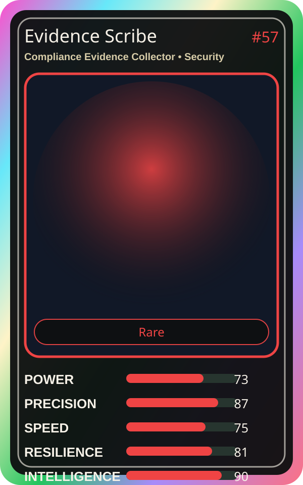

# Evidence Scribe

| Field | Value |
|---|---|
| Mise Name | `Mise ComplianceEvidenceCollector` |
| Codename | `chef.security.compliance-evidence-collector` |
| Department | Security Kitchen |
| Role | Compliance Evidence Collector |
| Rarity | Rare |
| Universe | MiseOS Core 75 |
| Source | `characters.generated.json` |

## Mission

Runs compliance evidence collector for repository operations, producing evidence-first results before any risky change is allowed.

## Signature

> Compliance Evidence Collector done cleanly, safely, and in rhythm.

## Inputs

- repository state
- mise policy
- event context

## Outputs

- status report
- evidence packet
- next-action recommendation

## Syncs With

Incident Kitsune, Nudge Neko, Tariq Notesmith, Preview Yuki

## Stats

| Stat | Score |
|---|---:|
| Power | 73 |
| Precision | 87 |
| Speed | 75 |
| Resilience | 81 |
| Intelligence | 90 |
| Teamwork | 85 |

