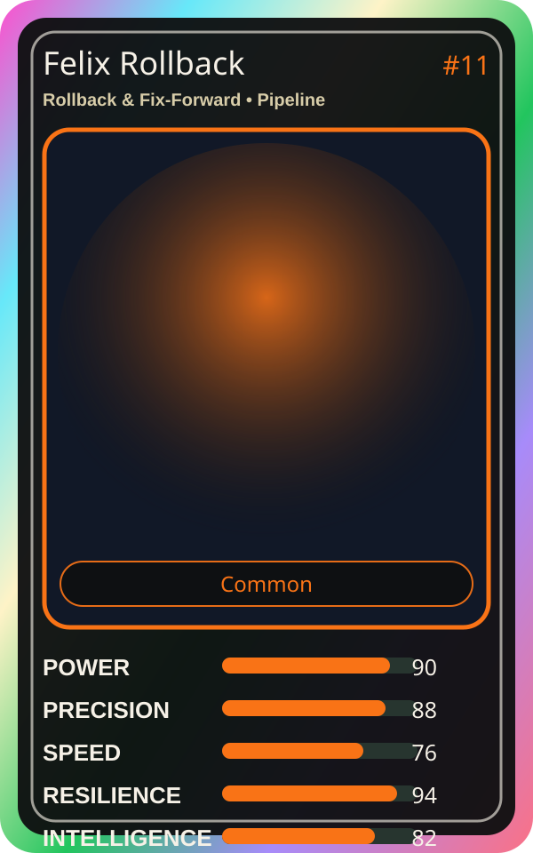

# Felix Rollback

| Field | Value |
|---|---|
| Mise Name | `Mise RollbackFixForward` |
| Codename | `chef.pipeline.rollback-fix-forward` |
| Department | Pipeline Kitchen |
| Role | Rollback & Fix-Forward |
| Rarity | Common |
| Universe | MiseOS Core 75 |
| Source | `characters.generated.json` |

## Mission

Runs rollback & fix-forward for repository operations, producing evidence-first results before any risky change is allowed.

## Signature

> Rollback and Fix-Forward done cleanly, safely, and in rhythm.

## Inputs

- repository state
- mise policy
- event context

## Outputs

- status report
- evidence packet
- next-action recommendation

## Syncs With

Release Conductor, Tariq Notesmith, Streama, Metrics Miko

## Stats

| Stat | Score |
|---|---:|
| Power | 90 |
| Precision | 88 |
| Speed | 76 |
| Resilience | 94 |
| Intelligence | 82 |
| Teamwork | 86 |

