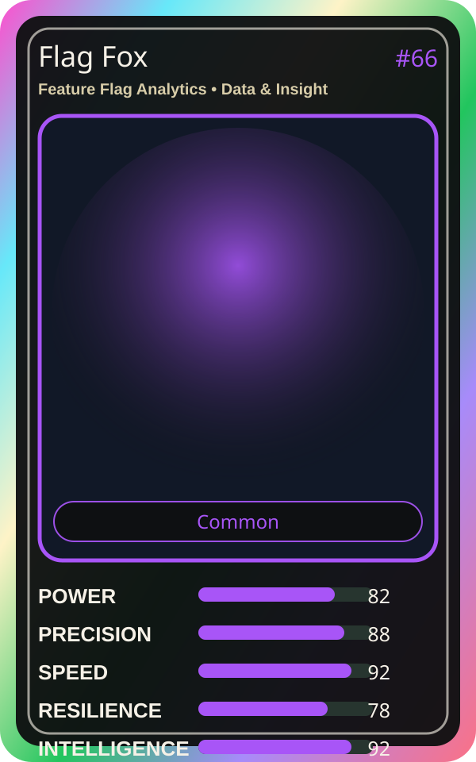

# Flag Fox

| Field | Value |
|---|---|
| Mise Name | `Mise FeatureFlagAnalytics` |
| Codename | `chef.data-insight.feature-flag-analytics` |
| Department | Data & Insight Kitchen |
| Role | Feature Flag Analytics |
| Rarity | Common |
| Universe | MiseOS Core 75 |
| Source | `characters.generated.json` |

## Mission

Runs feature flag analytics for repository operations, producing evidence-first results before any risky change is allowed.

## Signature

> Feature Flag Analytics done cleanly, safely, and in rhythm.

## Inputs

- repository state
- mise policy
- event context

## Outputs

- status report
- evidence packet
- next-action recommendation

## Syncs With

DORA Daichi, Cost Kaito, Seira Scan, Vault Hana

## Stats

| Stat | Score |
|---|---:|
| Power | 82 |
| Precision | 88 |
| Speed | 92 |
| Resilience | 78 |
| Intelligence | 92 |
| Teamwork | 80 |

