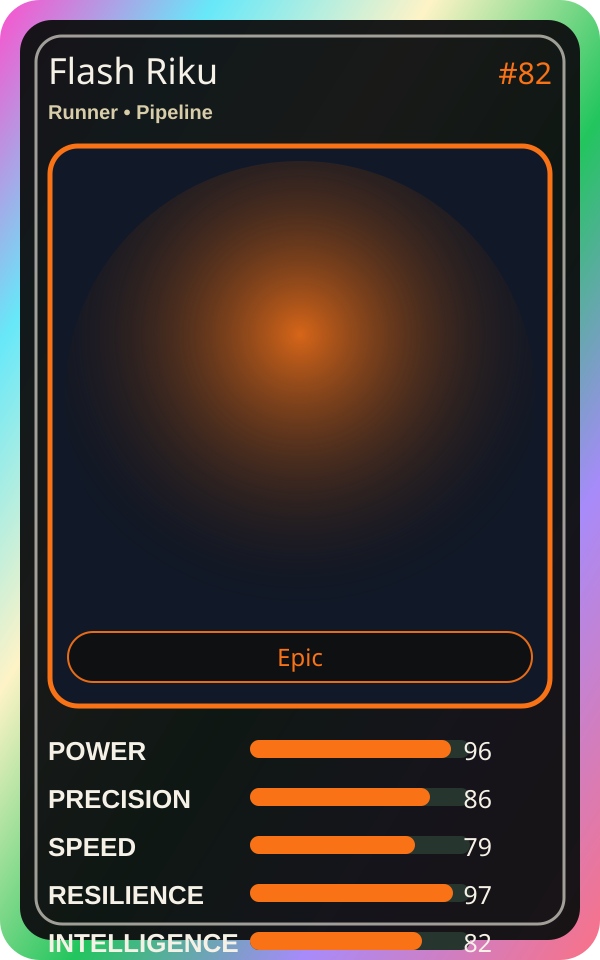

# Flash Riku

| Field | Value |
|---|---|
| Mise Name | `Mise Deploy` |
| Codename | `chef.pipeline.deploy` |
| Department | Pipeline Kitchen |
| Role | Runner |
| Rarity | Epic |
| Universe | Mise Orchestra Expansion |
| Source | `mise_orchestra_cards.csv` |

## Mission

Moves code at lightning speed through the pipeline.

## Signature

> Flash Riku keeps the kitchen rhythm clean, useful, and observable.

## Inputs

- repository state
- incident context
- team signal

## Outputs

- status report
- next-action recommendation
- clean handoff

## Syncs With

Yume, Build-Kun

## Stats

| Stat | Score |
|---|---:|
| Power | 96 |
| Precision | 86 |
| Speed | 79 |
| Resilience | 97 |
| Intelligence | 82 |
| Teamwork | 76 |

## Season 1 Trading Card Overlay

| Field | Value |
|---|---|
| Function | Deploy |
| Element | Blue Lightning |
| Ability | Lightning Delivery |
| Lore | Moves code at lightning speed through the pipeline. |
| Source image | `cards/png/009-flash-riku.png` |
| Metadata | `metadata/erc721/009-flash-riku.json` |

