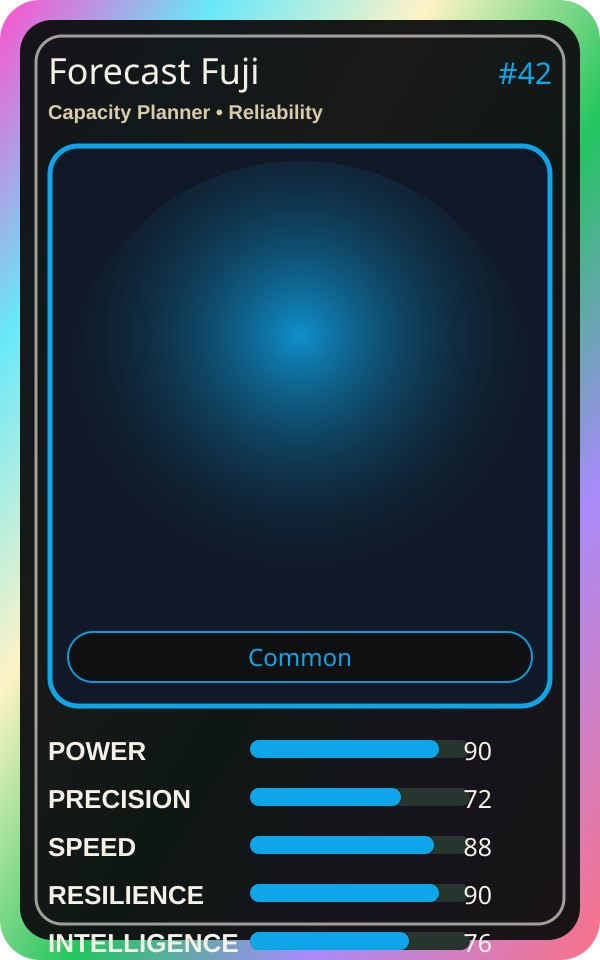

# Forecast Fuji

| Field | Value |
|---|---|
| Mise Name | `Mise CapacityPlanner` |
| Codename | `chef.reliability.capacity-planner` |
| Department | Reliability Kitchen |
| Role | Capacity Planner |
| Rarity | Common |
| Universe | MiseOS Core 75 |
| Source | `characters.generated.json` |

## Mission

Runs capacity planner for repository operations, producing evidence-first results before any risky change is allowed.

## Signature

> Capacity Planner done cleanly, safely, and in rhythm.

## Inputs

- repository state
- mise policy
- event context

## Outputs

- status report
- evidence packet
- next-action recommendation

## Syncs With

Metrics Miko, Resilience Ryu, Tariq Notesmith, Preview Yuki

## Stats

| Stat | Score |
|---|---:|
| Power | 90 |
| Precision | 72 |
| Speed | 88 |
| Resilience | 90 |
| Intelligence | 76 |
| Teamwork | 76 |

