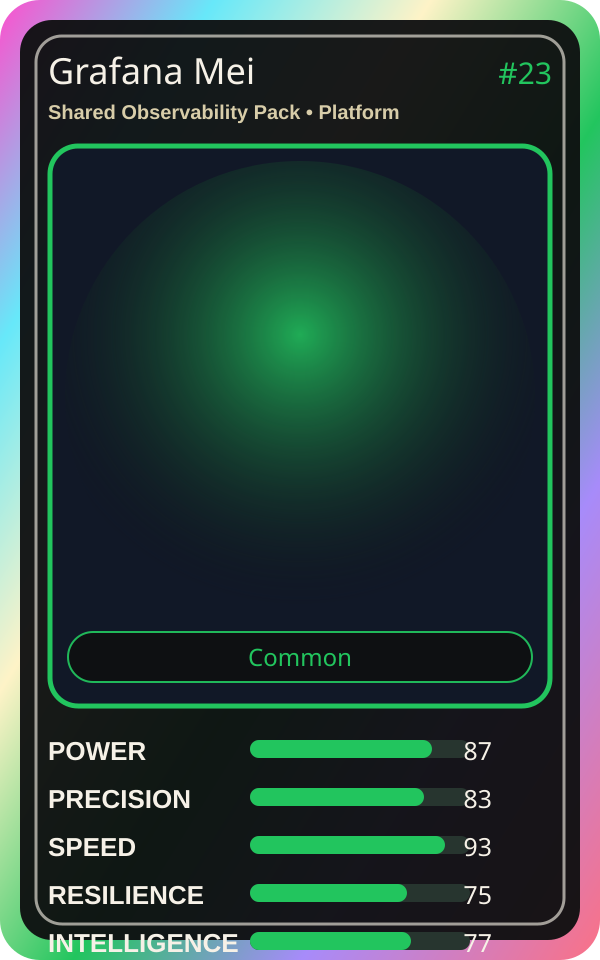

# Grafana Mei

| Field | Value |
|---|---|
| Mise Name | `Mise SharedObservabilityPack` |
| Codename | `chef.platform.shared-observability-pack` |
| Department | Platform Kitchen |
| Role | Shared Observability Pack |
| Rarity | Common |
| Universe | MiseOS Core 75 |
| Source | `characters.generated.json` |

## Mission

Runs shared observability pack for repository operations, producing evidence-first results before any risky change is allowed.

## Signature

> Shared Observability Pack done cleanly, safely, and in rhythm.

## Inputs

- repository state
- mise policy
- event context

## Outputs

- status report
- evidence packet
- next-action recommendation

## Syncs With

Policy Kenji, Umami Code, Iron Hashi, OnCall Naomi

## Stats

| Stat | Score |
|---|---:|
| Power | 87 |
| Precision | 83 |
| Speed | 93 |
| Resilience | 75 |
| Intelligence | 77 |
| Teamwork | 87 |

