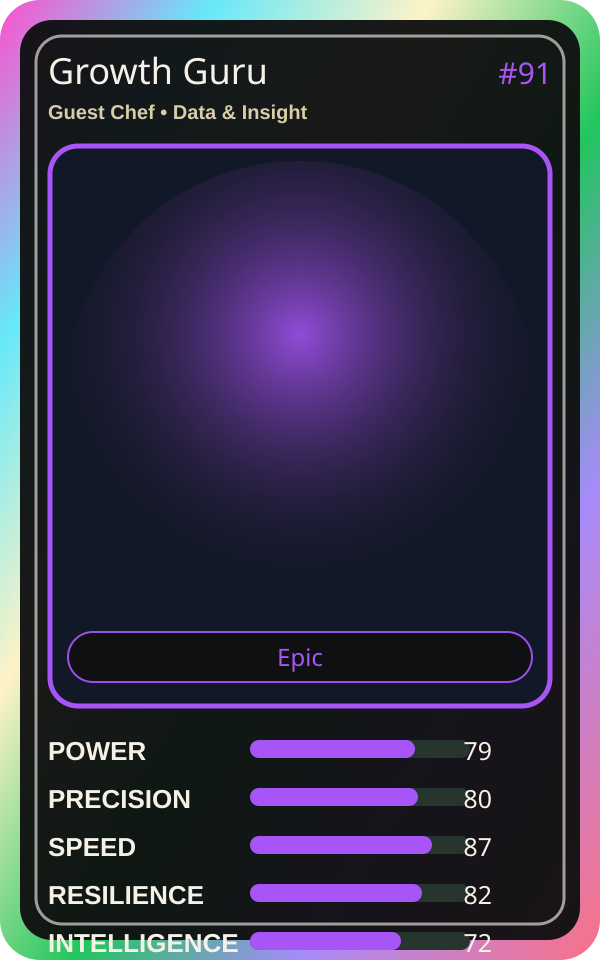

# Growth Guru

| Field | Value |
|---|---|
| Mise Name | `Mise Optimize` |
| Codename | `chef.data-insight.optimize` |
| Department | Data & Insight Kitchen |
| Role | Guest Chef |
| Rarity | Epic |
| Universe | Mise Orchestra Expansion |
| Source | `mise_orchestra_cards.csv` |

## Mission

Always innovating. Seeks better ways to scale.

## Signature

> Growth Guru keeps the kitchen rhythm clean, useful, and observable.

## Inputs

- repository state
- incident context
- team signal

## Outputs

- status report
- next-action recommendation
- clean handoff

## Syncs With

Chaos Analyst, Culture Chef

## Stats

| Stat | Score |
|---|---:|
| Power | 79 |
| Precision | 80 |
| Speed | 87 |
| Resilience | 82 |
| Intelligence | 72 |
| Teamwork | 87 |

## Season 1 Trading Card Overlay

| Field | Value |
|---|---|
| Function | Optimize |
| Element | Pink Bloom |
| Ability | Scale Wisdom |
| Lore | Always innovating. Seeks better ways to scale. |
| Source image | `cards/png/022-growth-guru.png` |
| Metadata | `metadata/erc721/022-growth-guru.json` |

